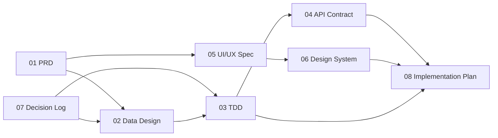

# Mobile 100% Inspection — Document Map

| | |
|---|---|
| Product | Mobile 100% Inspection (working name until 15 Oct 2026: Mobile PQI for CFA) |
| Owner | QIP Digital Team, PT Parkland World Indonesia |
| Status | Planning — documents are written before implementation |
| Implementation | AI coding agent (Claude Code), driven by these documents |
| Last updated | 27 Oct 2026 (ADR-019: Qty Inspection entered by the PSI) |

This file lists every planning document for Mobile 100% Inspection, what each one decides, and the order an engineer or a coding agent should read them in. A document marked **Done** can be used as an implementation input. A document marked **Planned** must not be assumed; ask or wait for it.

## Document set

| # | Document | Answers the question | Status |
|---|---|---|---|
| 00 | Document Map (this file) | Which documents exist, and in what order to read them | Done |
| 01 | [PRD — Product Requirements](01-prd.md) | What the app must do, for whom, and how we know it works | Draft v0.7 (27 Oct 2026; FR-15 Qty Inspection entry and BR-10 added, NO DEFECT removed, ADR-019; FR-14 admin added in v0.6; OQ-05, 06, 09, 10 open) |
| 02 | [Data Design — PostgreSQL Schema](02-data-design.md) | Tables, constraints, import, the write sequence, photo storage, reporting views, backup | Done (v2.1, 27 Oct 2026: `counting_rule`, migration 0006, ADR-019) |
| 03 | [TDD — Technical Design](03-tdd.md) | NestJS modules, PWA architecture, outbox, synchronous Submit PO, PhotoStore, admin app, security, deployment, backup | Draft v0.4 (27 Oct 2026; Qty Inspection event and limits, ADR-019; PostgreSQL; photo-store product open) |
| 04 | [API Contract](04-api-contract.md) + [`04-openapi.yaml`](04-openapi.yaml) | Every endpoint, request and response shape, error codes (OpenAPI 3.1) | Done (v2.1, 27 Oct 2026: `counts.qtyInspection`, A17; includes admin endpoints) |
| 05 | [UI/UX Flow and Screen Spec](05-ui-ux-spec.md) | Every screen, state and interaction (S0–S9, S5b), layouts, copy, traceability to FR/AC | Draft v0.3 (27 Oct 2026; S5b Qty Inspection dialog, NO DEFECT removed, U20–U22; admin screens §20; U2, U10 confirmed; U1 superseded) |
| 06 | Design System — claude.ai artifact "Mobile 100% Inspection" (Design System, namespace `M100`) | Tokens (light and dark), type, 25 components with live previews (including `ShoeMap` for the Defect page), responsive and touch rules; accent `#1D4ED8` | Done (v2, 16 Oct 2026: added CheckboxRow, Stepper, NumberPad) |
| 07 | [Decision Log (ADRs)](07-decision-log.md) | Why each architectural choice was made, and what it costs | Done (ADR-001 to ADR-021; 018 Accepted, supersedes 001, 002, 007, 011, 012, 017; 019 Accepted 27 Oct 2026, supersedes 008; 020 approved in principle 29 Oct 2026, amends 018's PostgreSQL version; 021 Accepted 29 Oct 2026, PSI lv.2 counts with NO DEFECT again, data per factory and cell, amends 019) |
| 08 | [Implementation Plan and Task Breakdown](08-implementation-plan.md) | Phases, ordered tasks with acceptance checks; the repo `CLAUDE.md` and `.claude/rules/` live in the starter kit | Draft v0.6 (27 Oct 2026; Phase 5 for ADR-019 added; Phases 2, 3, 3b rewritten for PostgreSQL and the admin app) |
| 09 | [Agent Workflow (Orca)](09-agent-workflow.md) | How a phase is built by Claude (planner, integrator), a Codex builder and Codex / Claude reviewers through Orca; setup, gates, artifacts | Draft v0.1 (30 Oct 2026) |

### Reference material (inputs, not specs)

| Item | Where | Use |
|---|---|---|
| Clickable prototype | claude.ai artifact "Mobile 100% Inspection" (v4) | Layout and behavior reference only; doc 05 wins where they differ |
| Defect mapping database | `Footwear_Defect_Mapping_Database_v2.xlsx` | Area → sub-area → family → defect mapping (98 defects, 437 mapping rows) |
| Backend option comparison | claude.ai artifact "M100 Backend Options" | Historical (Google options); superseded by ADR-018 |
| Company logo | `assets/parkland.png` in the Design System artifact | Login screen and PDF export header |
| Shoe map photo | `assets/erasebg-transformed.avif` in the Design System artifact | Footwear picture for area mapping on the Defect page, used by `ShoeMap` (2000 × 2000 px, transparent background) |
| Old spreadsheet | Google Sheet "100%INLINE IMPACTIVA" | **Historical.** Source of the one-time master-data export (doc 02 §5.1); M100 never reads or writes it (ADR-018) |

## Reading order

**For a coding agent starting implementation:** 08 → 01 → 07 → 02 → 04 → 03 → 05 → 06. Doc 08 says which task to do; the others are looked up as the task needs them.

**For a reviewer approving scope:** 01 → 07 → 05.

**For the administrators (QIP Digital):** 05 §20 → 02 §5 → 03 §7.

## How these documents depend on each other

## Conventions used in every document

- **Requirement IDs.** Functional requirements are `FR-xx`, non-functional `NFR-xx`, business rules `BR-xx`, acceptance criteria `AC-xx.y` (tied to their FR). IDs are never reused after deletion.
- **Must / Should / Could.** "Must" is required for release 1; "Should" is expected but can slip; "Could" is optional.
- **Table and column names** are written as in the database (`snake_case`: `submissions`, `psi_users`); values such as `PSI lv.2` are written exactly as stored.
- **Language.** Documents are in English. On-screen text is in Bahasa Indonesia, except fixed shop-floor labels the users already know in English (ADD DEFECT, REWORK, B-GRADE, END INSPECTION, BACK, HOME, UNDO, SUBMIT PO, QTY INSPECTION). NO DEFECT was one of them until ADR-019 removed it.
- **Time.** All times are WIB (UTC+07:00). The database stores UTC timestamps and the inspection date in WIB.
- **Changes.** Any change to a decided item gets a new ADR in doc 07 that supersedes the old one; the old ADR stays with status "Superseded".

## Open items

| Blocks | Open item | Raised in |
|---|---|---|
| 03 → Phase 4 | Confirm the sub-domain `m100` (ADR-016); server pre-checks: Windows version, port 443 free, RAM, disk and backup target, PostgreSQL install, outbound reach to Cloudflare and Let's Encrypt, DHCP reservation (TQ-5) | doc 03 §7.3, §9 |
| 01 | PRD OQ-05 (parallel use with AppSheet), OQ-06 (which POs Add PO offers), OQ-09 (who maintains the area map), OQ-10 (CFA flow later) | PRD §10 |
