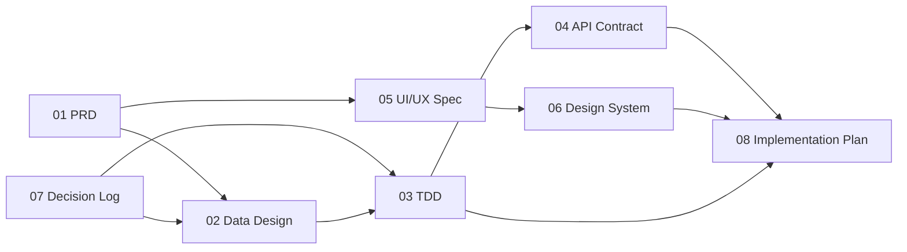

# Mobile 100% Inspection — Document Map

| | |
|---|---|
| Product | Mobile 100% Inspection (working name until 15 Oct 2026: Mobile PQI for CFA) |
| Owner | QIP Digital Team, PT Parkland World Indonesia |
| Status | Planning — documents are written before implementation |
| Implementation | AI coding agent (Claude Code), driven by these documents |
| Last updated | 16 Oct 2026 |

This file lists every planning document for Mobile 100% Inspection, what each one decides, and the order an engineer or a coding agent should read them in. A document marked **Done** can be used as an implementation input. A document marked **Planned** must not be assumed; ask or wait for it.

## Document set

| # | Document | Answers the question | Status |
|---|---|---|---|
| 00 | Document Map (this file) | Which documents exist, and in what order to read them | Done |
| 01 | [PRD — Product Requirements](01-prd.md) | What the app must do, for whom, and how we know it works | Done (v0.6, 19 Oct 2026; OQ-05, OQ-06, OQ-08…OQ-10, OQ-12 open) |
| 02 | [Data Design — Spreadsheet Schema](02-data-design.md) | Which sheets the system reads and writes, column by column, and how a session maps onto DATA_INSPECTION | Done (v1.0, 16 Oct 2026) |
| 03 | [TDD — Technical Design](03-tdd.md) | NestJS modules, PWA architecture, offline queue, Submit PO pipeline, quotas, security, deployment | Draft v0.2 (16 Oct 2026; HTTPS decided; server is Windows) |
| 04 | [API Contract](04-api-contract.md) + [`04-openapi.yaml`](04-openapi.yaml) | Every endpoint, request and response shape, error codes (OpenAPI 3.1) | Done (v1.1, 16 Oct 2026) |
| 05 | [UI/UX Flow and Screen Spec](05-ui-ux-spec.md) | Every screen, state and interaction (S0–S9), layouts, copy, traceability to FR/AC | Draft v0.2 (19 Oct 2026; U2, U10 need owner confirmation) |
| 06 | Design System — claude.ai artifact "Mobile 100% Inspection" (Design System, namespace `M100`) | Tokens (light and dark), type, 25 components with live previews (including `ShoeMap` for the Defect page), responsive and touch rules; accent `#1D4ED8` | Done (v2, 16 Oct 2026: added CheckboxRow, Stepper, NumberPad) |
| 07 | [Decision Log (ADRs)](07-decision-log.md) | Why each architectural choice was made, and what it costs | Done (ADR-001 to ADR-017; 017 Proposed) |
| 08 | [Implementation Plan and Task Breakdown](08-implementation-plan.md) | Phases, ordered tasks with acceptance checks; the repo `CLAUDE.md` and `.claude/rules/` live in the starter kit | Draft v0.4 (Phase 0–4 ready; Phase 4 starts with the server pre-checks) |

### Reference material (inputs, not specs)

| Item | Where | Use |
|---|---|---|
| Clickable prototype | claude.ai artifact "Mobile 100% Inspection" (v4) | Layout and behavior reference only; doc 05 wins where they differ |
| Defect mapping database | `Footwear_Defect_Mapping_Database_v2.xlsx` | Area → sub-area → family → defect mapping (98 defects, 437 mapping rows) |
| Backend option comparison | claude.ai artifact "M100 Backend Options" | Background for ADR-004 |
| Company logo | `assets/parkland.png` in the Design System artifact | Login screen and PDF export header |
| Shoe map photo | `assets/erasebg-transformed.avif` in the Design System artifact | Footwear picture for area mapping on the Defect page, used by `ShoeMap` (2000 × 2000 px, transparent background) |
| Production spreadsheet | Google Sheet "100%INLINE IMPACTIVA" (ID `1a-uVy2HfZlitzW1kJ-DGoVisnKbIVKeFZRahH4QwL6I`) | Live database shared with the AppSheet app; read-only until the Data Design is approved |

## Reading order

**For a coding agent starting implementation:** 08 → 01 → 07 → 02 → 04 → 03 → 05 → 06. Doc 08 says which task to do; the others are looked up as the task needs them.

**For a reviewer approving scope:** 01 → 07 → 05.

**For whoever maintains the spreadsheet:** 02 → 07 (ADR-001, ADR-002).

## How these documents depend on each other

## Conventions used in every document

- **Requirement IDs.** Functional requirements are `FR-xx`, non-functional `NFR-xx`, business rules `BR-xx`, acceptance criteria `AC-xx.y` (tied to their FR). IDs are never reused after deletion.
- **Must / Should / Could.** "Must" is required for release 1; "Should" is expected but can slip; "Could" is optional.
- **Sheet and column names** are written exactly as they appear in the spreadsheet, including spaces and case: `DATA_INSPECTION`, `TYPE INSPECTION`, `PSI lv.2`.
- **Language.** Documents are in English. On-screen text is in Bahasa Indonesia, except fixed shop-floor labels the users already know in English (ADD DEFECT, REWORK, B-GRADE, NO DEFECT, END INSPECTION, BACK, HOME, UNDO, SUBMIT PO).
- **Time.** All times are WIB (UTC+07:00). The spreadsheet's time zone is Asia/Bangkok, which is the same offset.
- **Changes.** Any change to a decided item gets a new ADR in doc 07 that supersedes the old one; the old ADR stays with status "Superseded".

## Open items

| Blocks | Open item | Raised in |
|---|---|---|
| 03 → Phase 4 | Confirm the sub-domain `m100` (ADR-016); server pre-checks: Windows version, port 443 free, RAM and disk, outbound reach to Cloudflare and Let's Encrypt, DHCP reservation (TQ-5) | doc 03 §7.3, §9 |
| 05 | Confirm U2 (Home shows the current session only, OQ-08) and U10 (a partial stays after Submit PO) | doc 05 §18 |
