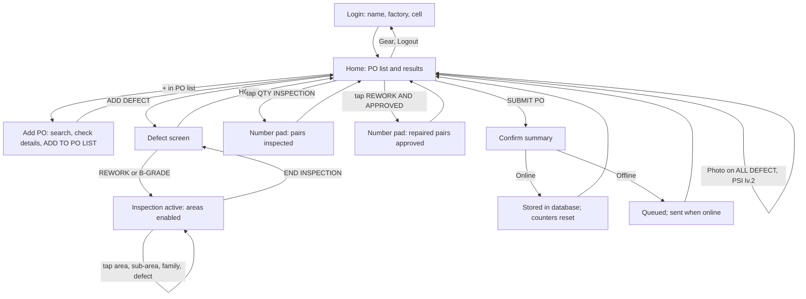

# PSI Inspection Report — Product Requirements (PRD)

| | |
|---|---|
| Version | 0.9 — 30 Oct 2026 (ADR-022): ALL DEFECT and photos per defect, INSPECTION REWORK QTY, REWORK AND APPROVED (FR-16, BR-11), END INSPECTION requires a finding, template exports. v0.8 — 29 Oct 2026 (ADR-021): PSI lv.2 counts Qty Inspection with NO DEFECT and END INSPECTION again (A-Grade = NO DEFECT, upper limit); PSI lv.1 keeps FR-15; tablet data per factory and cell (AC-02.4); exports without Foto column and defect list (FR-12). v0.7 — Qty Inspection entered by the PSI, NO DEFECT removed, Qty A-Grade = Qty Inspection − Qty Defect (ADR-019 as revised 28 Oct 2026; FR-15, BR-01, BR-02, BR-10). v0.6: backend moved to PostgreSQL + photo store; admin screens added (ADR-018) |
| Date | 30 Oct 2026 |
| Owner | QIP Digital Team, PT Parkland World Indonesia |
| Related | [00 Document Map](00-document-map.md), [07 Decision Log](07-decision-log.md), clickable prototype "Mobile 100% Inspection" v3 |

## 1. Summary

PSI Inspection Report is a tap-only tablet app that PSI inspectors (levels 1 and 2) use on the production line to record defects while they inspect shoes. The PSI picks the PO, taps REWORK or B-GRADE for each pair with a defect, taps where the defect is on a shoe diagram, and taps the defect. PSI lv.1 enters QTY INSPECTION on Home with the app's own number pad (ADR-019); PSI lv.2 counts it from NO DEFECT and ended inspections (ADR-021). From that number and the taps the app calculates defects, A-Grade and B-Grade, and shows ALL DEFECT, Defect Rate and Pass Rate as the PSI works. When the round is done, **SUBMIT PO** stores the result in the app's own PostgreSQL database (photos in a photo store), where the Leader Quality reads it through reports built on the database (OQ-13). The old `100%INLINE IMPACTIVA` spreadsheet and AppSheet app are no longer touched (ADR-018).

## 2. Problem and goals

### Problem

Today PSI record defects on paper during inspection and share them through a WhatsApp group. This makes reporting slow for PSI lv.1 and lv.2, and Leader Quality receives defect information late. Typing defects into a form on the line is also slow: the defect list has 98 entries with long names.

### Goals

| # | Goal | How we measure it (release 1 pilot) |
|---|---|---|
| G1 | Record a defect without a keyboard | Every defect is recorded by taps only. From an active inspection, a defect takes at most 4 taps: area, sub-area, family, defect (fewer when a level has one option). |
| G2 | Make results visible as soon as the round is done | A submitted PO is stored in the database and visible to the admin app within 1 minute when the tablet is online. |
| G3 | Give the Leader Quality a way to read the results | Every submission can be listed, opened (with photos) and exported to CSV from the admin app, and read by a reporting tool through read-only views (OQ-13). |
| G4 | Capture where on the shoe each defect is | Every submitted defect has an area and sub-area in `submission_findings`. |
| G5 | Lose nothing, duplicate nothing | 0 lost sessions after a reload, app close or connection drop; 0 duplicate submissions from a retried submit. |

## 3. Users and roles

| Role | Who | In `psi_users` as | Can do |
|---|---|---|---|
| PSI lv.1 | Line inspector | `level` = `PSI lv.1` | Everything in §5, except attaching photos |
| PSI lv.2 | Senior line inspector | `level` = `PSI lv.2` | Everything in §5, and **must** attach a photo to every defect with a finding before Submit PO or export |
| Leader Quality | Reads results | — (not a tablet user) | Reads results through the admin app's submission list and CSV export, or database views (OQ-13) |
| Admin | QIP Digital Team and designated maintainers | username + password (admin app) | Maintains PSI users, factories/cells, POs, defects and area map; views and exports submissions (read-only); manages admins; sees the audit log (FR-14). Tablets are registered by QIP Digital with server commands, not in the admin app |

The PSI app has no admin features; admins use a separate web app (FR-14, ADR-018). On 15 Oct 2026 the old `USER_LIST` held 14 distinct PSI names: 6 at PSI lv.1 and 8 at PSI lv.2; they are the first import.

## 4. Scope

### In release 1

- Login by name, factory and cell; logout.
- PO list on the tablet: add a PO from the PO master, select a PO, remove a PO with no open session.
- Inspection of each pair with a defect: REWORK, B-GRADE, END INSPECTION.
- QTY INSPECTION (pairs inspected) entered by PSI lv.1 on Home with the app's number pad (FR-15, ADR-019); PSI lv.2 counts NO DEFECT and ended inspections (ADR-021).
- Defect input on the shoe diagram: 12 areas → sub-area → defect family → defect, using the area mapping database.
- BACK, HOME and UNDO on the defect screen, and the current inspection's defect history; session totals stay on Home.
- Home results: Qty PO Order, Qty Inspection, Qty Defect, Qty A-Grade, Qty B-Grade, Defect Rate, Pass Rate (RFT), ALL DEFECT.
- Photo evidence for every defect with a finding (PSI lv.2).
- INSPECTION REWORK QTY (read-only) and REWORK AND APPROVED (number pad, both levels).
- Export the current session to PDF and Excel.
- SUBMIT PO: store the session in the database (`submissions`, `submission_findings`, `submission_photos`).
- Working without Wi-Fi: inspection continues offline, and Submit PO waits in the tablet's outbox until the connection returns.
- **Admin web app** (FR-14): master data (with one-time import from CSV/XLSX), a DataTable of submitted inspections, admins, audit log.

### Not in release 1

- Editing, deleting or voiding submitted results (submissions are immutable; a mistake is fixed by the database owner outside the app).
- Registering tablets in the admin app (done with the server commands `device:add`, `device:revoke`, `device:list`).
- Dashboards and charts (reports come from the views and CSV export; a dashboard may come later, OQ-13).
- Any connection to the old Google Sheet or AppSheet.
- NIK or password login.
- Inspection types other than PSI: T1QM, AQL 3rd party, CFA audits, repacking.
- New dashboards or reports. Existing reports read the data.
- iOS devices (see NFR-01).

## 5. How the app is used

A **session** is everything recorded for one PO on one tablet between two Submit POs. An **inspection** is one pair with a defect, from tapping REWORK or B-GRADE until END INSPECTION. PSI lv.1 counts pairs without a defect through entered QTY INSPECTION; PSI lv.2 taps NO DEFECT for each passed pair (BR-01).

## 6. Functional requirements

Priority: **M** = Must, **S** = Should, **C** = Could.

### FR-01 Login (M)

The login screen shows three pickers and a LOGIN button. Nothing is typed.

1. **Name**: the active names in `psi_users` (level `PSI lv.1` or `PSI lv.2`), sorted A–Z, each shown with its level. A name listed twice with the same type appears once.
2. **Factory**: the active factories (`F 1` … `F 5`); `PWA` and `BOTTOM` are not imported (decided 16 Oct 2026).
3. **Cell**: the active cells for the chosen factory (for example `F3-10`). If the factory has only one cell, it is selected automatically.

LOGIN is enabled when all three are chosen.

- AC-01.1 Only `PSI lv.1` and `PSI lv.2` users are listed; users of other types (CFA, T1QM, AQL3RD PARTY) are not.
- AC-01.2 After login, the user's name and level appear in the Home header and the Factory/Cell appears in the PO info strip as the cell code (for example `F3-10`).
- AC-01.3 The login stays active after the app is closed and reopened, until the user logs out.
- AC-01.4 If master data can't be loaded and nothing is cached, the screen says so and offers RETRY; it never shows an empty name list without explanation.

### FR-02 Logout (M)

The gear button in the Home header opens a menu showing the user's name, level and Factory/Cell, with LOGOUT at the bottom.

- AC-02.1 LOGOUT returns to the login screen.
- AC-02.2 If any PO has an open session that hasn't been submitted, logout first warns: "N PO belum disubmit. Data tetap tersimpan di tablet ini untuk [name]." The user can cancel or continue.
- AC-02.3 Open sessions belong to the user who recorded them. They reappear when the same user logs in again on the same tablet and are never shown to a different user.
- AC-02.4 (ADR-021) POs and open sessions also belong to the factory and cell of the login. A login with another factory or cell starts with an empty PO list and no inspection data; the POs and sessions of the first factory and cell come back, unchanged, on a later login there. Each session is submitted with the factory and cell it was recorded in. Nothing is deleted.

### FR-03 PO list and Add PO (M)

The left column of Home lists the user's POs on this tablet, with a + button at the bottom.

1. **+** opens the Add PO dialog with a searchable PO NUMBER dropdown.
2. The search matches PO number, article or model in the PO master. Typing in this search box is the one place a keyboard is used. Results appear after 3 characters, at most 20 at a time.
3. Picking a PO shows: PO Number, Article, Model, Destination, Qty Order, PODD, CRD.
4. **PO PARTIAL** checkbox (off by default). When ticked, two inputs appear: the partial number (P1, P2, … chosen with − / + buttons, starting at P1) and the partial quantity in pairs (entered with the app's own number pad, not the device keyboard).
5. **ADD TO PO LIST** adds it, selects it and closes the dialog. With PO PARTIAL ticked it is enabled only when the partial quantity is filled in.
6. The PO info strip on Home shows the partial (for example `P1 · 1.200 dari 10.002`); **UBAH PARTIAL** there reopens the two inputs, so the value can be changed or removed before the next Submit PO.

- AC-03.1 A PO already in the list is shown as "sudah di list" and can't be added twice.
- AC-03.2 Each PO in the list shows its number and, when it has an open session, the session's defect count and "Inspeksi berjalan" while an inspection is active.
- AC-03.3 Selecting a PO updates the info strip and the results panel to that PO.
- AC-03.4 (S) A PO with no open session can be removed from the list by a long press and confirmation. A PO with an open session can't be removed.
- AC-03.5 PO numbers keep their leading zero and any prefix (for example `0903359388`, `CX-0902368685`).
- AC-03.6 The partial quantity is a whole number from 1 to the PO's Qty Order; anything else can't be entered.
- AC-03.7 Each Submit PO writes the PO's partial at that moment to `PARTIAL OF QTY PO` (doc 02 §5); a PO without PO PARTIAL leaves the column empty.

### FR-04 Results panel (M)

For the selected PO's **current session**, Home shows:

| Field | Value |
|---|---|
| Qty PO Order | `order_qty` of the PO master |
| Qty Inspection | PSI lv.1: entered by the PSI (FR-15); "—" only while empty, otherwise the entered value (also when it is not valid). PSI lv.2: counted from NO DEFECT and ended inspections (BR-01), from 0 |
| Qty Defect | BR-01, the recorded findings, always |
| Qty A-Grade | BR-01; PSI lv.1: `0` while Qty Inspection is empty or not valid (BR-10); PSI lv.2: the NO DEFECT taps |
| Qty B-Grade | BR-01, the recorded B-GRADE findings, always |
| INSPECTION REWORK QTY | Read-only `counts.rework`: REWORK inspections started, reduced by UNDO of a start; no change to the existing counting formulas (ADR-022) |
| REWORK AND APPROVED | Pairs repaired, re-inspected and passed; entered with the number pad (FR-16), disabled when INSPECTION REWORK QTY is 0 unless the entered value is not valid (BR-11); empty is sent as 0 |
| Defect Rate | BR-02, one decimal; `0,0%` while Qty Inspection is empty or not valid |
| Pass Rate (RFT) | BR-02, one decimal; `0,0%` while Qty Inspection is empty or not valid |

The `0` and `0,0%` shown while Qty Inspection is empty or not valid are display fallbacks (ADR-019 decision 7), not calculated results; they are never submitted.

- AC-04.1 Values update immediately after every tap on the defect screen and every change of Qty Inspection or REWORK AND APPROVED; no network is needed.
- AC-04.2 After a Submit PO is sealed (stored or waiting), all values return to 0 and Qty Inspection to empty (PSI lv.1) or 0 (PSI lv.2) for the next session; REWORK AND APPROVED starts empty.

### FR-15 QTY INSPECTION entry (M) — added 27 Oct 2026, ADR-019; PSI lv.1 only since ADR-021

A PSI lv.1 enters how many pairs were inspected in the session; the app never counts it from taps. For a PSI lv.2 the QTY INSPECTION row is not a button: the value is counted from taps (FR-06, BR-01, ADR-021).

1. The QTY INSPECTION row of the results box on Home can be tapped when a PO is selected. It opens a dialog with the app's own number pad (no device keyboard, NFR-02), pre-filled with the current value.
2. SIMPAN stores the value for the selected PO's session; BATAL changes nothing. The value can be changed any number of times until SUBMIT PO, also while an inspection is active.
3. The number pad accepts only a whole number within the limits of BR-10 and says which limit is broken ("Minimal {n} pasang", "Maksimum {n} pasang").

- AC-15.1 Qty Inspection is saved on the tablet before the dialog closes, survives a reload and belongs to the session of the selected PO only (NFR-05, BR-09).
- AC-15.2 The lower limit shown by the number pad is the larger of 1 and the session's Qty Defect (recorded findings); the upper limit is the PO's partial quantity when PO PARTIAL is set, otherwise its Qty Order. When the lower limit is above the upper one, no value can be saved and the dialog says why (BR-10).
- AC-15.3 Recording findings is never blocked by Qty Inspection. If the limits change after the value was entered (more findings, a smaller partial), the value is kept, never raised by the app, Home marks it as not valid, and SUBMIT PO refuses until the PSI corrects Qty Inspection or the findings (FR-11, ADR-019 decision 6).
- AC-15.4 After SUBMIT PO the next session of the PO starts with Qty Inspection empty.

### FR-16 REWORK AND APPROVED entry (M) — added 30 Oct 2026, ADR-022

Both PSI levels enter the number of REWORK pairs repaired, re-inspected and passed for the selected PO's session.

1. Tap REWORK AND APPROVED in the Home results box to open the app's number pad, pre-filled with the current value. The row is disabled while INSPECTION REWORK QTY is 0, except while the entered value is not valid (AC-16.2): then it stays tappable so the PSI can correct it (save 0 or empty when INSPECTION REWORK QTY is 0). Title: "REWORK AND APPROVED"; helper: `Pasang rework yang sudah diperbaiki dan lolos inspeksi ulang (maks. <INSPECTION REWORK QTY>)` (replace the placeholder with the count).
2. SIMPAN accepts a whole number from 0 through INSPECTION REWORK QTY or empty (BR-11); BATAL changes nothing. The value can be changed until SUBMIT PO. Empty is sent as 0.

- AC-16.1 Save to the tablet before closing; the value survives reload and belongs only to this session (BR-09). The next session starts empty.
- AC-16.2 UNDO that reduces INSPECTION REWORK QTY below the entered value keeps that value and marks it not valid: "REWORK AND APPROVED melebihi INSPECTION REWORK QTY. Ubah angkanya sebelum SUBMIT PO." SUBMIT PO is refused until corrected. The row stays tappable while the value is not valid, also when INSPECTION REWORK QTY has fallen to 0, so the PSI can open the number pad and save 0 or empty.
- AC-16.3 Tablet, API and database independently check BR-11. This input changes no ADR-019 / ADR-021 counting formula or rate; report figures follow FR-12.

### FR-05 ALL DEFECT (M)

A table on Home lists every defect with a finding in the session, grouped by DEFECT_ID across all areas and inspection types and ranked by total quantity descending, scrolling inside its pane: number, defect name, classification chip (MINOR / MAJOR / CRITICAL), the areas it was found in, quantity, and the photo control (FR-10).

- AC-05.1 Ties are ordered by severity (CRITICAL, MAJOR, MINOR), then by which defect was recorded first.
- AC-05.2 With no defects, the table says "Belum ada defect" and how to start (tap ADD DEFECT).

### FR-06 Starting and ending an inspection (M)

The defect screen has REWORK and B-GRADE buttons (and NO DEFECT for PSI lv.2, ADR-021) above the shoe diagram, and END INSPECTION below it.

1. With no active inspection, the shoe areas, sub-areas, families and defects are disabled and visibly dimmed. The right panel says to choose REWORK or B-GRADE.
2. **REWORK** or **B-GRADE** starts an inspection of one pair (BR-01) and enables defect input. The chosen button is highlighted, the other is disabled, and the panel shows the inspection type.
3. **NO DEFECT** (PSI lv.2 only, back since ADR-021): records one A-Grade pair at once, without END INSPECTION; disabled while an inspection is active. A PSI lv.1 has no NO DEFECT: a pair without a defect is counted through Qty Inspection (FR-15, ADR-019).
4. **END INSPECTION** ends the active inspection and disables defect input again. It is disabled when no inspection is active or the current inspection has no defect (AC-06.3). For PSI lv.2 the pair counts in Qty Inspection from here (ADR-021).
5. **Upper limit (PSI lv.2, ADR-021).** NO DEFECT, REWORK and B-GRADE are disabled once the pairs tapped (the active one included) reach the PO's partial quantity, otherwise its Qty Order, with a notice that says so. Defect taps inside an open inspection are never refused.

- AC-06.1 Defects can be recorded only while a REWORK or B-GRADE inspection is active.
- AC-06.2 An active inspection survives HOME, switching to another screen, reloading or closing the app; returning to the defect screen shows it still active.
- AC-06.3 END INSPECTION is disabled until the current inspection has at least one defect. UNDO of its last defect disables it again; UNDO of the empty start cancels a mistaken REWORK / B-GRADE inspection. Each start clears the current-inspection list; session totals stay on Home (ADR-022).

### FR-07 Recording a defect (M)

1. The shoe diagram shows 12 areas: Tongue, Eyestay/Lace, Vamp, Toe Box, Branding/Treatment, Midsole, Inside, Collar, Heel, Outsole/Bonding, Quarter, General. An area can be tapped on its label or on the shoe.
2. The right panel then lists, in turn: the area's **sub-areas**, the sub-area's **defect families**, and the family's **defects**, each with its classification. A level with only one option is skipped.
3. Tapping a defect records one finding (BR-01) for the current area, sub-area and inspection type. The PSI can tap several defects, or the same defect several times, while the list stays open.
4. The classification comes from the defect list; the PSI never chooses it (BR-03).
5. A breadcrumb above the list shows the path (for example `QUARTER › MEDIAL QUARTER › STITCHING`). Tapping an earlier crumb goes back to that level.
6. Each area label shows how many defects were recorded there in the active inspection.

- AC-07.1 Area, sub-area, family and defect lists come from the area map in the database (`area_map`, ADR-009). Medial Quarter offers the same defects as Lateral Quarter.
- AC-07.2 Each tap gives visible feedback within 100 ms (row highlight and a short "+1 Defect" or "+1 Defect dan B-Grade" message) and a short vibration where supported.
- AC-07.3 The defect row shows how many times it was tapped in the active inspection.

### FR-08 BACK, HOME and UNDO (M)

- **BACK** goes up one level (defect list → families → sub-areas → no area). With no area selected, BACK returns to Home.
- **HOME** returns to Home. The active inspection stays active.
- **UNDO**:
  - during an active inspection with recorded defects, it removes the last defect recorded in that inspection;
  - during an active inspection with no defects, it cancels the inspection (it no longer counts as a REWORK or B-GRADE pair);
  - right after NO DEFECT (PSI lv.2), it cancels that pair (ADR-021);
  - otherwise it is disabled. UNDO never reaches an inspection that has already ended, and never changes an entered Qty Inspection (that is changed on Home, FR-15).

- AC-08.1 Every UNDO shows a short message saying what was undone.

### FR-09 Defect history (M)

Below the drill-down list, the defect screen shows only the current inspection's recorded defects, starting empty at every REWORK / B-GRADE start: number, defect name, area › sub-area · family · inspection type, classification, and quantity.

- AC-09.1 The row just changed is highlighted and scrolled into view.
- AC-09.2 One row per area + sub-area + defect + inspection type within the current inspection. Submission findings still aggregate the whole session by these keys.

### FR-10 Photo evidence (M for PSI lv.2)

1. For a PSI lv.2 user, each row in ALL DEFECT has a FOTO button that opens the tablet camera. **One photo per defect**: it is attached to that defect for the session.
2. An attached photo shows as a thumbnail; tapping it shows it large with GANTI FOTO and HAPUS.
3. For a PSI lv.1 user, the photo column is not shown and no photo is ever taken or uploaded (decided 16 Oct 2026).

- AC-10.1 Photos are resized on the tablet to at most 960 px on the long edge and at most 500 KB (JPEG) before being stored; the API accepts up to 1 MB per photo without re-encoding.
- AC-10.2 Photos are kept with the session on the tablet until Submit PO and survive a reload.
- AC-10.3 Any ALL DEFECT row without a photo is marked "Foto wajib" for PSI lv.2.
- AC-10.4 A photo stays attached to its DEFECT_ID regardless of rank. A defect completely removed by UNDO is excluded from export and submission photos; the remaining defects each need a photo (ADR-022).
- AC-10.5 A defect never has more than one photo; GANTI FOTO replaces it.
- AC-10.6 A PSI lv.1 submission contains no photos, and has no `submission_photos` rows (doc 02 §7).

### FR-11 SUBMIT PO (M)

SUBMIT PO on Home sends the selected PO's session to the server, which stores it.

1. **Checks before confirming** (each failure says what to do):
   - an inspection is still active → "Selesaikan inspeksi dulu (END INSPECTION)";
   - PSI lv.2 with no pair counted yet → "Belum ada pasang diinspeksi" (opens the defect screen, ADR-021);
   - Qty Inspection is empty (PSI lv.1) → "Isi QTY INSPECTION dulu" (opens FR-15);
   - Qty Inspection is below Qty Defect or above the partial quantity / Qty Order (BR-10) → says which limit and opens FR-15;
   - Qty Defect is above the partial quantity / Qty Order, so no Qty Inspection is valid → says so; the PSI corrects the findings (UNDO) or the partial. Findings are never deleted by the app;
   - PSI lv.2 and any defect with a finding has no photo → list the defects missing a photo (BR-04).
   - REWORK AND APPROVED exceeds INSPECTION REWORK QTY (BR-11) → "REWORK AND APPROVED melebihi INSPECTION REWORK QTY. Ubah angkanya sebelum SUBMIT PO."
2. **Confirmation** shows PO, Qty Inspection, Qty Defect, A-Grade, B-Grade, INSPECTION REWORK QTY, REWORK AND APPROVED, Defect Rate, Pass Rate, and the number of photos, with KIRIM and BATAL.
3. **On KIRIM**, the session is sealed: it can't be changed any more, and the PO starts a new empty session.
   - Online: the API stores the submission, its findings and photos in one database transaction and answers with the submission number (`displayNo`). The app shows "PO terkirim" with the time. There is no queue on the server: the answer means it is stored.
   - Offline or server error: the sealed session waits in the tablet's outbox and is sent automatically when the connection returns. The app shows "Menunggu koneksi" with the number of waiting submissions.
4. Each sealed session carries a UUID created on the tablet. Sending the same UUID twice never creates a second submission (BR-06).

- AC-11.1 After a successful Submit PO, the new `submissions` row has the user's name and level, the factory and cell, the PO fields (snapshot of the PO master), the Qty Inspection entered by the PSI lv.1 or counted from the PSI lv.2 taps, the counts from BR-01 and the rates from BR-02, and one `submission_findings` row per area + sub-area + defect + inspection type, with no limit on the number of distinct defects.
- AC-11.2 Turning Wi-Fi off, submitting, closing the app, then turning Wi-Fi on and reopening the app results in exactly one submission.
- AC-11.3 The header shows how many submissions are waiting, and the gear menu lists each with its PO, time and status (waiting, sending, sent, failed with reason).
- AC-11.4 A submission the API rejects as invalid (not a network error) stays in the outbox as "Gagal" with the reason, and is never silently dropped.

### FR-12 Export PDF and Excel (S)

EXPORT PDF and EXPORT EXCEL create the selected PO's current session file on the tablet: one PO session per file, not a multi-PO daily report (ADR-022).

- AC-12.1 Both formats follow the layouts and report figures below; every defect appears, not only the Top 5. Excel uses one sheet, values only and no formulas.
- AC-12.2 PDF includes all current finding-defect photos. Both exports are refused while any required PSI lv.2 photo is missing (BR-04); PSI lv.1 takes no photos.
- AC-12.3 File names follow `PSI_<PO>_<yyyyMMdd>.pdf` / `.xlsx`, using the session's inspection date. For an open session, use the WIB date of its first recorded event; with no event yet, use the WIB date the session was created. For a sealed submission, use its stored `inspection_date`. This date supplies Excel Part I Date, PDF DATE INSPECTION and the file name, never the export time.
- AC-12.4 Export works offline and does not change the session.

**Excel layout** (one sheet, values only; `write-excel-file`). Title "PSI Inspection Report". Follow `reference/excel-format/excel-template.xlsx` and the user-confirmed layout of 30 Oct 2026:

1. **Part I: General Data** — Date, PSI Name.
2. **Part II: KPI Summary** — Inspected Qty, Inspected Qty (Including Rework), Rejected Order Qty (ADR-022 decision 7's Rejected Qty), RFT %, Defect %, Not Reworkable Defect Qty, Not Reworkable Defect %, Total Approved Qty, in that order.
3. **Part III: Daily Inspection Summary** — the template's vertical label/value block (rows 25–37; labels in column A, values in B), for one PO session: PO No., Model Name, Qty Order, Destination, Offered Lot Qty, Inspected Qty, Inspected Qty (Including Rework), Approved Qty, Rejected Qty, Rework and Approved, Pairs Not Reworkable & Not Shippable (B&C Grade), Balance Rework, Balance Qty, in that order. The template's wide legacy table (rows 20–23) and example numbers are not copied.
4. **Defect Findings List** — No / Defect / Severity (MINOR, MAJOR, CRITICAL) / Qty / % of QTY INSPECTION. Every defect in ranking order, grouped by DEFECT_ID; no defect code (`ctq_code` is not unique and is not on the tablet).

**PDF layout.** Company mark and title "PSI INSPECTION REPORT" on every page; "DATE INSPECTION" uses the session's WIB inspection date instead of "DICETAK" or export time. Include PO info, PSI name and level, Factory/Cell, results including INSPECTION REWORK QTY and REWORK AND APPROVED, then all defects (No / Defect / Severity / Area / Qty / % of QTY INSPECTION) and all photos of current finding defects in ranking order, each once with its defect name. No Foto column; PSI lv.1 has no photos. The PDF creator is "PSI Inspection Report".

**Report figures — ADR-022 decision 7** (exports and Home where listed; no change to BR-01 / BR-02):

| Figure | Rule |
|---|---|
| Date | Open session: WIB date of its first recorded event, or the WIB creation date if no event exists. Sealed submission: stored `inspection_date` (also for file names and PDF DATE INSPECTION) |
| PSI Name | username (+ level) |
| Inspected Qty | QTY INSPECTION |
| Inspected Qty (Including Rework) | PSI lv.1: QTY INSPECTION + INSPECTION REWORK QTY (entered QTY INSPECTION excludes rework pairs); PSI lv.2: QTY INSPECTION (already includes ended REWORK pairs) |
| Rejected Qty | QTY INSPECTION − Qty A-Grade |
| RFT % | Pass Rate (RFT) |
| Defect % | Defect Rate |
| Not Reworkable Defect Qty | Qty B-Grade (findings-based for PSI lv.1, ADR-019) |
| Not Reworkable Defect % | Qty B-Grade ÷ QTY INSPECTION (`0,0%` while QTY INSPECTION is empty or 0) |
| Approved Qty | Qty A-Grade |
| Total Approved Qty | Qty A-Grade + REWORK AND APPROVED |
| Offered Lot Qty | Partial quantity, otherwise Qty Order |
| Balance Qty | Offered Lot Qty − QTY INSPECTION |
| Balance Rework | INSPECTION REWORK QTY − REWORK AND APPROVED |

For open sessions, empty REWORK AND APPROVED counts as 0; while PSI lv.1 QTY INSPECTION is empty or not valid the engine returns `null` for Inspected Qty (Including Rework), Rejected Qty, Total Approved Qty, Not Reworkable Defect % and Balance Qty, and while REWORK AND APPROVED is not valid it returns `null` for Total Approved Qty and Balance Rework; screens and exports display these null figures as `0` / `0,0%` (clarified 31 Oct 2026).

Submissions sealed before ADR-022 show "–" for REWORK AND APPROVED and dependent figures (Total Approved Qty, Balance Rework), with only the photos they have. Stored counts are never recalculated. Export figures use this table, never the template's example numbers.

### FR-13 Master data on the tablet (M)

- AC-13.1 Users, cells and the area map are downloaded at first launch and cached on the tablet; the app works offline with the cached copy.
- AC-13.2 The cache refreshes when the app opens online and at most every 30 minutes while it is open.
- AC-13.3 PO search needs a connection. Details of POs already in the list are kept on the tablet.
- AC-13.4 The gear menu shows when master data was last updated.

### FR-14 Admin web app (M)

A separate web app at `/admin/` for the administrators, on a laptop or tablet browser. Screens: doc 05 §20.

1. **Sign in** with username and password; session 8 hours; 5 failed attempts lock the account for 10 minutes.
2. **PSI users, factories, cells**: list, add, edit, deactivate (never delete). A name may exist at both levels.
3. **POs**: search; **import** a CSV/XLSX with a dry run (counts of new / changed / invalid rows, errors by row) before applying; the import adds and updates by PO number and never deletes.
4. **Defects and area map**: view; import the mapping workbook with the same dry run.
5. **Submissions (DataTable)**: read-only list filtered by date, factory, cell, user, PO; open one with its findings and photos; export the filtered list to CSV.
6. **Admins**: add, reset password, deactivate.
7. **Audit log**: who changed what and when, for every admin action and every server command.

- AC-14.1 Every change to master data raises the master version, so tablets receive it within 30 minutes (AC-13.2) while open.
- AC-14.2 A deactivated user, cell or PO no longer appears on tablets but stays on past submissions (they hold a snapshot).
- AC-14.3 An import with any invalid row applies nothing; the report lists every invalid row.
- AC-14.4 The Submissions list has no edit, delete or void action; it only filters, opens, shows photos and exports.

## 7. Business rules

| ID | Rule |
|---|---|
| BR-01 | Counting (ADR-019 for PSI lv.1, ADR-021 for PSI lv.2). **PSI lv.2** (ADR-021): Qty Inspection = NO DEFECT taps + ended REWORK and B-GRADE inspections; Qty A-Grade = NO DEFECT taps; Qty Defect and Qty B-Grade as below (the ADR-008 calculation). **PSI lv.1** (ADR-019): Qty Inspection is entered by the PSI (FR-15). **Qty Defect counts defect findings, not defective pairs**: each defect recorded in a REWORK or B-GRADE inspection adds 1 (one pair with three REWORK findings adds 3). Qty B-Grade = the findings recorded in B-GRADE inspections. Qty A-Grade = Qty Inspection − Qty Defect. REWORK and B-GRADE starts are recorded as pairs; for PSI lv.1 they enter no counting formula. INSPECTION REWORK QTY displays `counts.rework` read-only, decreases on UNDO of the start, and adds no new term to any ADR-019 / ADR-021 counting formula or rate (ADR-022). |
| BR-02 | Defect Rate = Qty Defect ÷ Qty Inspection. Pass Rate (RFT) = Qty A-Grade ÷ Qty Inspection. Both are percentages with one decimal; for PSI lv.1 they add up to 100%, for PSI lv.2 not necessarily (A-Grade is the NO DEFECT taps, ADR-021). For PSI lv.1, Pass Rate (RFT) is a **findings-based operational metric**, not a pair-based first-time yield (ADR-019 decision 4). While Qty Inspection is empty or not valid (BR-10), both show `0,0%` and Qty A-Grade shows `0` as display fallbacks. |
| BR-03 | A defect's classification (MINOR, MAJOR, CRITICAL) is fixed by the defect list. The user never sets it. |
| BR-04 | For PSI lv.2, every defect with a finding must have one photo before SUBMIT PO or either export. PSI lv.1 takes no photos. Only new PSI lv.2 payloads carry `photoRule: 'ALL'`; PSI lv.1 payloads carry none; older sealed payloads without it retain the Top 5 rule (ADR-022, doc 04). |
| BR-05 | Only one inspection can be active per PO at a time. REWORK and B-GRADE are disabled while one is active. |
| BR-06 | A sealed session is written at most once. Its UUID identifies it across retries. |
| BR-07 | Submissions are immutable. Nobody edits, deletes or voids one through the app; the database rejects every UPDATE and DELETE. |
| BR-08 | A level of the drill-down with exactly one option (sub-area or family) is selected automatically and skipped by BACK. |
| BR-09 | Sessions and the PO list belong to one user on one tablet, in one factory and cell (AC-02.3, AC-02.4). |
| BR-10 | PSI lv.2 (ADR-021): at least 1 pair counted and at most the partial quantity, otherwise Qty Order; the taps that add a pair stop there (FR-06), and the API checks the maximum on its own. PSI lv.1 — valid Qty Inspection (ADR-019): a whole number, at least 1, at least the session's Qty Defect, and at most the PO's partial quantity when PO PARTIAL is set, otherwise its Qty Order. When Qty Defect is above that maximum, no value is valid. A session is submitted only with a valid Qty Inspection; the API checks the same rules on its own (doc 04 §4.2). |
| BR-11 | REWORK AND APPROVED is a whole number from 0 through INSPECTION REWORK QTY; empty is sent as 0. UNDO never changes the entered value: if the limit falls below it, keep it, mark it not valid, keep its row and number pad enabled (also at 0 rework, where the PSI can save 0 or empty) so the PSI can correct it, and refuse SUBMIT PO until then. Tablet, API and database check independently (FR-16, ADR-022). |

## 8. Data stored (summary)

Detailed tables are in doc 02 (Data Design v2.3). In short, per Submit PO:

| Table | Rows | Content |
|---|---|---|
| `submissions` | 1 | Who, when, factory/cell, PO snapshot, partial, counts, totals, rates, photo count, app version, device |
| `submission_findings` | 1 per area + sub-area + defect + inspection type | Defect ID and name, area, sub-area, family, inspection type, classification, quantity |
| `submission_photos` | 0–98 | One per defect with a finding for PSI lv.2: object key, SHA-256, size; the JPEG itself is in the photo store |

Master data (`psi_users`, `factories`, `cells`, `pos`, `defects`, `areas`, `sub_areas`, `families`, `area_map`) is kept by admins (FR-14); the tablets read it through the API.

## 9. Non-functional requirements

| ID | Requirement |
|---|---|
| NFR-01 | **Devices.** Target tablet: Xiaomi Redmi Pad 2 (11", 2560 × 1600, Android 15 / HyperOS), Chrome, installed as a PWA, landscape first; about 1280 × 800 CSS px. Tablets may be shared by several PSI (BR-09, AC-02.3). Portrait and phone widths must remain usable. iOS is not supported in release 1. |
| NFR-02 | **Touch.** Every tappable element is at least 44 × 44 CSS px. No device keyboard except the PO search box; numbers (the partial quantity, Qty Inspection, REWORK AND APPROVED) are entered with the app's own number pad. |
| NFR-03 | **Speed.** Recording a tap never waits on the network; feedback within 100 ms. App start from cache within 3 s on the target tablet. |
| NFR-04 | **Offline.** After the first online launch, login, inspection, defect input, photos, results and export all work without a connection. Submit PO waits in the outbox. |
| NFR-05 | **Durability.** Every change to a session is saved on the tablet before the screen confirms it. Closing, reloading or a browser crash loses nothing that was confirmed. |
| NFR-06 | **Integrity.** A submission is stored in one database transaction (complete or absent) and every step is safe to repeat, so a retry never duplicates it (BR-06). Submitted data is immutable (BR-07). |
| NFR-07 | **Capacity.** One database transaction per submission, answered synchronously (doc 02 §6). The system handles 30 tablets (design target 50) submitting within the same 5 minutes without losing a submission. |
| NFR-08 | **Security.** Tablets call the API over HTTPS with a device key and a token issued by the API. Name-only PSI login is a known, accepted risk (ADR-006). Admins sign in with a password (argon2id), a lockout and an audit log. Database and photo store are reachable only from the server itself. |
| NFR-09 | **Language and format.** Indonesian UI with the fixed English shop-floor labels listed in doc 00; WIB time; Indonesian number format on screen (2.400; 18,8%). Dates and numbers are stored as typed values, not text. |
| NFR-10 | **Traceability.** The API logs every submission with UUID, `displayNo`, user, PO, duration and result; every admin change is in the audit log. |
| NFR-12 | **Backup.** Nightly database dump and photo copy (14 daily, 12 monthly), restore tested at pilot start and quarterly; RPO 24 hours (doc 03 §7.6). |
| NFR-11 | **Readability.** Classification is shown as text, never by color alone; text contrast meets WCAG AA in light and dark themes. |

## 10. Open questions

| # | Question | Needed for |
|---|---|---|
| ~~OQ-01~~ | **Superseded 20 Oct 2026 (ADR-018):** photos go to the photo store; the database keeps the object key. | — |
| ~~OQ-02~~ | **Answered 16 Oct 2026:** the old sheet's `STATUS PO`, `PIC ADM`, `INSPECTION BY`, `CFA NAME`, `HISTORYCAL PO`, `C-GRADE` and `CATEGORY` columns are not stored (ADR-018); the partial comes from the PO PARTIAL input of FR-03 (ADR-013). The old sheet's columns no longer apply (ADR-018). | — |
| ~~OQ-03~~ | **Answered 16 Oct 2026 (ADR-015):** on an existing PWI server, reachable from the tablets over the factory Wi-Fi. HTTPS is solved by ADR-016. | — |
| ~~OQ-04~~ | **Answered 16 Oct 2026:** most likely Xiaomi Redmi Pad 2; a tablet can be shared by several PSI. Number of tablets: more than 30, on Wi-Fi with internet access (16 Oct 2026). | — |
| OQ-05 | Once PSI Inspection Report is live, do PSI stop entering the same results in the AppSheet app? The two systems are now separate, so reports must not add both. | Rollout |
| OQ-06 | Which POs should Add PO offer: all active POs, or only those not finished (`finished` = false)? The import sets `finished` from the source file. | Doc 02, 04 |
| ~~OQ-07~~ | **Answered 20 Oct 2026:** NO DEFECT records the pair immediately, without END INSPECTION (U1). **Superseded 27 Oct 2026 (ADR-019):** NO DEFECT is removed; Qty Inspection is entered by the PSI. | — |
| ~~OQ-08~~ | **Answered 20 Oct 2026:** Home shows the current session only (U2). | — |
| OQ-09 | Who in QIP Digital maintains defects and the area map in the admin app, and how are changes announced to PSI? | Rollout |
| OQ-10 | The product is named "for CFA", and the old `USER_LIST` had CFA users. Release 1 serves PSI only. Is a CFA flow planned later? | Roadmap |
| ~~OQ-11~~ | **Answered 16 Oct 2026:** PSI lv.1 never attaches photos; PSI lv.2 originally attached one photo per Top 5 defect. **Amended 30 Oct 2026 (ADR-022):** PSI lv.2 needs one per defect with a finding. | — |
| ~~OQ-12~~ | **Superseded 20 Oct 2026 (ADR-018):** the old `SUMMARY` sheet is out of scope; summaries come from the database views. | — |
| ~~OQ-13~~ | **Answered 20 Oct 2026:** release 1 reads results through the admin app (list, detail, CSV export). A separate **central dashboard** of the QIP team will come later and will read the read-only views with role `m100_report` (doc 02 §8). | — |
| ~~OQ-14~~ | **Answered 20 Oct 2026:** release 1 keeps photos in a plain folder (`DiskPhotoStore`); S3 stays an option behind `PhotoStore` (ADR-018). | — |

## 11. Assumptions

- Tablets have Wi-Fi at least at the end of each round or shift.
- The first master data comes from the current `USER_LIST`, `DB_CELL`, `ALL_PO_MASTER`, `DEFECT_LIST` and the area-mapping workbook, exported to CSV/XLSX and imported once (doc 02 §5.1); afterwards they live only in the database.
- The defect list has 98 defects (D001–D098) aligned with the mapping workbook.
- The old AppSheet app and Google Sheet keep running on their own; M100 neither reads nor writes them.

## 12. Glossary

| Term | Meaning |
|---|---|
| PSI | Line inspector, level 1 or 2, as listed in `psi_users` (`PSI lv.1`, `PSI lv.2`) |
| PO | Production order, identified by PO number in the PO master (`pos`) |
| Session | Everything recorded for one PO on one tablet between two Submit POs |
| Inspection | One pair with a defect, from REWORK / B-GRADE until END INSPECTION |
| Qty Inspection | PSI lv.1: entered pairs inspected (FR-15, ADR-019); PSI lv.2: NO DEFECT taps plus ended REWORK / B-GRADE inspections (ADR-021) |
| REWORK / B-GRADE pairs | Number of REWORK / B-GRADE inspections started in the session (PSI lv.1 counting formulas exclude starts; PSI lv.2 counts the ended inspections, ADR-021) |
| Qty Defect | Number of defect findings (taps) in the session, not of defective pairs |
| Finding | One defect tapped during an inspection |
| A-Grade | PSI lv.1: Qty Inspection − Qty Defect (findings-based, ADR-019); PSI lv.2: NO DEFECT taps (ADR-021) |
| B-Grade | Inspection type for a pair downgraded to B-Grade; each finding counts toward Qty B-Grade |
| Rework | Inspection type for a pair that goes back for repair |
| RFT | Right First Time = Pass Rate = Qty A-Grade ÷ Qty Inspection; for PSI lv.1 a findings-based operational metric, not a pair-based first-time yield; PSI lv.2 uses NO DEFECT ÷ Qty Inspection |
| Area / Sub-area / Family | The three levels of the shoe defect map (for example Quarter / Medial Quarter / Stitching) |
| Outbox | Sealed sessions waiting on the tablet to be sent |
| Admin | Person who maintains master data and reads submissions, through the admin web app |
| Photo store | Where the JPEG photos are kept; the database holds only their keys |
| PSI Inspection Report | User-visible product name (ADR-022); repository and technical names remain M100 |
| INSPECTION REWORK QTY | REWORK inspections started (`counts.rework`); read-only; UNDO of the start subtracts one |
| REWORK AND APPROVED | REWORK pairs repaired, re-inspected and passed; input limited by BR-11 |
| Offered Lot Qty | Partial quantity when set, otherwise Qty Order |
| Balance Qty | Offered Lot Qty − QTY INSPECTION |
| Balance Rework | INSPECTION REWORK QTY − REWORK AND APPROVED |
| Total Approved Qty | Qty A-Grade + REWORK AND APPROVED |
