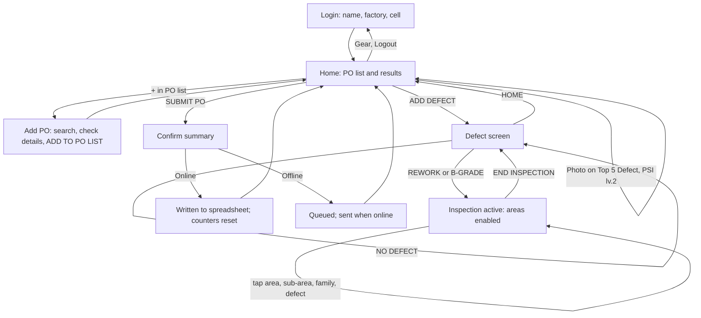

# Mobile 100% Inspection — Product Requirements (PRD)

| | |
|---|---|
| Version | 0.6 — OQ-07 answered: NO DEFECT records the pair at once |
| Date | 19 Oct 2026 |
| Owner | QIP Digital Team, PT Parkland World Indonesia |
| Related | [00 Document Map](00-document-map.md), [07 Decision Log](07-decision-log.md), clickable prototype "Mobile 100% Inspection" v3 |

## 1. Summary

Mobile 100% Inspection is a tap-only tablet app that PSI inspectors (levels 1 and 2) use on the production line to record defects while they inspect shoes. The PSI picks the PO, taps REWORK, B-GRADE or NO DEFECT for each pair, taps where the defect is on a shoe diagram, and taps the defect. The app counts inspections, defects, A-Grade and B-Grade, and shows Top 5 Defect, Defect Rate and Pass Rate as the PSI works. When the round is done, **SUBMIT PO** writes the result into the existing `100%INLINE IMPACTIVA` spreadsheet in the same format the AppSheet app uses, so the Leader Quality sees it in the reports they already use.

## 2. Problem and goals

### Problem

Today PSI record defects on paper during inspection and share them through a WhatsApp group. This makes reporting slow for PSI lv.1 and lv.2, and Leader Quality receives defect information late. Typing defects into a form on the line is also slow: the defect list has 98 entries with long names.

### Goals

| # | Goal | How we measure it (release 1 pilot) |
|---|---|---|
| G1 | Record a defect without a keyboard | Every defect is recorded by taps only. From an active inspection, a defect takes at most 4 taps: area, sub-area, family, defect (fewer when a level has one option). |
| G2 | Make results visible as soon as the round is done | A submitted PO appears in `DATA_INSPECTION` within 1 minute when the tablet is online. |
| G3 | Keep existing reports working | Mobile 100% Inspection rows are read correctly by the existing AppSheet app and reports with no change to them. |
| G4 | Capture where on the shoe each defect is | Every submitted defect has an area and sub-area in `M100_DEFECT_DETAIL`. |
| G5 | Lose nothing, duplicate nothing | 0 lost sessions after a reload, app close or connection drop; 0 duplicate rows from a retried submit. |

## 3. Users and roles

| Role | Who | In `USER_LIST` as | Can do |
|---|---|---|---|
| PSI lv.1 | Line inspector | `TYPE INSPECTION` = `PSI lv.1` | Everything in §5, except attaching photos |
| PSI lv.2 | Senior line inspector | `TYPE INSPECTION` = `PSI lv.2` | Everything in §5, and **must** attach a photo to every Top 5 Defect before Submit PO |
| Leader Quality | Reads results | — (not an app user) | Uses existing spreadsheet reports and AppSheet; not part of this app |
| Spreadsheet maintainer | Whoever maintains the sheet today | — | Maintains users, cells, POs, defect list and area map directly in the spreadsheet (ADR-007) |

There is no admin role in the app (ADR-007). On 15 Oct 2026 `USER_LIST` held 14 distinct PSI names: 6 at PSI lv.1 and 8 at PSI lv.2.

## 4. Scope

### In release 1

- Login by name, factory and cell; logout.
- PO list on the tablet: add a PO from `ALL_PO_MASTER`, select a PO, remove a PO with no open session.
- Inspection by pair: REWORK, B-GRADE, NO DEFECT, END INSPECTION.
- Defect input on the shoe diagram: 12 areas → sub-area → defect family → defect, using the area mapping database.
- BACK, HOME and UNDO on the defect screen, and the session's defect history.
- Home results: Qty PO Order, Qty Inspection, Qty Defect, Qty A-Grade, Qty B-Grade, Defect Rate, Pass Rate (RFT), Top 5 Defect.
- Photo evidence for Top 5 Defect (PSI lv.2).
- Export the current session to PDF and Excel.
- SUBMIT PO: write the session to `DATA_INSPECTION` and `M100_DEFECT_DETAIL`.
- Working without Wi-Fi: inspection continues offline, and Submit PO is queued until the connection returns.

### Not in release 1

- Admin screens, user management, or editing and deleting submitted results (done in the spreadsheet).
- NIK or password login.
- Inspection types other than PSI: T1QM, AQL 3rd party, CFA audits, repacking.
- New dashboards or reports. Existing reports read the data.
- iOS devices (see NFR-01).

## 5. How the app is used

A **session** is everything recorded for one PO on one tablet between two Submit POs. An **inspection** is one pair, from tapping REWORK, B-GRADE or NO DEFECT until END INSPECTION.

## 6. Functional requirements

Priority: **M** = Must, **S** = Should, **C** = Could.

### FR-01 Login (M)

The login screen shows three pickers and a LOGIN button. Nothing is typed.

1. **Name**: the distinct names in `USER_LIST` whose `TYPE INSPECTION` is `PSI lv.1` or `PSI lv.2`, sorted A–Z, each shown with its level. A name listed twice with the same type appears once.
2. **Factory**: the distinct `FACTORY` values in `DB_CELL` of the form `F <number>` (`F 1` … `F 5`); `PWA` and `BOTTOM` are not offered (decided 16 Oct 2026).
3. **Cell**: the `CELL` values in `DB_CELL` for the chosen factory (for example `F3-10`). If the factory has only one cell, it is selected automatically.

LOGIN is enabled when all three are chosen.

- AC-01.1 Only `PSI lv.1` and `PSI lv.2` users are listed; users of other types (CFA, T1QM, AQL3RD PARTY) are not.
- AC-01.2 After login, the user's name and level appear in the Home header and the Factory/Cell appears in the PO info strip as the cell code (for example `F3-10`).
- AC-01.3 The login stays active after the app is closed and reopened, until the user logs out.
- AC-01.4 If master data can't be loaded and nothing is cached, the screen says so and offers RETRY; it never shows an empty name list without explanation.

### FR-02 Logout (M)

The gear button in the Home header opens a menu showing the user's name, level and Factory/Cell, with LOGOUT at the bottom.

- AC-02.1 LOGOUT returns to the login screen.
- AC-02.2 If any PO has an open session that hasn't been submitted, logout first warns: "N PO belum disubmit. Data tetap tersimpan di tablet ini untuk [name]." The user can cancel or continue.
- AC-02.3 Open sessions belong to the user who recorded them. They reappear when the same user logs in again on the same tablet and are never shown to a different user.

### FR-03 PO list and Add PO (M)

The left column of Home lists the user's POs on this tablet, with a + button at the bottom.

1. **+** opens the Add PO dialog with a searchable PO NUMBER dropdown.
2. The search matches PO number, article or model in `ALL_PO_MASTER`. Typing in this search box is the one place a keyboard is used. Results appear after 3 characters, at most 20 at a time.
3. Picking a PO shows: PO Number, Article, Model, Destination, Qty Order, PODD, CRD.
4. **PO PARTIAL** checkbox (off by default). When ticked, two inputs appear: the partial number (P1, P2, … chosen with − / + buttons, starting at P1) and the partial quantity in pairs (entered with the app's own number pad, not the device keyboard).
5. **ADD TO PO LIST** adds it, selects it and closes the dialog. With PO PARTIAL ticked it is enabled only when the partial quantity is filled in.
6. The PO info strip on Home shows the partial (for example `P1 · 1.200 dari 10.002`); **UBAH PARTIAL** there reopens the two inputs, so the value can be changed or removed before the next Submit PO.

- AC-03.1 A PO already in the list is shown as "sudah di list" and can't be added twice.
- AC-03.2 Each PO in the list shows its number and, when it has an open session, the session's defect count and "Inspeksi berjalan" while an inspection is active.
- AC-03.3 Selecting a PO updates the info strip and the results panel to that PO.
- AC-03.4 (S) A PO with no open session can be removed from the list by a long press and confirmation. A PO with an open session can't be removed.
- AC-03.5 PO numbers keep their leading zero and any prefix (for example `0903359388`, `CX-0902368685`).
- AC-03.6 The partial quantity is a whole number from 1 to the PO's Qty Order; anything else can't be entered.
- AC-03.7 Each Submit PO writes the PO's partial at that moment to `PARTIAL OF QTY PO` (doc 02 §5); a PO without PO PARTIAL leaves the column empty.

### FR-04 Results panel (M)

For the selected PO's **current session**, Home shows:

| Field | Value |
|---|---|
| Qty PO Order | `ORDER QTY` from `ALL_PO_MASTER` |
| Qty Inspection | BR-01 |
| Qty Defect | BR-01 |
| Qty A-Grade | BR-01 |
| Qty B-Grade | BR-01 |
| Defect Rate | BR-02, one decimal, "—" when Qty Inspection is 0 |
| Pass Rate (RFT) | BR-02, one decimal, "—" when Qty Inspection is 0 |

- AC-04.1 Values update immediately after every tap on the defect screen; no network is needed.
- AC-04.2 After a successful or queued Submit PO, all values return to 0 for the next session.

### FR-05 Top 5 Defect (M)

A table on Home lists the session's five defects with the highest total quantity, across all areas and inspection types: number, defect name, classification chip (MINOR / MAJOR / CRITICAL), the areas it was found in, quantity, and the photo control (FR-10).

- AC-05.1 Ties are ordered by severity (CRITICAL, MAJOR, MINOR), then by which defect was recorded first.
- AC-05.2 With no defects, the table says "Belum ada defect" and how to start (tap ADD DEFECT).

### FR-06 Starting and ending an inspection (M)

The defect screen has REWORK, B-GRADE and NO DEFECT buttons above the shoe diagram, and END INSPECTION below it.

1. With no active inspection, the shoe areas, sub-areas, families and defects are disabled and visibly dimmed. The right panel says to choose REWORK, B-GRADE or NO DEFECT.
2. **REWORK** or **B-GRADE** starts an inspection (BR-01) and enables defect input. The chosen button is highlighted, the other two are disabled, and the panel shows the inspection type.
3. **NO DEFECT** records an A-Grade pair (BR-01) and completes it at once. Defect input stays disabled; no END INSPECTION is needed (decided 19 Oct 2026, OQ-07).
4. **END INSPECTION** ends the active inspection and disables defect input again. It is disabled when no inspection is active.

- AC-06.1 Defects can be recorded only while a REWORK or B-GRADE inspection is active.
- AC-06.2 An active inspection survives HOME, switching to another screen, reloading or closing the app; returning to the defect screen shows it still active.
- AC-06.3 Ending a REWORK or B-GRADE inspection with no defects is allowed and counts as one inspection.

### FR-07 Recording a defect (M)

1. The shoe diagram shows 12 areas: Tongue, Eyestay/Lace, Vamp, Toe Box, Branding/Treatment, Midsole, Inside, Collar, Heel, Outsole/Bonding, Quarter, General. An area can be tapped on its label or on the shoe.
2. The right panel then lists, in turn: the area's **sub-areas**, the sub-area's **defect families**, and the family's **defects**, each with its classification. A level with only one option is skipped.
3. Tapping a defect records one finding (BR-01) for the current area, sub-area and inspection type. The PSI can tap several defects, or the same defect several times, while the list stays open.
4. The classification comes from the defect list; the PSI never chooses it (BR-03).
5. A breadcrumb above the list shows the path (for example `QUARTER › MEDIAL QUARTER › STITCHING`). Tapping an earlier crumb goes back to that level.
6. Each area label shows how many defects were recorded there in the active inspection.

- AC-07.1 Area, sub-area, family and defect lists come from `M100_AREA_MAP` (ADR-009). Medial Quarter offers the same defects as Lateral Quarter.
- AC-07.2 Each tap gives visible feedback within 100 ms (row highlight and a short "+1 Defect" or "+1 Defect dan B-Grade" message) and a short vibration where supported.
- AC-07.3 The defect row shows how many times it was tapped in the active inspection.

### FR-08 BACK, HOME and UNDO (M)

- **BACK** goes up one level (defect list → families → sub-areas → no area). With no area selected, BACK returns to Home.
- **HOME** returns to Home. The active inspection stays active.
- **UNDO**:
  - during an active inspection with recorded defects, it removes the last defect recorded in that inspection;
  - during an active inspection with no defects, it cancels the inspection (reverses its +1 Qty Inspection);
  - right after NO DEFECT, with nothing started since, it cancels that NO DEFECT (reverses its +1 Qty Inspection and +1 Qty A-Grade);
  - otherwise it is disabled. UNDO never reaches an inspection that has already ended.

- AC-08.1 Every UNDO shows a short message saying what was undone.

### FR-09 Defect history (M)

Below the defect list, the defect screen shows the session's recorded defects: number, defect name, area › sub-area · family · inspection type, classification, and quantity.

- AC-09.1 The row just changed is highlighted and scrolled into view.
- AC-09.2 One row per area + sub-area + defect + inspection type, matching what `M100_DEFECT_DETAIL` will receive.

### FR-10 Photo evidence (M for PSI lv.2)

1. For a PSI lv.2 user, each Top 5 Defect row has a FOTO button that opens the tablet camera. **One photo per defect**: it is attached to that defect for the session.
2. An attached photo shows as a thumbnail; tapping it shows it large with GANTI FOTO and HAPUS.
3. For a PSI lv.1 user, the photo column is not shown and no photo is ever taken or uploaded (decided 16 Oct 2026).

- AC-10.1 Photos are resized on the tablet to at most 960 px on the long edge (JPEG) before being stored.
- AC-10.2 Photos are kept with the session on the tablet until Submit PO and survive a reload.
- AC-10.3 A Top 5 row without a photo is marked "Foto wajib" for PSI lv.2.
- AC-10.4 A photo stays attached to its defect even if that defect later drops out of the Top 5, and is submitted with it.
- AC-10.5 A defect never has more than one photo; GANTI FOTO replaces it.
- AC-10.6 A PSI lv.1 submission contains no photos, and its `DATA_INSPECTION` row has every `PHOTO` cell empty (doc 02 §7).

### FR-11 SUBMIT PO (M)

SUBMIT PO on Home sends the selected PO's session to the spreadsheet.

1. **Checks before confirming** (each failure says what to do):
   - an inspection is still active → "Selesaikan inspeksi dulu (END INSPECTION)";
   - Qty Inspection is 0 → "Belum ada inspeksi untuk PO ini";
   - PSI lv.2 and a Top 5 Defect has no photo → list the defects missing a photo (BR-04).
2. **Confirmation** shows PO, Qty Inspection, Qty Defect, A-Grade, B-Grade, Defect Rate, Pass Rate, and the number of photos, with KIRIM and BATAL.
3. **On KIRIM**, the session is sealed: it can't be changed any more, and the PO starts a new empty session.
   - Online: the API writes one `DATA_INSPECTION` row and its `M100_DEFECT_DETAIL` rows (ADR-002) and returns the row `ID`. The app shows "PO terkirim" with the time.
   - Offline or server error: the sealed session waits in the tablet's outbox and is sent automatically when the connection returns. The app shows "Menunggu koneksi" with the number of waiting submissions.
4. Each sealed session carries a UUID created on the tablet. Sending the same UUID twice never creates a second row (BR-06).

- AC-11.1 After a successful Submit PO, the new row in `DATA_INSPECTION` has the user's name in `INSPECTOR`, their level in `TYPE INSPECTION`, the factory and cell, the PO fields from `ALL_PO_MASTER`, the counts from BR-01, the defects in slots 1–25, and the rates from BR-02.
- AC-11.2 Turning Wi-Fi off, submitting, closing the app, then turning Wi-Fi on and reopening the app results in exactly one row.
- AC-11.3 The header shows how many submissions are waiting, and the gear menu lists each with its PO, time and status (waiting, sending, sent, failed with reason).
- AC-11.4 A submission the API rejects as invalid (not a network error) stays in the outbox as "Gagal" with the reason, and is never silently dropped.

### FR-12 Export PDF and Excel (S)

EXPORT PDF and EXPORT EXCEL on Home create a file of the selected PO's current session.

- AC-12.1 Both files contain the PO info, inspector, Factory/Cell, export time, the results panel values, Top 5 Defect, and every recorded defect with area, sub-area, family, inspection type, classification and quantity.
- AC-12.2 The PDF includes the attached photos.
- AC-12.3 File names follow `M100_<PO>_<YYYYMMDD>.pdf` / `.xlsx`.
- AC-12.4 Export works offline and doesn't change the session.

### FR-13 Master data on the tablet (M)

- AC-13.1 Users, cells and the area map are downloaded at first launch and cached on the tablet; the app works offline with the cached copy.
- AC-13.2 The cache refreshes when the app opens online and at most every 30 minutes while it is open.
- AC-13.3 PO search needs a connection. Details of POs already in the list are kept on the tablet.
- AC-13.4 The gear menu shows when master data was last updated.

## 7. Business rules

| ID | Rule |
|---|---|
| BR-01 | Counting (ADR-008). Each REWORK, B-GRADE or NO DEFECT start: Qty Inspection +1. NO DEFECT: Qty A-Grade +1. Each defect recorded in a REWORK inspection: Qty Defect +1. Each defect recorded in a B-GRADE inspection: Qty Defect +1 and Qty B-Grade +1. B-Grade is counted per defect finding. |
| BR-02 | Defect Rate = Qty Defect ÷ Qty Inspection. Pass Rate (RFT) = Qty A-Grade ÷ Qty Inspection. Both are percentages; Defect Rate can exceed 100% because one pair can have several defects. |
| BR-03 | A defect's classification (MINOR, MAJOR, CRITICAL) is fixed by the defect list. The user never sets it. |
| BR-04 | For PSI lv.2, every defect in the Top 5 at the moment of Submit PO must have a photo. |
| BR-05 | Only one inspection can be active per PO at a time. REWORK, B-GRADE and NO DEFECT are disabled while one is active. |
| BR-06 | A sealed session is written at most once. Its UUID identifies it across retries. |
| BR-07 | Mobile 100% Inspection only appends rows. It never edits or deletes existing rows in any sheet. |
| BR-08 | A level of the drill-down with exactly one option (sub-area or family) is selected automatically and skipped by BACK. |
| BR-09 | Sessions and the PO list belong to one user on one tablet (AC-02.3). |

## 8. Data written (summary)

Detailed column mapping is in doc 02 (Data Design). In short, per Submit PO:

| Sheet | Rows | Content |
|---|---|---|
| `DATA_INSPECTION` (existing) | 1 | Existing 276-column format: header fields, defects summed by name into slots 1–25 with classification and quantity, the Google Drive photo links in `LINK1` … `LINK75` by slot (ADR-011), then A-Grade, B-Grade, Total Defect, RFT, Defect Rate. `STATUS PO` and `PIC ADM` stay empty (ADR-012). |
| `M100_DEFECT_DETAIL` (new) | 1 per area + sub-area + defect + inspection type | Session `ID`, submission UUID, defect ID and name, area, sub-area, family, inspection type, classification, quantity, photo link, submit time |
| `M100_AREA_MAP` (new, read) | — | The area mapping database, read by the API (ADR-009) |

## 9. Non-functional requirements

| ID | Requirement |
|---|---|
| NFR-01 | **Devices.** Target tablet: Xiaomi Redmi Pad 2 (11", 2560 × 1600, Android 15 / HyperOS), Chrome, installed as a PWA, landscape first; about 1280 × 800 CSS px. Tablets may be shared by several PSI (BR-09, AC-02.3). Portrait and phone widths must remain usable. iOS is not supported in release 1. |
| NFR-02 | **Touch.** Every tappable element is at least 44 × 44 CSS px. No device keyboard except the PO search box; numbers (the partial quantity) are entered with the app's own number pad. |
| NFR-03 | **Speed.** Recording a tap never waits on the network; feedback within 100 ms. App start from cache within 3 s on the target tablet. |
| NFR-04 | **Offline.** After the first online launch, login, inspection, defect input, photos, results and export all work without a connection. Submit PO is queued. |
| NFR-05 | **Durability.** Every change to a session is saved on the tablet before the screen confirms it. Closing, reloading or a browser crash loses nothing that was confirmed. |
| NFR-06 | **Integrity.** Every step of a submission is safe to repeat, so a retry completes a half-written submission and never duplicates it (BR-06). No changes to existing rows (BR-07). |
| NFR-07 | **Capacity.** Two Sheets write requests per submission (an append, then one batch; doc 02 §8). The API handles 30 tablets (design target 50; more than 30 are planned) submitting within the same 5 minutes without losing a submission, retrying on HTTP 429 with backoff. |
| NFR-08 | **Security.** No Google credentials on tablets. Tablets call the API over HTTPS with a token issued by the API. Name-only login is a known, accepted risk (ADR-006). |
| NFR-09 | **Language and format.** Indonesian UI with the fixed English shop-floor labels listed in doc 00; WIB time; Indonesian number format on screen (2.400; 18,8%). Dates and numbers are written to the sheet as values, not text. |
| NFR-10 | **Traceability.** The API logs every submission with UUID, row ID, user, PO, duration and result. |
| NFR-11 | **Readability.** Classification is shown as text, never by color alone; text contrast meets WCAG AA in light and dark themes. |

## 10. Open questions

| # | Question | Needed for |
|---|---|---|
| ~~OQ-01~~ | **Answered 16 Oct 2026 (ADR-011):** photos are uploaded to Google Drive; each link appears in `LINK1` … `LINK75` by defect slot. Mechanism to confirm: doc 02 §7. | — |
| ~~OQ-02~~ | **Answered 16 Oct 2026:** `STATUS PO`, `PIC ADM`, `INSPECTION BY`, `CFA NAME`, `HISTORYCAL PO`, `C-GRADE` stay empty; `CATEGORY` is always `SHOES`; `PARTIAL OF QTY PO` comes from the PO PARTIAL input of FR-03 (ADR-012, ADR-013). | — |
| ~~OQ-03~~ | **Answered 16 Oct 2026 (ADR-015):** on an existing PWI server, reachable from the tablets over the factory Wi-Fi. It has no HTTPS yet, which a PWA requires (ADR-015). | — |
| ~~OQ-04~~ | **Answered 16 Oct 2026:** most likely Xiaomi Redmi Pad 2; a tablet can be shared by several PSI. Number of tablets: more than 30, on Wi-Fi with internet access (16 Oct 2026). | — |
| OQ-05 | Once Mobile 100% Inspection is live, do PSI stop entering the same results in the AppSheet app? Otherwise the same check round could appear twice. | Rollout |
| OQ-06 | Which POs should Add PO offer: all of `ALL_PO_MASTER`, or only those not finished (`FINISH PRODUCTION` empty or `Balance Prod` > 0)? | Doc 02, 04 |
| ~~OQ-07~~ | **Answered 19 Oct 2026:** NO DEFECT records the pair immediately, without END INSPECTION, and UNDO right after it cancels it (FR-06.3, FR-08; doc 05 U1). | — |
| OQ-08 | Should Home also show what was already submitted today for the selected PO, next to the current session? Doc 05 assumes no (U2). | Doc 05 |
| OQ-09 | Who updates `M100_AREA_MAP` when `DEFECT_LIST` changes, and how is the change announced? | Doc 02 |
| OQ-10 | The product is named "for CFA", and `USER_LIST` has CFA users. Release 1 serves PSI only. Is a CFA flow planned later? | Roadmap |
| ~~OQ-11~~ | **Answered 16 Oct 2026:** PSI lv.1 never attaches photos; PSI lv.2 attaches one photo per Top 5 defect. | — |
| OQ-12 | How is the `SUMMARY` sheet produced, and must Mobile 100% Inspection rows appear in it? | Doc 02 |

## 11. Assumptions

- Tablets have Wi-Fi at least at the end of each round or shift.
- `USER_LIST`, `DB_CELL`, `ALL_PO_MASTER` and `DEFECT_LIST` keep their current column names and order. A change there needs a matching change in doc 02.
- `DEFECT_LIST` stays row-for-row aligned with the mapping database (98 defects).
- The AppSheet app keeps writing `DATA_INSPECTION` in its current format.

## 12. Glossary

| Term | Meaning |
|---|---|
| PSI | Line inspector, level 1 or 2, as listed in `USER_LIST` (`PSI lv.1`, `PSI lv.2`) |
| PO | Production order, identified by PO number in `ALL_PO_MASTER` |
| Session | Everything recorded for one PO on one tablet between two Submit POs |
| Inspection | One pair, from REWORK / B-GRADE / NO DEFECT until END INSPECTION |
| Finding | One defect tapped during an inspection |
| A-Grade | Pair passed with no defect (NO DEFECT) |
| B-Grade | Inspection type for a pair downgraded to B-Grade; each finding counts toward Qty B-Grade |
| Rework | Inspection type for a pair that goes back for repair |
| RFT | Right First Time = Pass Rate = Qty A-Grade ÷ Qty Inspection |
| Area / Sub-area / Family | The three levels of the shoe defect map (for example Quarter / Medial Quarter / Stitching) |
| Outbox | Sealed sessions waiting on the tablet to be sent |
