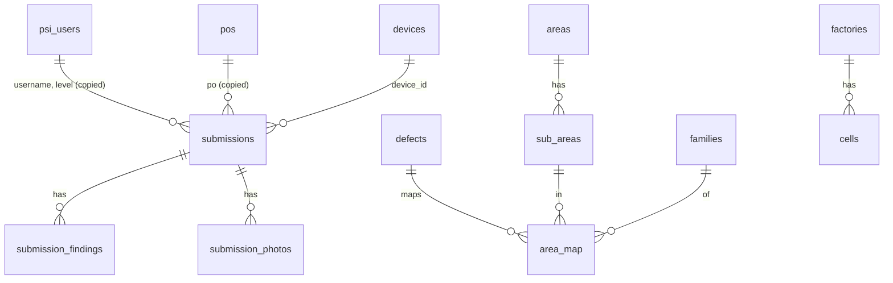

# Mobile 100% Inspection — Data Design (PostgreSQL and object storage)

| | |
|---|---|
| Version | 2.0 — rewritten 20 Oct 2026 for ADR-018 (v1.0, the Google Sheets design, is superseded) |
| Date | 20 Oct 2026 |
| Database | PostgreSQL 16, database `m100`, schema `public`, time zone `Asia/Jakarta` for sessions, all timestamps stored as `timestamptz` |
| Photos | An object store behind the `PhotoStore` interface (S3 API; MinIO or another S3-compatible store, or a plain folder), bucket `m100-photos` |
| Based on | A full read of the old spreadsheet on 16 Oct 2026 (its findings are kept in §2 where they still matter) and ADR-018 |
| Related | ADR-003, 006, 008, 009, 013, 018 in [07 Decision Log](07-decision-log.md); FR-01…FR-14 in [01 PRD](01-prd.md); [03 TDD](03-tdd.md) §5 |

This document says what is stored, where, and how a submission is written. Mobile 100% Inspection no longer reads or writes the "100%INLINE IMPACTIVA" spreadsheet or any Google service (ADR-018). Historical AppSheet data stays in that spreadsheet and is not migrated.

## 1. Overview



| Group | Tables | Written by |
|---|---|---|
| Master data | `psi_users`, `factories`, `cells`, `pos`, `defects`, `areas`, `sub_areas`, `families`, `area_map` | One-time import, then the admin app (§5) |
| Submissions | `submissions`, `submission_findings`, `submission_photos` | The API, once per Submit PO (§6) |
| Operations | `devices`, `admins`, `audit_log`, `settings` | The admin app and scripts |
| Reporting | views `v_submissions`, `v_findings`, `v_defect_totals`, `v_top5` | Read-only (§8) |
| Photos | objects in the photo store | The API |

Rules that hold for every table: primary keys are explicit; text copied from a master table into a submission is a **snapshot** (so later edits to master data never change history); no table has `ON DELETE CASCADE` from master data to submissions; submissions are never updated or deleted.

## 2. What the old data taught us (kept)

These findings from the old spreadsheet still shape the rules below.

| # | Finding | Rule here |
|---|---|---|
| D1 | A PSI session has 0–24 distinct defects (median 10); one pair can carry several defects. | No slot limit any more: findings are rows (§4). |
| D2 | `QTY INSPECTION` ≠ `A-GRADE` + `TOTAL DEFECT` under ADR-008, so RFT + Defect Rate ≠ 100%. | Stored as computed by ADR-008 (§6.3, §9). |
| D3 | PO fields (`MODEL`, `DESTINATION`) carried non-breaking spaces copied from the PO master. | Master text is stored **as imported**, never trimmed or normalised by the import; the search ignores them (§3.3). |
| D4 | 132 historical slots held hand-typed defect names outside `DEFECT_LIST`. | Mobile 100% Inspection writes only defects that exist in `defects`. |
| D5 | `PARTIAL OF QTY PO` was free text (`1`, `1200`, `P1 1200`). | Two structured numbers (§4.1); the text form `P1 1.200 OF 10.002` is a derived display value (§4.1). |
| D6 | 99% of old slots had photos, at both levels. | Decided: one photo per Top 5 defect, PSI lv.2 only (FR-10, §4.3). |

## 3. Master data

All master tables have `id` or a natural key, `active boolean` (inactive rows are hidden but kept, because submissions refer to them), `created_at`, `updated_at`. A single row in `settings` (`key = 'master_version'`) is a counter incremented **in the same transaction** as any master change; the tablet's `/master-data` ETag is derived from it.

### 3.1 `psi_users`

| Column | Type | Rule |
|---|---|---|
| `id` | `integer` identity PK | |
| `username` | `text` not null | Exactly as shown on screen; no NIK (ADR-006) |
| `level` | `text` not null | `PSI lv.1` or `PSI lv.2` (check constraint) |
| `active` | `boolean` | default true |

Unique on (`username`, `level`). The login list (FR-01) is the active rows sorted by `username`, each shown with its level. A name present at both levels appears twice, once per level.

Import rule from the old `USER_LIST`: keep only `TYPE INSPECTION` in (`PSI lv.1`, `PSI lv.2`), de-duplicate on (`USERNAME`, `TYPE INSPECTION`). On 16 Oct 2026 this gives 14 people (6 lv.1, 8 lv.2); `ROIS FATHUR ROHIM` (listed twice) and `EVA JULIYANI` (also a CFA) each appear once.

### 3.2 `factories` and `cells`

| Table | Columns |
|---|---|
| `factories` | `id` PK, `name` unique (`F 1` … `F 5`), `active` |
| `cells` | `id` PK, `factory_id` FK, `code` unique (`F3-10`), `active` |

Only factories of the form `F <number>` are offered at login (decided 16 Oct 2026); `PWA` and `BOTTOM` from the old `DB_CELL` are not imported. A factory with a single active cell has it selected automatically (FR-01.3).

### 3.3 `pos`

| Column | Type | Rule |
|---|---|---|
| `po` | `text` PK | Keeps leading zeros and prefixes (`0902028839`, `CX-0902368685`); never converted to a number (AC-03.5) |
| `article`, `model`, `destination` | `text` | As imported |
| `order_qty` | `integer` not null | ≥ 1 |
| `podd`, `crd` | `date` null | Old ISO text `2026-01-12`; null if empty or unreadable |
| `finished` | `boolean` | From old `FINISH PRODUCTION` / `Balance Prod` if imported (PRD OQ-06 decides whether it filters) |
| `active` | `boolean` | |
| `source` | `text` | `import:<file>` or `admin` |

About 71,500 rows. **Search (FR-03.2):** case-insensitive substring match on `po`, `article`, `model`, after 3 characters, at most 20 rows. Implemented with the `pg_trgm` extension and one GIN index on `lower(po || ' ' || article || ' ' || model)`; non-breaking spaces are replaced by spaces **in the index expression only**, never in the stored data.

### 3.4 `defects`

| Column | Type | Rule |
|---|---|---|
| `id` | `text` PK | `D001` … `D098` (ADR-009) |
| `name` | `text` not null | Exactly as in the old `DEFECT_LIST`, mixed case and brackets included; never shortened (doc 06) |
| `severity` | `text` not null | `MINOR`, `MAJOR`, `CRITICAL` (check). This is the old `DEFECT_LIST.CLASSIFICATION` |
| `ctq_category` | `text` null | The old `DEFECT_LIST.DEFECT CLASSIFICATION` ("Outer carton"), kept for reference only |
| `ctq_code` | `text` null | The old `CTQ DEFECT CODE` |

98 rows at import; row *r* (2–99) of the old sheet is `D(r−1)`. D049 and D071 are both "POOR TOUCH UP/PAINTING, MARKING LINE" (MINOR) and stay two defects.

### 3.5 Area map

| Table | Columns |
|---|---|
| `areas` | `id` PK (`A01`…`A12`), `name`, `sort` |
| `sub_areas` | `id` PK (`SA03L`), `area_id` FK, `name`, `sort` |
| `families` | `id` PK (`F03`), `name` |
| `area_map` | `id` PK (`MAP-035-03`), `area_id`, `sub_area_id`, `family_id`, `defect_id` FKs, `active`; unique (`sub_area_id`, `family_id`, `defect_id`) |

437 mapping rows at import, from `Footwear_Defect_Mapping_Database_v2.xlsx` (sheets `Defect_Area_Map`, `Area_Master`, `SubArea_Master`, `Defect_Family`, `Defect_Master`). Medial Quarter offers the same defects as Lateral Quarter (AC-07.1). The name and severity of a defect are not repeated in `area_map`; there is one source (`defects`), which removes the old check that the two copies agree.

**Integrity rules** (enforced by constraints and by the import/admin validation, §5): every `sub_areas.area_id` exists; every `area_map` row refers to existing rows; a `sub_area` belongs to exactly one area; `areas` has exactly the 12 area ids A01–A12 (the shoe-map pills of doc 06 are bound to them); every active `defects` row appears in at least one active `area_map` row (warning, not an error).

## 4. Submissions

One row of `submissions` is one Submit PO (ADR-003).

### 4.1 `submissions`

| Column | Type | Rule |
|---|---|---|
| `id` | `uuid` PK | The **submission UUID** created by the tablet when the PSI taps KIRIM. Idempotency key (BR-06) |
| `display_no` | `bigint` identity, unique | Human number for the admin app and reports (`M100-000123`) |
| `payload_sha256` | `bytea` not null | SHA-256 of the JSON part exactly as received (doc 04 §4.3) |
| `sealed_at` | `timestamptz` not null | When the PSI tapped KIRIM |
| `received_at` | `timestamptz` not null default now() | When the API wrote it |
| `inspection_date` | `date` not null | Date of `sealed_at` in WIB (stored, so reports need no time-zone math) |
| `app_version` | `text` | |
| `device_id` | `uuid` FK `devices` | The tablet that sent it |
| `username`, `level` | `text` not null | Snapshot of the PSI (checked against the token) |
| `factory`, `cell` | `text` not null | Snapshot (`F 3`, `F3-10`) |
| `po`, `article`, `model`, `destination` | `text` not null | Snapshot copied from `pos` at write time |
| `order_qty` | `integer` not null | Snapshot |
| `podd`, `crd` | `date` null | Snapshot |
| `partial_no` | `smallint` null | 1–99; null when the PO is not partial (ADR-013) |
| `partial_qty` | `integer` null | 1 … `order_qty`; null when not partial. Check: both null or both set |
| `qty_rework`, `qty_bgrade_inspections`, `qty_no_defect` | `integer` not null | Inspections started per type (the tablet's `counts`) |
| `qty_inspection` | `integer` not null | `rework + bgrade_inspections + no_defect`, ≥ 1 (check) |
| `qty_a_grade` | `integer` not null | = `qty_no_defect` (BR-01) |
| `qty_b_grade` | `integer` not null | Sum of `qty` of B-GRADE findings |
| `qty_defect` | `integer` not null | Sum of `qty` of all findings |
| `rft` | `numeric(8,5)` not null | `qty_a_grade / qty_inspection` (a fraction, 0.60000 = 60,0%) |
| `defect_rate` | `numeric(8,5)` not null | `qty_defect / qty_inspection`; can exceed 1 |
| `photo_count` | `smallint` not null | Number of `submission_photos` rows |

**Partial text.** The sheet's `P1 1.200 OF 10.002` is a display value, computed when needed (admin app, exports) as `P<partial_no> <partial_qty> OF <order_qty>` with Indonesian number format. It is not stored. The Home info strip shows `P1 · 1.200 dari 10.002`.

**Immutability.** A trigger rejects every `UPDATE` and `DELETE` on `submissions`, `submission_findings` and `submission_photos`; role `m100_app` also has no DELETE grant. There is no void in release 1.

Constraints (database level, so a bug in the API cannot store inconsistent numbers): `qty_inspection = qty_rework + qty_bgrade_inspections + qty_no_defect`; `qty_a_grade = qty_no_defect`; `qty_b_grade <= qty_defect`; the check on `partial_*` above. The API computes all totals itself from the tablet's counts and findings (doc 04 §4.1); the database re-checks `qty_defect` and `qty_b_grade` against the findings in the same transaction (§6.3).

### 4.2 `submission_findings`

One row per inspection type + area + sub-area + defect.

| Column | Type | Rule |
|---|---|---|
| `id` | `bigint` identity PK | |
| `submission_id` | `uuid` FK, not null | `ON DELETE RESTRICT` |
| `inspection_type` | `text` | `REWORK` or `B-GRADE` |
| `area_id`, `sub_area_id`, `family_id`, `defect_id` | `text` | FKs to the master tables |
| `defect_name`, `severity` | `text` | Snapshot of `defects` at write time |
| `qty` | `integer` | ≥ 1 |
| `first_recorded_at` | `timestamptz` | When the PSI first tapped it; used for ranking ties |

Unique on (`submission_id`, `inspection_type`, `area_id`, `sub_area_id`, `defect_id`). Index on `defect_id` and on (`area_id`).

### 4.3 `submission_photos`

| Column | Type | Rule |
|---|---|---|
| `id` | `bigint` identity PK | |
| `submission_id` | `uuid` FK | |
| `defect_id` | `text` | The defect the photo belongs to |
| `object_key` | `text` not null | Key in the photo store, §7 |
| `sha256` | `bytea` | Of the JPEG, matched against the tablet's value |
| `size_bytes` | `integer` | ≤ 1 MB |

Unique on (`submission_id`, `defect_id`): at most one photo per defect (AC-10.5). **Photo rule** (decided 16 Oct 2026, FR-10, BR-04): a PSI lv.2 submission has exactly one photo for each defect in its Top 5 (more photos only for defects that were photographed while in the Top 5 and later left it, AC-10.4); a PSI lv.1 submission has none.

## 5. Master data: import and administration

### 5.1 One-time import (`scripts/import-master`)

Run by QIP Digital from CSV/XLSX exports of the old sheets and the mapping workbook; no Google access is needed.

| Input | Target | Notes |
|---|---|---|
| `USER_LIST` (csv) | `psi_users` | §3.1 rules |
| `DB_CELL` (csv) | `factories`, `cells` | §3.2 rules |
| `ALL_PO_MASTER` (csv) | `pos` | All text kept as is; dates parsed from ISO text; rows with empty `PO` or non-numeric `ORDER QTY` are reported and skipped |
| `DEFECT_LIST` (csv) | `defects` | Row order gives `D001…`; the file must have exactly 98 rows or the import stops |
| `Footwear_Defect_Mapping_Database_v2.xlsx` | `areas`, `sub_areas`, `families`, `area_map` | 12 areas, 437 rows; every `DEFECT_ID` must exist in `defects` and its name must equal the workbook's name |

The import runs in one transaction, prints a report (rows read, inserted, skipped, with reasons), supports `--dry-run`, and can be repeated: it upserts by natural key and never deletes. It writes one `audit_log` row.

### 5.2 Administration (FR-14, doc 05 §20)

After the import, master data is maintained in the admin web app by people with an `admins` account:

| Subject | Operations |
|---|---|
| PSI users | add, rename, change level, deactivate / reactivate |
| Factories and cells | add, rename, deactivate / reactivate |
| POs | search, add or edit one PO, **import a CSV/XLSX of POs** (upsert by `po`, dry-run report first, never deletes) |
| Defects and area map | view; deactivate / reactivate a defect or a map row; import the mapping workbook again (same validation as §5.1) |
| Submissions | list (DataTable), filter, open, view photos, export CSV (read-only) |
| Admins | add, deactivate, reset password |

Every change writes an `audit_log` row (`at`, `actor`, `action`, `entity`, `entity_id`, `details` JSON with old and new values) and increments `master_version` when it affects what tablets download.

### 5.3 Operations tables

| Table | Columns |
|---|---|
| `devices` | Managed by the CLI `device:add` / `device:revoke` / `device:list` (no admin screen). `id` uuid PK, `label` unique, `key_sha256` bytea unique, `created_at`, `revoked_at` null, `last_seen_at` null. Only the SHA-256 of the device key is stored (ADR-014) |
| `admins` | `id` PK, `username` unique, `password_hash` (argon2id), `active`, `created_at`, `last_login_at`, `failed_logins`, `locked_until` |
| `audit_log` | `id` bigint identity, `at` timestamptz, `actor` text (`admin:<username>`, `script:<name>`, `system`), `action`, `entity`, `entity_id`, `details` jsonb |
| `settings` | `key` text PK, `value` text — `master_version`, `submit_enabled` |

## 6. Writing a submission

### 6.1 Order of operations

```mermaid
sequenceDiagram
  participant T as Tablet
  participant A as API
  participant P as PhotoStore
  participant D as PostgreSQL
  T->>A: POST /submissions (multipart)
  A->>A: device key, token, rate limit, validate (doc 04 §4.2)
  A->>D: SELECT submission by uuid
  alt already written, same hash
    A-->>T: 200 (stored result)
  else already written, different hash
    A-->>T: 409 SUBMISSION_UUID_REUSED
  else new
    A->>P: put photos (parallel, deterministic keys)
    A->>D: BEGIN; INSERT submission, findings, photos; COMMIT
    A-->>T: 201 (displayNo, totals)
  end
```

1. **Look up the UUID.** If a row exists with the same `payload_sha256`, return its stored result (`200`); with a different hash, `409` (BR-06).
2. **Validate** (doc 04 §4.2) using the master tables, in one read-only transaction at `REPEATABLE READ`, so a master edit during validation cannot produce a half-valid result.
3. **Put photos** into the store under deterministic keys (§7). Putting the same key again overwrites it with identical bytes, so this step is safe to repeat. A row must never point to a missing object, so photos go first.
4. **Write the rows** in **one transaction**: `INSERT INTO submissions … ON CONFLICT (id) DO NOTHING RETURNING …`; if nothing was returned a concurrent attempt won, so read it and answer as in step 1; otherwise insert the findings and photo rows with the snapshot columns filled from the master tables inside the same transaction, then re-check `qty_defect` and `qty_b_grade` against the findings (`SELECT sum(qty)`); a mismatch rolls back and returns `500 INTERNAL`.
5. **Answer** `201` with `displayNo` and the totals.

### 6.2 Crashes and retries

| Crashed after | Left behind | The retry (same UUID, same bytes) |
|---|---|---|
| Validation | nothing | starts normally |
| Some photos put | objects without rows | overwrites them, continues |
| Transaction begun, not committed | nothing (rolled back) | writes it |
| Commit, before the answer | a complete submission | step 1 returns `200` with the stored result |

Objects whose key has no `submission_photos` row and are older than 24 hours are removed by a weekly sweep (`scripts/sweep-photos`, `--dry-run` first). A submission is therefore always complete or absent; nothing needs repair.

### 6.3 Totals

Computed by the API from the tablet's `counts` and `findings` with the ADR-008 rules and **verified in the database** (§4.1). Formulas: Qty Inspection = rework + B-GRADE inspections + NO DEFECT; Qty A-Grade = NO DEFECT; Qty Defect = Σ `qty`; Qty B-Grade = Σ `qty` of B-GRADE findings; `rft` = A-Grade ÷ Qty Inspection; `defect_rate` = Qty Defect ÷ Qty Inspection. Submit PO is refused when Qty Inspection is 0 (FR-11), so the rates always have a denominator. Fractions are stored with 5 decimals; screens and exports show percentages with one decimal and an Indonesian decimal comma.

### 6.4 Time

`sealed_at` comes from the tablet and is rejected if more than 5 minutes in the future (R7). `received_at` is the server clock. `inspection_date` is the WIB date of `sealed_at`.

## 7. Photo storage

- **Interface.** `PhotoStore` (doc 03 §5.2): `put`, `get` (stream), `exists`, `delete`, `probe`. Implementations: `S3PhotoStore` (any S3-compatible server, using `@aws-sdk/client-s3` with path-style addressing) and `DiskPhotoStore` (a folder, `PHOTO_DIR`).
- **Bucket and key.** Bucket `m100-photos`, private, no public access. Key: `submissions/<yyyy>/<MM>/<submission uuid>/<defect id>.jpg`, for example `submissions/2026/10/0f6b6c1e-6a52-4c9f-9a3e-5d7a2b0c41f2/D035.jpg`. The year and month come from `inspection_date`.
- **Content.** JPEG, ≤ 960 px on the long edge, ≤ 1 MB, about 100–200 KB (AC-10.1). The API checks the JPEG signature and SHA-256; it does not re-encode.
- **Access.** Tablets never read photos back. Admins view a photo through `GET /v1/admin/photos/{id}`, which checks the admin session and streams the object; no pre-signed URLs and no public address are used.
- **Volume.** About 5 photos × ~290 submissions a month ≈ 1,500 objects ≈ 225 MB a month ≈ 2.7 GB a year at today's PSI rate; plan for 3× that with 30+ tablets.
- **Retention.** Kept indefinitely. Delete only through a reviewed script after a written decision.

## 8. Reporting

Leader Quality no longer reads `DATA_INSPECTION` for this data (ADR-018). Three routes, none of which write:

1. **Admin app:** filterable submission list, detail with photos, CSV export (columns of `v_submissions` plus Top 5).
2. **Views** for reporting tools, readable by the database role `m100_report` (read-only, no access to base tables or to `devices`/`admins`):

| View | One row per | Content |
|---|---|---|
| `v_submissions` | submission | `display_no`, `inspection_date`, `sealed_at` (WIB), `username`, `level`, `factory`, `cell`, PO fields, `partial_text`, all `qty_*`, `rft`, `defect_rate`, `photo_count` |
| `v_findings` | finding | submission keys plus area, sub-area, family, defect, severity, `inspection_type`, `qty` |
| `v_defect_totals` | submission + defect | total `qty` over areas and types, `rank_in_submission` by the Top 5 order (quantity, then severity, then first recorded), `has_photo` |
| `v_top5` | submission + rank ≤ 5 | `v_defect_totals` filtered |

3. A BI tool (Looker Studio, Metabase, Power BI) connected to the views with `m100_report`. The owner plans a central QIP dashboard that will read these views (PRD OQ-13).

## 9. How the numbers differ from the old AppSheet rows

Unchanged from the old design: under ADR-008 one pair can carry several defects, so Qty Inspection ≠ A-Grade + Qty Defect, and RFT + Defect Rate does not add to 100%. Example: 10 REWORK pairs with 8 defects, 2 B-GRADE pairs with 3 defects, 18 NO DEFECT pairs → Qty Inspection 30, A-Grade 18, B-Grade 3, Qty Defect 11, RFT 60,0%, Defect Rate 36,7%. A report that expects the old AppSheet convention (A-Grade = Qty Inspection − Total Defect) will disagree with Mobile 100% Inspection data; the views carry a column `counting_rule = 'ADR-008'` so a combined report can tell the two sources apart.

## 10. Readiness checks (API)

The API reports each check in `GET /system/status`. Submit PO is disabled (`503 SUBMIT_DISABLED`) and the reason is shown in the gear menu if any fails:

| Id | Check |
|---|---|
| `DB` | The database answers and the migrations are at the expected version |
| `MASTER_DATA` | `psi_users`, `cells`, `defects` (98), `areas` (12) and `area_map` are not empty; the integrity rules of §3.5 hold |
| `PHOTO_STORE` | A probe object can be put, read and deleted |
| `SUBMIT_ENABLED` | `settings.submit_enabled` is true (an admin or script can switch submitting off for maintenance) |

Checks run at start, every 5 minutes, and every 30 seconds while any is failing, so a repaired store re-enables submitting without a restart. Login and inspection keep working offline on tablets while Submit PO is disabled; submissions wait in the outbox.

## 11. Capacity and backup

| Item | Estimate |
|---|---|
| Rows | ≈ 290 submissions a month today (design: 3,000), each ≈ 12 findings → < 40k findings a month; the database stays far below 1 GB for years |
| `pos` | ≈ 71,500 rows ≈ 15 MB with its index |
| Photos | §7 |
| Backup | Nightly `pg_dump` (custom format) and a copy of the photo store to another disk or machine, 14 daily and 12 monthly copies; a restore test at pilot start and every quarter (doc 03 §7.6). Recovery point: up to 24 hours; tablets keep unsent sessions and photos for 7 days after confirmation |

## 12. Decisions taken in this document

| # | Decision | Why |
|---|---|---|
| Q1 | One `submissions` row plus findings and photos rows replaces the 276-column row; no slots, no LINK formulas. | The wide row existed to fit AppSheet; PostgreSQL needs none of it |
| Q2 | The submission UUID is the primary key; `display_no` is the human number. | The tablet already creates a UUID and idempotency becomes a constraint |
| Q3 | Snapshots of user, PO and defect text are copied into each submission and finding. | History must not change when master data is edited |
| Q4 | Submissions are fully immutable: no edit, no delete, no void in release 1. A mistaken submission is handled outside the app by the database owner and noted in the runbook. | Keeps reports trustworthy; replaces "append only" (BR-07) |
| Q5 | Photos go to the store before the transaction; a weekly sweep removes orphans. | A row never points to a missing object, and no repair step is needed |
| Q6 | Percentages are stored as fractions with 5 decimals. | Display rounding is a screen concern |
| Q7 | Master data is imported once from CSV/XLSX exports, then edited in the admin app. | Answer of 20 Oct 2026; no Google access needed |
| Q8 | Photos are read back only through the admin API. | No public or pre-signed URLs to protect |
