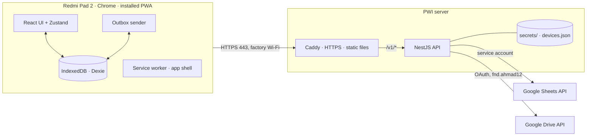
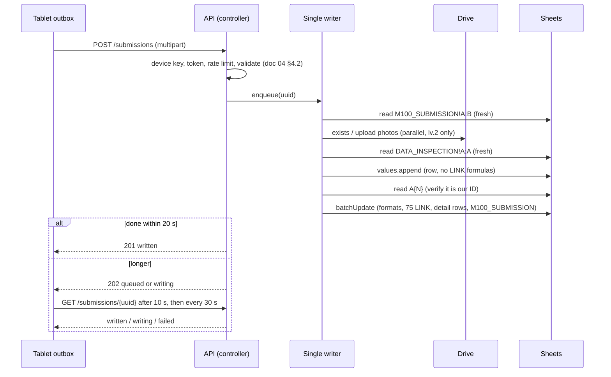

# Mobile 100% Inspection — Technical Design (TDD)

| | |
|---|---|
| Version | 0.2 — Draft for product-owner review (server and tablets known) |
| Date | 16 Oct 2026 |
| Status | Everything here can be built now. The HTTPS method is decided (option A, domain `qdms.web.id`, §7.2, ADR-016); the server is known (Windows, operated by the QIP Digital Team, §7.3). What remains for Phase 4 are the server pre-checks of §7.3. Phases 2 and 3 of [08 Implementation Plan](08-implementation-plan.md) are unblocked by this document. |
| Related | [01 PRD](01-prd.md) NFR-03…NFR-10; [02 Data Design](02-data-design.md) §7–8, §10; [04 API Contract](04-api-contract.md); ADR-004, 005, 011, 014, 015, 016, 017 in [07 Decision Log](07-decision-log.md) |

This document says how the pieces are built and run: what is on the tablet, what is on the server, how a Submit PO travels from one to the other without loss or duplication, and what the server needs from PWI IT. Behaviour that is already specified (columns, endpoints, error codes) is not repeated; it is referenced.

## 1. Inputs and constraints

| Constraint | Source |
|---|---|
| Tablets are Xiaomi Redmi Pad 2 running Chrome, installed as a PWA, shared by several PSI, on factory Wi-Fi that is sometimes weak. | NFR-01, NFR-04, BR-09 |
| The API and the PWA's files run on an existing PWI server. It is reachable over Wi-Fi, has **no HTTPS**, PWI has **no domain of its own**, and the server **can reach the internet** (Google APIs). | ADR-015; answer of 16 Oct 2026 |
| The spreadsheet is the database, shared with a live AppSheet app. Only appends. | ADR-001, BR-07 |
| Sheets API quota: 60 read and 60 write requests per minute per user per project (300 per project); HTTP 429 beyond it, retry with truncated exponential backoff. Verified against Google's [usage limits](https://developers.google.com/sheets/api/limits) on 16 Oct 2026. | ADR-004, NFR-07 |
| A service account has no Drive storage; photos are uploaded with the OAuth credentials of `fnd.ahmad12@gmail.com`. | ADR-011, doc 02 §7 |
| The server runs **Windows** and is operated by the **QIP Digital Team**. | Answer of 16 Oct 2026 |
| **More than 30 tablets** (design target 50), on Wi-Fi that has internet access. | Answer of 16 Oct 2026 |
| No device keyboard in the app except the PO search box. | NFR-02 |
| Load: 30 tablets (design target 50) submitting within the same 5 minutes without losing a submission. | NFR-07 |

## 2. Architecture at a glance



| Part | Responsibility |
|---|---|
| **PWA** (`apps/web`) | All inspection logic and counting, offline. Stores every tap in IndexedDB before confirming it. Holds sealed sessions in the outbox until the API confirms them. |
| **Caddy** | Terminates HTTPS, serves the built PWA files, forwards `/v1/*` to the API. The only process that listens on the network. |
| **API** (`apps/api`) | Authenticates tablets, serves master data and PO search from caches, validates and writes submissions (doc 02 §8). No database of its own. |
| **Google** | Sheets (service account) is the system of record. Drive (owner's OAuth) stores photos. |

Properties that hold everywhere in the design:

1. **A tap never touches the network** (NFR-03). The tablet is the system of record for a session until the API says it is written.
2. **Every network operation is safe to repeat.** The submission UUID, the ID derived from it and the photo file names make a retry converge to the same sheet state (doc 02 §8).
3. **The server keeps no durable state of its own** except the list of device keys. Its in-memory queue can be lost at any time (restart, deploy) and nothing is lost, because the tablet resends (§5.4, doc 04 §5).
4. **One writer.** All writes to the spreadsheet go through one worker, so the API never races itself; races with AppSheet are handled by verification (§5.4).

## 3. Repository layout

```
apps/web/        React + Vite PWA
apps/api/        NestJS API
packages/shared/ types · counting engine · top5 · mapping loader · formatters (id-ID, WIB, sheet dates)
deploy/          Caddyfile · windows/ (install.ps1, upgrade.ps1, WinSW service definitions) · docker/ (optional) · runbook
scripts/         device:add, device:revoke, setup:sheets (Node, run on the Windows server)
secrets/         (git-ignored) service-account.json · drive-oauth.json · devices.json · jwt.key
reference/       prototype and mapping inputs (read only)
docs/
```

`packages/shared` is used by both apps for the three things that must never disagree: the counting rules (ADR-008), the Top 5 order (AC-05.1) and the formatters. The slot planner (§5.5) reuses `top5()`, so the Top 5 the PSI sees on Home is exactly slots 1–5 of the row.

## 4. The PWA

### 4.1 Build and service worker

- Vite + `vite-plugin-pwa` (Workbox, `generateSW`). The service worker **precaches the whole app shell**: HTML, JS, CSS, self-hosted fonts, the shoe image, the mapping fallback. Navigation requests fall back to the cached `index.html`.
- **API calls are never cached by the service worker.** Offline data lives in IndexedDB, written by app code, so it can be versioned, scoped per user and cleared deliberately.
- Web app manifest: `display: standalone`, `orientation: landscape` (portrait and phone widths still work, NFR-01), name "Mobile 100% Inspection", icon from the company logo.
- Requires a secure context (§7.2). On `http://localhost` it works for development.

### 4.2 Local database (Dexie / IndexedDB)

| Table | Key | Holds |
|---|---|---|
| `meta` | key | `deviceKey`, `installedAt`, `appVersion`, `masterDataVersion`, `masterDataFetchedAt` |
| `masterData` | `'current'` | the `/master-data` document as received (users, factories/cells, areas, families, defects, map) |
| `auth` | `'current'` | username, level, factory, cell, token, token expiry |
| `pos` | `[username, po]` | PO details from `/pos`, partial `{number, qty}` or none, `addedAt` |
| `sessions` | `id` | `username`, `po`, `status: open`, `createdAt` |
| `events` | `[sessionId, seq]` | one row per tap: `START_REWORK`, `START_BGRADE`, `NO_DEFECT`, `DEFECT{areaId, subAreaId, familyId, defectId}`, `END`, `UNDO`, with a timestamp |
| `photos` | `[sessionId, defectId]` | JPEG blob (≤ 960 px, ≤ 1 MB), SHA-256, taken-at |
| `outbox` | `submissionUuid` | sealed submission (§4.6) |
| `outboxPhotos` | `[submissionUuid, defectId]` | the photo blobs of a sealed session |
| `view` | `username` | the screen (Home or Defect), the selected PO and the Defect drill-down path, so a restart returns to the same place (doc 05 §4, §8.4, §11.5, AC-06.2); per user because tablets are shared (BR-09) |

**A session is the result of reducing its event list** with the pure functions of `packages/shared`. Persisting events instead of counters makes the rules of persistence trivial: one tap = one IndexedDB write of one event, and the screen is updated from the stored result (NFR-05, AC-06.2). UNDO is an event that the reducer interprets by the four cases of FR-08. Totals, Top 5 and the findings list of FR-09 are derived, never stored.

### 4.3 State and the persistence rule

Zustand holds the current view state (selected PO, drill-down path). Anything that must survive a reload is in Dexie and is written **before** the UI shows its effect. On launch the store is hydrated from Dexie; a reload mid-inspection returns to exactly the same screen state (AC-06.2). The app asks the browser for persistent storage (`navigator.storage.persist()`) at first launch so Chrome does not evict the data under storage pressure.

### 4.4 Shared tablets

- `sessions`, `pos` and `events` carry the username; every query filters by it (AC-02.3). A PSI never sees another's sessions.
- LOGOUT deletes `auth` only. Sessions, POs and photos stay (AC-02.2).
- `outbox` items keep the **author's token** next to the submission, so a submission sealed by PSI A is sent as A even after B has logged in (doc 04 §2). The sender refreshes that token itself if it is within 7 days of expiry.
- The device key is per tablet, not per user, and is not removed by logout.

### 4.5 Photos (PSI lv.2 only)

`<input type="file" accept="image/*" capture="environment">` opens the camera. The image is drawn onto a canvas at most 960 px on its long edge and encoded as JPEG (quality chosen so the result is ≈ 100–200 KB and always ≤ 1 MB), then stored with its SHA-256. One photo per defect: GANTI FOTO replaces the row `[sessionId, defectId]` (AC-10.5). PSI lv.1 never gets the control and never stores a photo (AC-10.6). Behaviour of the `capture` attribute on the Redmi Pad 2 must be checked on the device (risk R8).

### 4.6 Sealing and the outbox

Pressing KIRIM runs **one Dexie transaction**:

1. build the submission JSON (doc 04 §4.1) from the session's events and the PO's partial, **serialise it once to a string**, and compute its SHA-256;
2. write the `outbox` item `{submissionUuid, payloadJson, payloadSha256, authorUsername, authorToken, state: waiting, attempts: 0, nextAttemptAt: now}`;
3. move the session's photos into `outboxPhotos`;
4. mark the session closed and create a new empty session for the PO.

Either all four happen or none, so a session is never both live and sealed, and never lost. The tablet always resends the **stored string**, byte for byte, so the API's hash check (doc 04 §4.3) compares identical bytes; no canonical-JSON library is needed on either side.

**Outbox sender** (a loop inside the app): runs when an item is sealed, when the browser fires `online`, when the app regains focus, and on a 30 s timer. It processes the oldest eligible item, follows the table in doc 04 §5 exactly, and sets `nextAttemptAt` with the back-off 5 s, 15 s, 1 min, 5 min, then every 5 min. It runs **only while the app is open**: items wait on the tablet until someone opens the app, and the header's waiting counter (AC-11.3) is what tells the PSI. Photos of a `Terkirim` item are deleted 7 days later.

### 4.7 Master data

On launch and at most every 30 minutes while open (AC-13.2) the app calls `GET /master-data` with `If-None-Match`; `304` keeps the stored copy. If the call fails the stored copy is used; with no stored copy the login screen shows RETRY (AC-01.4). PO search needs a connection (AC-13.3); POs already added keep their details in `pos`.

### 4.8 Updating the app

A new build produces a new service worker that **waits** instead of taking over. The app activates it only when no inspection is active (on the login screen, on Home with no active inspection, or at the next cold start), then reloads. It never reloads in the middle of an inspection. The version is sent as `appVersion` with every submission and stored in `M100_SUBMISSION.APP_VERSION`. API changes are additive within `/v1` (doc 04 §1), so an old tablet keeps working until it updates.

### 4.9 Registering a tablet (device key)

The device key is a secret that the PSI never types and the app has no screen to type it. The administrator opens the **setup link** `https://<host>/setup#k=<device key>` in Chrome on the tablet (typed in the address bar once, or scanned from a QR code printed by the `device:add` script). The setup page reads the fragment, saves the key in `meta`, immediately removes the fragment from the address (`history.replaceState`), and checks it with `GET /system/status`: `200` shows "Tablet terdaftar", `401 DEVICE_KEY_INVALID` says the key is wrong. A fragment is never sent to the server. Chrome may still keep the link in its history, so the administrator clears the history after setup; the key is revocable per tablet, which limits the damage.

To check on a real Redmi Pad 2 (risk R9): that the data saved while the page runs in Chrome is visible when the installed app runs. If it is not, setup moves into the installed app as a one-time screen with a paste field.

## 5. The API

### 5.1 Modules

| Module | Contents |
|---|---|
| `ConfigModule` | Reads environment variables and validates them at start-up (fails fast, names the missing variable). |
| `AuthModule` | `DeviceKeyGuard` (looks up the SHA-256 of `X-Device-Key` in the device list, constant-time compare), `JwtGuard` (HS256, claims `sub`, `lvl`, `fac`, `cel`, `dev`, 30 days), `/auth/login`, `/auth/refresh`. A token whose `dev` is revoked is rejected even if unexpired. |
| `GoogleModule` | `SheetsClient` (service account) and `DriveClient` (OAuth refresh token), each wrapped by the retry/back-off helper (§5.7). The only code that imports `googleapis`. |
| `MasterDataModule` | Repositories for users, cells, defects, area map; the cached `/master-data` document with its ETag; the start-up validation of doc 02 §10; `/system/status`. |
| `PoModule` | The in-memory PO index and `/pos`. |
| `SubmissionsModule` | Controller, request validation (doc 04 §4.2), the job registry, the single-writer worker and the pipeline (§5.4), the pure `SlotPlanner` and `RowBuilder` (§5.5). |
| `DevicesModule` | Loads `devices.json`, reloads it when the file changes, exposes lookups to the guard. No HTTP endpoints. |
| `HealthModule` | `/health`. |

### 5.2 Repository interfaces

Controllers and services depend on interfaces only (ADR-004). Each has a Google implementation and an **in-memory fake** that tests use; the fake can inject 429s, timeouts and crashes between calls.

```ts
interface UsersRepository     { listPsi(): Promise<PsiUser[]> }
interface CellsRepository     { listFCells(): Promise<Cell[]> }
interface DefectsRepository   { list(): Promise<Defect[]> }          // D001–D098, severity
interface AreaMapRepository   { list(): Promise<AreaMapRow[]> }      // ACTIVE rows
interface PoRepository        { loadAll(): Promise<PoRow[]> }
interface InspectionRepository {
  readIds(): Promise<Set<string>>                                     // DATA_INSPECTION!A:A, fresh
  linkTemplates(): Promise<LinkTemplates>                              // 75 formulas of the last data row
  append(row: Cell[]): Promise<{ rowNumber: number }>                  // values.append
  complete(args: CompleteArgs): Promise<void>                          // the one batchUpdate
  idAt(rowNumber: number): Promise<string | null>                      // verify read
}
interface SubmissionLogRepository { findDiId(uuid: string): Promise<string | null> } // M100_SUBMISSION!A:B
interface PhotoStore {
  exists(fileName: string): Promise<boolean>
  put(fileName: string, jpeg: Buffer): Promise<void>
  canList(): Promise<void>                                             // start-up check 6
}
```

### 5.3 Caches and refresh

| Cache | Source | Refresh | On failure |
|---|---|---|---|
| Master document (users, cells, defects, map) and ETag | 4 sheets | at start and every 30 min (AC-13.2) | keep the last good copy, log, `/master-data` still answers; with no copy yet → `503` |
| PO index | `ALL_PO_MASTER` (the 9 columns of doc 02 §3.3, ≈ 71,500 rows) | at start and every 30 min | same |
| Link templates | last data row of `DATA_INSPECTION` | re-read at each start-up check | disables Submit PO if missing or inconsistent (doc 02 §7) |

The PO index is an array of objects plus one pre-lowercased search string per row. A search scans it with `indexOf` and stops at 20 hits; with ≈ 71.5k rows this is a few milliseconds and ≈ 50 MB of memory.

**Start-up checks** (doc 02 §10) run when the process starts, then every 30 minutes, and **every 2 minutes while Submit PO is disabled**, so a repaired Drive consent or sheet header re-enables submitting without a restart. Each check has an `id` in `/system/status`; in addition to the ids in doc 04, the API uses `SHEETS_ACCESS`. A Google `401/403/404` met during a write also flips the matching check to failed at once instead of waiting for the timer.

### 5.4 The Submit PO pipeline



**Steps** follow doc 02 §8.2 exactly. The additions made here:

- The two lookups of steps 1 and 3 read the ID column **fresh**, not from a cache: they decide whether to write, and the columns are small (5,400 and a few hundred cells). A stale cache could miss a row written seconds earlier by a previous attempt.
- After `values.append`, the response gives the row number *N*. The worker reads `A{N}` and checks it equals our ID. If another writer (AppSheet) took the row first, it searches column A for the ID; if the ID is absent it appends again (same ID, safe). The LINK formulas and the format copy go **only** to the verified row.
- Photos are uploaded in parallel (at most 5, one per Top 5 defect) before any row is appended, so a row never points to a missing file.
- The worker takes one job at a time. Expected time per submission: ≈ 3 s for a PSI lv.1, ≈ 6 s for a PSI lv.2 with five photos (to be measured, T3.8), so one worker handles roughly 10 to 20 submissions a minute. Real traffic is far lower (about 290 PSI rows a month today, with bursts at the end of a shift). The NFR-07 worst case of 50 tablets submitting within 5 minutes is ≈ 10 a minute: at the limit for PSI lv.2, but nothing is lost, because later tablets get `202` and poll. If T3.8 shows a p95 above 6 s, photo uploads of different submissions are run in parallel (the ID, and so the file names, depend only on the UUID). Sheets use is 3 reads + 2 writes per submission, below 60 a minute.

**Job states** are kept in an in-memory registry `uuid → {state, payloadSha256, result|problem, updatedAt}`: `queued → writing → written | failed`. Terminal states are kept 24 hours. The registry is rebuilt from nothing after a restart.

**Answering the tablet.** The controller waits for the job for up to **20 s** and answers `201` if it finished, otherwise `202` (doc 04 §4.4). `GET /submissions/{uuid}` answers from the registry; if the UUID is not in the registry it asks `M100_SUBMISSION` (written → `200`-style result) and otherwise answers `404 SUBMISSION_NOT_FOUND`.

**Server restart while a job was queued.** The registry is gone, so the tablet's poll gets `404`. The tablet resends the same UUID and the same bytes (doc 04 §5, added in v1.1). The pipeline is idempotent, so if the earlier attempt had already written the row, the resend returns it.

**Where a crash can leave things**, and what the retry does:

| Crashed after | Left behind | The retry |
|---|---|---|
| Validation | nothing | starts normally |
| Some photos uploaded | some files in `DATA_INSPECTION_Images` | step 2 skips files that exist, uploads the rest |
| `values.append` | a row with the right ID and no LINK formulas | step 3 finds the ID, goes to the batch |
| `batchUpdate` (it is one atomic request) | either nothing or everything | repeats it or finds `M100_SUBMISSION` complete |

A row without LINK formulas exists for a few seconds at most under normal operation (between the append and the batch). AppSheet reading it in that window sees empty LINK cells, which does not change its behaviour for later rows.

### 5.5 Pure functions (no I/O, golden-tested)

| Function | Input → output |
|---|---|
| `computeTotals(counts, findings)` | doc 04 §4.1 table → Qty Inspection, A-Grade, Qty Defect, B-Grade, RFT, Defect Rate |
| `planSlots(findings, photos, defects)` | group by `DEFECT_ID`; order by quantity, severity, first recorded (**the same `top5()` as the tablet**, doc 02 §6.2); first 25 get slots; move photographed defects ahead of unphotographed ones only when they would overflow (doc 02 §6.3) |
| `buildDataInspectionRow(...)` | the 276 cells of doc 02 §5–6 as an array (LINK cells empty at append time) |
| `buildCompleteRequest(...)` | the `batchUpdate` body: format copy, 75 `formulaValue`s from the templates with the row number substituted, detail rows, submission row |
| `photoFileName(id, slot, sealedAt)` | `<ID>.PHOTO<3n−2>.<HHmmss>.jpg` |
| `submissionId(uuid, taken)` | first 8 hex of SHA-256, next 8 on collision (doc 02 §8.1) |
| `sheetDate(date)` / `partialText(...)` | WIB date serial; `P1 1.200 OF 10.002` with `Intl.NumberFormat('id-ID')` (Node 22 ships full ICU) |

Values go in with `valueInputOption=RAW` so no text is ever interpreted as a formula; the LINK formulas are the only formulas, written through `updateCells`/`formulaValue`.

### 5.6 Limits and rate control

- Per device: 60 requests per minute (`@nestjs/throttler`, keyed by device ID; unknown keys by IP, 20 failed key attempts per minute per IP are refused). Beyond it: `429 RATE_LIMITED` with `Retry-After`.
- Request body ≤ 8 MB, each photo part ≤ 1 MB; checked by the multipart parser (memory storage) before validation. Photo parts must start with the JPEG signature `FF D8 FF`; the server does not re-encode photos.
- One worker means at most 3 reads and 2 writes per submission to Sheets. Master refreshes add 5 reads every 30 minutes. If Google answers `429`, the helper waits `2^n` s + up to 1 s jitter (cap 32 s) and retries the same call, as Google recommends.

### 5.7 Google errors → behaviour

| From Google | The API does | Tablet sees |
|---|---|---|
| `429` | back off and retry the same call; the job stays `writing` | `202` after 20 s, then `written` |
| `5xx`, timeout, connection reset | retry with the same back-off for up to 10 minutes, then the job becomes `failed` with `GOOGLE_UNAVAILABLE` (retryable) | `503` / failed-retryable → Menunggu koneksi, resend |
| `401`/`403`/`404` on Sheets or Drive, `invalid_grant` | flip `SHEETS_ACCESS` or `DRIVE_ACCESS` to failed, `submitEnabled=false`; fail the job as retryable | `503 SUBMIT_DISABLED` with the reason; the tablet keeps retrying every 5 min |
| `400` (a bug in our request) | log the request id, body and Google's message; `INTERNAL` | `500`, retried with back-off; needs a developer |

### 5.8 Logging and monitoring

JSON logs (pino) written to files under `logs/` and rotated by size and age (the WinSW service wrapper captures the console output as a second source). Every request has `requestId`; every submission logs `submissionUuid`, `diId`, `username`, `po`, `photoCount`, `durationMs`, `result` (NFR-10). Device keys, tokens and photo bytes are never logged. `GET /health` is for an uptime check by QIP Digital; `GET /system/status` shows why submitting is disabled. Alert-worthy lines: `SUBMIT_DISABLED` for more than 10 minutes, five consecutive `GOOGLE_UNAVAILABLE`, any `INTERNAL`.

## 6. Security

| Threat | Control | Residual risk |
|---|---|---|
| Someone outside the factory network reaches the API | Server is not exposed to the internet (firewall: 443 from the tablet network only). Every call also needs a device key. | None beyond the network boundary |
| Sniffing of keys and tokens on Wi-Fi | HTTPS with a certificate Chrome trusts (§7.2) | Low |
| A tablet is lost or stolen | Revoke its device key (`device:revoke`); its tokens stop working at once because every request checks the device. Unsent sessions on it are lost with it. | Data on the tablet, until revoked |
| One PSI logs in as another | Known and accepted (ADR-006); limited to registered tablets (ADR-014) | Accepted |
| Device key guessing | 256-bit random key; only its SHA-256 is stored; constant-time compare; per-IP failure limit | Negligible |
| Server compromise | Secrets are read-only files for the API user; no secret is in the repo, image or logs. The service account can edit the whole spreadsheet (Sheets has no append-only role), so append-only is enforced by code and by tests (BR-07). The Drive token has the broad `drive` scope on the owner's Drive. | **Accept consciously:** whoever takes the server can alter the spreadsheet and the owner's Drive. Keep the server patched and the secrets backup restricted. |
| Malicious input | Schema validation with unknown fields rejected; `RAW` writes; JPEG signature check; size limits | Low |
| Cross-site content | Same-origin app and API; CSP `default-src 'self'; img-src 'self' blob: data:; connect-src 'self'`; `X-Content-Type-Options: nosniff`; `Referrer-Policy: no-referrer`; HSTS once HTTPS is stable | Low |

Secrets and their handling:

| Secret | Used for | Who holds it | If lost or leaked |
|---|---|---|---|
| Service-account key `service-account.json` | Sheets read/write | Server `secrets/`; the spreadsheet is shared with the account as Editor | Create a new key, delete the old one in Google Cloud |
| Drive OAuth client + refresh token (`drive-oauth.json`) for `fnd.ahmad12@gmail.com`, scope `https://www.googleapis.com/auth/drive` | Photo upload | Server `secrets/` | Owner revokes access in the Google account; re-run consent |
| `jwt.key` (≥ 32 random bytes) | Signing tokens | Server `secrets/` | Replace it; every PSI logs in again |
| `devices.json` (SHA-256 of each device key, label, created, revoked) | Device list | Server `secrets/` | Re-issue keys |
| Cloudflare API token `CF_API_TOKEN` (Zone Read + DNS Edit on `qdms.web.id` only) | Certificate issue and renewal (§7.2.1) | Server `.env` | Delete the token in Cloudflare and create a new one; certificates already issued stay valid |

**Drive consent trap.** A Google Cloud project whose OAuth consent screen is "External" and still in **Testing** has refresh tokens that Google revokes after 7 days ([source](https://nango.dev/blog/google-oauth-invalid-grant-token-has-been-expired-or-revoked)). The consent screen must be set to **In production** before the real token is issued (Google then shows an "unverified app" warning once, which the owner accepts for their own project). A token unused for six months also lapses, which daily photo uploads prevent. Start-up check 6 (doc 02 §10) catches a lapsed token, and the 2-minute re-check re-enables submitting after the owner consents again.

## 7. Deployment

### 7.1 Topology

One Windows server, two processes, each installed as a Windows service (§7.3):

```
tablets ──HTTPS 443──▶ caddy ──▶ /            static files (apps/web/dist)
                                └▶ /v1/*      127.0.0.1:3000  (NestJS, not exposed)
                       api ──HTTPS──▶ sheets.googleapis.com · www.googleapis.com · oauth2.googleapis.com
```

- Caddy serves the PWA files itself with the right cache headers: `index.html` and the service-worker file `no-cache`, hashed assets `immutable`, `/v1/*` `no-store`. The API does not serve static files.
- The API listens only on `127.0.0.1`. Windows Firewall allows inbound 443 (Caddy) from the tablet network only.
- Both services start with Windows and restart on failure (service recovery options). Windows Update must not reboot the server in the middle of a shift: set active hours or a maintenance window. Time zone `Asia/Jakarta`; the clock is kept by Windows Time (NTP), because token expiry and Google's OAuth reject a skewed clock.
- Sizing: 1 vCPU, 2 GB RAM and 10 GB of disk are enough (the PO index is ≈ 50 MB; the API stores no photos).

### 7.2 HTTPS (ADR-016, accepted)

**Decision (16 Oct 2026): option A.** The product owner owns the domain `qdms.web.id`, with DNS on Cloudflare. The app is served at **`https://m100.qdms.web.id`** (the sub-domain name is to be confirmed before the pilot, see the warning below). The other options stay for the record. Setup steps are in §7.2.1.

Chrome runs service workers and offers installation only on HTTPS (or `localhost`). The tablets must therefore open the app through an `https://` address whose certificate they trust. PWI has no domain; the options are:

| Option | How it works | Per-tablet work | Needs | Verdict |
|---|---|---|---|---|
| **A. A domain of our own** (chosen) | The QIP team or PWI registers any domain (a `.id` or `.com`, roughly Rp 200–300 thousand a year, in the company's name). A record `m100.<domain>` points to the server's LAN IP. Caddy obtains a free, publicly trusted Let's Encrypt certificate with the **DNS challenge** (the domain's DNS provider must have an API; a free Cloudflare DNS zone works) and renews it automatically. | **None.** | A domain, a DNS provider with an API token; tablets must resolve the name to a private IP (some routers block public DNS answers that point to private addresses; then add the name to the router's local DNS). | Best experience, small yearly cost |
| **B. Internal certificate authority** | Caddy (or `step-ca`) acts as the factory's own CA. Its root certificate is installed on every tablet (Android Settings → security → install certificate → CA certificate; the menu name differs in HyperOS). The app is opened by the server's **fixed IP** (`https://192.168.x.y`) or an internal name. | Install the root certificate on each tablet once (a few minutes each); redo for any new or reset tablet. | A fixed IP (DHCP reservation); control of the tablets; the CA's private key kept safe on the server. | Free and works without internet; more manual, and a leaked CA key lets its holder intercept HTTPS on trusted tablets, so use these tablets for this app only |
| C. Free dynamic-DNS hostname | A free subdomain from a DDNS service, with a Let's Encrypt certificate via the DNS challenge. | None. | A free third-party service. | Possible for a pilot; production then depends on a free service |
| D. Cloudflare Tunnel | Public HTTPS address in front of the server. | None. | A domain on Cloudflare (so it adds nothing over A) and internet on the tablets; quick tunnels change address at each restart. | Not suitable |
| E. Chrome flag `unsafely-treat-insecure-origin-as-secure` | Tell Chrome on each tablet to treat the HTTP address as secure. | Set the flag on every tablet, again after a Chrome reset. | Nothing | **Test only.** Keys and tokens still travel in clear text |

**Choose before the pilot, and do not change it afterwards.** A browser stores data per *origin*: a different host name, or a different IP in option B, is a different origin with an empty IndexedDB, so a tablet would lose its device key and any unsent sessions. In option B the server's IP must therefore never change. The application code is identical for every option; only the `tls` line of the Caddyfile and the one-time setup differ.

### 7.2.1 Setting up option A with Cloudflare (once)

Needed: access to the registrar panel of `qdms.web.id` (to change its name servers) and a Cloudflare account (the free plan is enough).

1. **Find out what the domain is used for today.** If `qdms.web.id` already serves a website or e-mail, write down every DNS record in the registrar panel first. Moving the name servers moves *all* DNS of the domain to Cloudflare, so each existing record must exist there too, or that service breaks.
2. **Add the domain in Cloudflare** (Add a domain → `qdms.web.id` → Free plan). Cloudflare imports the records it finds; compare them with step 1 and add what is missing.
3. **Change the name servers at the registrar** to the two Cloudflare names shown. Wait until Cloudflare shows the domain as *Active* (minutes to a day).
4. **Create the DNS record**: type `A`, name `m100`, value = the server's LAN IP (a reserved address, for example `192.168.x.y`), proxy status **DNS only (grey cloud)**. Cloudflare's proxy cannot reach a private address, so a proxied record would break the app.
5. **Create an API token** (My Profile → API Tokens → Create Token → Custom) with *Zone → Zone → Read* and *Zone → DNS → Edit*, resources limited to the zone `qdms.web.id`. Save it on the server as `CF_API_TOKEN` (§7.4). The Caddy module documents a two-token variant (a read token for zones, an edit token for DNS); use it if Caddy cannot find the zone with one token.
6. **Get a Caddy for Windows that includes the Cloudflare module** (done by T4.1): download it from Caddy's download page with the `caddy-dns/cloudflare` module selected, or build it with `xcaddy build --with github.com/caddy-dns/cloudflare` (needs Go). A plain Caddy download does not contain the module. Install it as a Windows service (WinSW) with the environment variables `CF_API_TOKEN` and `XDG_DATA_HOME` (a folder that is backed up) set for the service.
7. **Caddyfile** (a sketch; T4.1 produces and tests the real one):
   ```
   m100.qdms.web.id {
       tls {
           dns cloudflare {env.CF_API_TOKEN}
       }
       encode zstd gzip
       handle /v1/* {
           header Cache-Control "no-store"
           reverse_proxy 127.0.0.1:3000
       }
       handle {
           root * C:/m100/current/web
           header /index.html Cache-Control "no-cache"
           header /sw.js Cache-Control "no-cache"
           header /assets/* Cache-Control "public, max-age=31536000, immutable"
           try_files {path} /index.html
           file_server
       }
   }
   ```
   Caddy asks Let's Encrypt for the certificate, proves ownership by creating a temporary TXT record through the Cloudflare API, and renews it by itself about 30 days before it expires. No inbound port from the internet is needed.
8. **Check.** From a laptop on the factory Wi-Fi, `nslookup m100.qdms.web.id` returns the LAN IP; `https://m100.qdms.web.id/v1/health` opens without a warning and the certificate is issued by Let's Encrypt. Then open the address in Chrome on the Redmi Pad 2.
9. **If a tablet cannot resolve the name.** Some routers and firewalls drop public DNS answers that point to private addresses ("DNS rebind protection"). Add `m100.qdms.web.id → LAN IP` to the router's or firewall's local DNS, or exempt the name from rebind protection.

The DNS record shows the server's LAN IP to anyone who looks the name up. A private address cannot be reached from outside, so this is harmless, but it is the reason the server must never be exposed to the internet (§6). **Keep the domain renewed**: if it lapses, the name stops resolving and certificates cannot be renewed, and every tablet loses the app. Turn on auto-renew at the registrar and record the expiry date in the runbook.

### 7.3 What the server needs

| Need | Detail |
|---|---|
| Operating system | **Windows** (16 Oct 2026). Reference deployment: Node.js 22 LTS and Caddy, each installed as a Windows service with WinSW by the PowerShell scripts of T4.1, under a dedicated low-privilege service account; the folders `secrets/` and `.env` are readable by that account and administrators only. Docker is not needed and is not assumed; Docker Desktop adds a Linux virtual machine and may need a paid licence in a company of PWI's size. |
| Network in | TCP 443 from the tablet network (Windows Firewall rule); nothing from the internet. A fixed IP or DHCP reservation. Port 443 must not already be used (for example by IIS). |
| Network out | HTTPS to `sheets.googleapis.com`, `www.googleapis.com`, `oauth2.googleapis.com`; for the certificate also `api.cloudflare.com` and `acme-v02.api.letsencrypt.org`. Google APIs confirmed reachable from the PWI server on 16 Oct 2026; Cloudflare and Let's Encrypt are to be tested. |
| Time | NTP synchronised. |
| People | The **QIP Digital Team** operates the server: patches, backups, restarts, certificate and token renewals, device keys. |

**Pre-checks on the server before T4.1 (TQ-5):** Windows version (Node.js 22 needs a currently supported Windows: Windows 10 / Server 2016 or newer, see Node's platform list); port 443 free; at least 2 GB free RAM and 10 GB disk; `curl -I https://api.cloudflare.com` and `curl -I https://acme-v02.api.letsencrypt.org/directory` answer; DHCP reservation for `192.168.43.175`; a remote-access method for QIP Digital.

### 7.4 Configuration

Configuration (a `.env` file in the install folder and service environment variables; readable only by the service account; never committed):

| Variable | Meaning |
|---|---|
| `SHEET_ID` | Spreadsheet to use. Development and tests: the **copy**. Production: the real one, set only by the operator. |
| `DRIVE_IMAGES_FOLDER_ID` | Folder `DATA_INSPECTION_Images` (development: a test folder). |
| `GOOGLE_SA_KEY_FILE`, `GOOGLE_OAUTH_FILE`, `JWT_KEY_FILE`, `DEVICES_FILE` | Paths under `secrets/`. |
| `MASTER_REFRESH_MINUTES` (30), `SUBMIT_WAIT_SECONDS` (20), `SUBMIT_RETRY_MINUTES` (10) | Tunables with the defaults of doc 04 and §5. |
| `PUBLIC_HOST` | `m100.qdms.web.id`, used in the Caddyfile and the setup link. |
| `CF_API_TOKEN` | Cloudflare token for the certificate (§7.2.1). |
| `TZ` | `Asia/Jakarta` |
| `LOG_LEVEL` | `info` |

### 7.5 Tablet provisioning and shared-tablet practice

1. Operator runs `pnpm --filter api device:add --label "Tablet F3-01"`. It generates a 32-byte random key, stores only its SHA-256 in `devices.json`, and prints the key, the setup link and a QR code. The API reloads the file by itself. For 30+ tablets, `device:add --batch tablets.csv` creates every key at once and prints a sheet of QR codes with labels, one per tablet. Plan about 5 minutes per tablet for steps 2–3, so 30 tablets are about a day's work for two people.
2. On the tablet: open the setup link in Chrome (§4.9), confirm "Tablet terdaftar", choose **Install app** in Chrome, open it from the home screen, clear Chrome's history for the site.
3. A PSI logs in with name, factory and cell. A second PSI on the same tablet logs out the first and logs in; unsent submissions of the first stay and are sent under the first's name (§4.4).
4. Lost tablet: `device:revoke --label "Tablet F3-01"`. Replaced tablet: `device:add` again.
5. Never use Chrome's "clear site data" or uninstall the app while the header shows waiting submissions: that deletes unsent sessions. Put this in the PSI instruction card.

### 7.6 Backup, recovery, upgrade

- **Back up** `secrets/` (all five files) and the Caddy data folder (`XDG_DATA_HOME`: certificates and account) on the server's usual backup, restricted to QIP Digital. The spreadsheet and Drive are the system of record and are not backed up by this system.
- **Recover** a lost server: install Node and Caddy with `install.ps1`, restore `secrets/` and the Caddy data folder, start the services. Tablets keep working offline meanwhile and send when it returns.
- **Upgrade**: `upgrade.ps1` unpacks the new release next to the old one (`C:\m100\releases\<version>`), switches the `current` junction, restarts the API and keeps the previous release for rollback; do it at a shift change. In-flight jobs are lost from memory and resent by the tablets (§5.4).

## 8. Testing strategy

| Level | What | Tool |
|---|---|---|
| Unit | Counting engine against the ADR-008 table and FR-08; `top5`; `planSlots`; `buildDataInspectionRow` and `buildCompleteRequest` against **golden files** built from a real AppSheet row (276 cells, 75 LINK formulas); `sheetDate`, `partialText`, `submissionId` | Vitest |
| API integration | Every endpoint against the in-memory fakes, validated against `04-openapi.yaml`; all checks of doc 04 §4.2; auth and revocation | Jest + supertest |
| Idempotency and faults | Crash injected after photos, after append, before and inside the batch; duplicate and conflicting UUIDs; 429 storms; Google down for 10 minutes; restart with a queued job | Jest with the fake Sheets/Drive |
| Load | 30 simulated tablets submitting within 5 minutes with 5 photos each against the fakes with realistic latency and 429s: no loss, no duplicate, p95 per submission measured | Script (k6 or Node) |
| Real-sheet check | The pipeline against a **copy** of the spreadsheet and a test Drive folder: row identical in shape to an AppSheet row (formats, LINK formulas, photo opens in AppSheet) | Manual, env-gated test, run by a person |
| Web | Playwright for each flow of the plan, offline mode on, reload mid-inspection, shared tablet, outbox states against a stub API | Playwright |
| Device | Camera `capture`, install, setup link storage, offline start, certificate trust, on a real Redmi Pad 2 | Manual checklist (T4.2, T4.4) |
| Server | `install.ps1` on a clean Windows VM, reboot, upgrade and rollback, certificate issue through Cloudflare | Manual (T4.1) |

## 9. Risks and open items

| # | Risk or open item | Handling |
|---|---|---|
| ~~TQ-1~~ | **HTTPS method.** Decided 16 Oct 2026: option A with the domain `qdms.web.id` on Cloudflare (ADR-016). Confirm the sub-domain name `m100` before the pilot. | — |
| ~~TQ-2~~ | **Server operating system.** Decided 16 Oct 2026: Windows, native services, no Docker (T2). | — |
| ~~TQ-3~~ | **Tablets.** Answered 16 Oct 2026: more than 30 (design target 50), Wi-Fi with internet. | — |
| ~~TQ-4~~ | **Who operates the server.** Answered 16 Oct 2026: the QIP Digital Team. | — |
| TQ-5 | **Server pre-checks** (§7.3): Windows version, port 443 free, RAM and disk, outbound reach to Cloudflare and Let's Encrypt, DHCP reservation, remote access. | QIP Digital, before T4.1 |
| R2 | Drive consent left in "Testing" → token dies after 7 days (§6). | Consent screen "In production"; start-up check 6; runbook step |
| R3 | A write by AppSheet at the same instant as the append. | Verify read of `A{N}` and re-append (§5.4) |
| R4 | Photos fill the owner's personal Drive (15 GB shared with Gmail). | Check the owner's usage before the pilot; estimate ≈ 1–2 GB a year |
| R5 | Unsent sessions are lost if Chrome data is cleared or the tablet is lost (ADR-003). | `storage.persist()`, installed PWA, instruction card, visible waiting counter |
| R6 | The outbox only sends while the app is open. | Counter in the header; PSI instruction: open the app at the end of the shift |
| R7 | Tablet clock wrong → `sealedAt` rejected (> 5 min in the future) or wrong `DATE`. | The date is taken from `sealedAt` in WIB; a clear message on rejection; tablet time set to automatic |
| R8 | `capture="environment"` behaviour on the Redmi Pad 2. | Device checklist (T1.5 on real tablet) |
| R9 | Data saved in Chrome (setup link) may not be visible to the installed app. | Device checklist; fallback in §4.9 |
| R10 | One server, no standby: during an outage submissions wait on tablets. | Accepted for release 1 |
| R11 | Sheet reaches the 10M-cell limit around mid-2028 (doc 02 §11). | Owner cleanup and yearly archive; repository layer allows another store |
| R12 | The service account can edit anything in the spreadsheet. | Append-only enforced by code and tests; accepted |
| R13 | The domain lapses or its Cloudflare account is lost: the name stops resolving and certificates stop renewing. | Auto-renew; expiry date and the account owner in the runbook; a second administrator on the Cloudflare account |
| R14 | The router drops DNS answers that point to private addresses. | Local DNS entry on the router or firewall (§7.2.1 step 9) |
| R15 | Moving the name servers to Cloudflare breaks something that already uses `qdms.web.id`. | Step 1–2 of §7.2.1: list and recreate every record before switching. **Checked 16 Oct 2026:** the zone is Active on Cloudflare, the website records were imported, e-mail on the domain is not used, and the `m100` record exists (DNS only, LAN IP) |
| R16 | Windows Update reboots the server during a shift; or a service does not start after a reboot. | Maintenance window; service recovery options; reboot test in T4.1 |
| R17 | Setting up 30+ tablets by hand is slow and error-prone. | Batch device keys and a QR sheet (§7.5); a setup checklist; consider Android device management later |

## 10. Decisions taken in this document

| # | Decision | Why |
|---|---|---|
| T1 | Caddy serves static files and terminates HTTPS; the API serves only `/v1`. | One process owns TLS and caching headers; the API stays simple |
| T2 | Reference deployment is two Windows services (Caddy and the Node API), installed and upgraded by PowerShell scripts. Docker Compose stays an optional alternative. | The server is Windows and operated by QIP Digital; Docker would add a Linux virtual machine the server does not otherwise need |
| T3 | No database. The API's job registry is in memory; the **tablet is the durable store** until the API confirms; a lost registry is repaired by resending. | Fewer parts to run; safe because of idempotency |
| T4 | A session is stored as an event list and reduced by the shared engine. | One write per tap, trivial restore, UNDO is just another event |
| T5 | The outbox sends only while the app is open. | Background Sync is not reliable enough to depend on; the counter makes waiting visible |
| T6 | Idempotency lookups read the ID columns fresh, and the appended row is verified before the batch. | A stale cache or a concurrent AppSheet write must not corrupt a row |
| T7 | A new service worker never takes over during an inspection. | Avoids reloads that interrupt the PSI |
| T8 | The start-up checks repeat every 30 minutes, and every 2 minutes while Submit PO is disabled. | A repaired consent or sheet re-enables submitting without a restart |
| T9 | The device key is delivered through a setup link fragment and stored by the app; no typing in the app. | Keeps NFR-02 intact; the key stays revocable per tablet |
| T10 | Certificates come from Let's Encrypt through Caddy's Cloudflare DNS challenge; the DNS record is DNS-only and points to the server's LAN IP. | Publicly trusted certificate on a private address, no setup on the tablets, no inbound internet port |
| T11 | Both services are wrapped with WinSW (a maintained service wrapper that Caddy's documentation also recommends for Windows). | One mechanism for both services; restart on failure; log capture |
| T12 | Design and load-test target is 50 tablets (more than 30 are planned). | Headroom over the NFR-07 figure of 30 |
