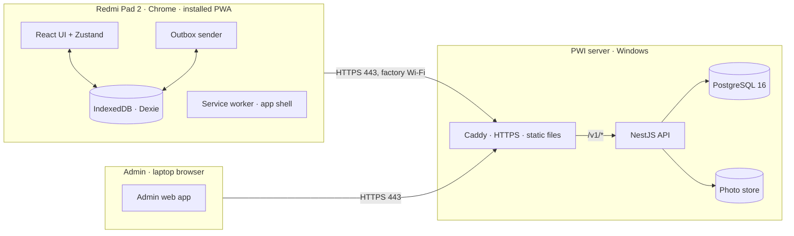
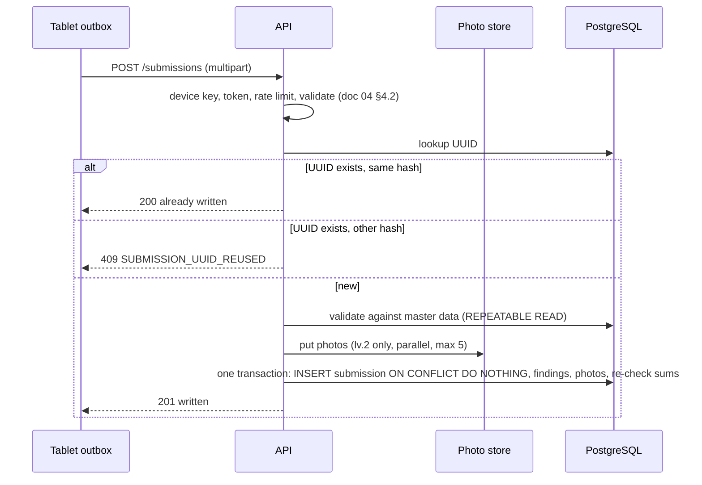

# Mobile 100% Inspection — Technical Design (TDD)

| | |
|---|---|
| Version | 0.3 — PostgreSQL + photo store + admin app (ADR-018) |
| Date | 20 Oct 2026 |
| Status | Replaces v0.2, which was built on Google Sheets and Drive. Everything here can be built now. The HTTPS method is decided (option A, `m100.qdms.web.id`, §7.2, ADR-016); the server is known (Windows, operated by QIP Digital). Photo store decided: a plain folder for release 1 (§5.2). Open: the server pre-checks of §7.3. |
| Related | [01 PRD](01-prd.md); [02 Data Design](02-data-design.md) v2.0; [04 API Contract](04-api-contract.md) v2.0; ADR-004, 005, 014, 015, 016, **018** in [07 Decision Log](07-decision-log.md) |

This document says how the pieces are built and run: what is on the tablet, what is on the server, how a Submit PO travels from one to the other without loss or duplication, and what the server needs from PWI IT. Behaviour that is already specified (tables, endpoints, error codes) is referenced, not repeated.

## 1. Inputs and constraints

| Constraint | Source |
|---|---|
| Tablets are Xiaomi Redmi Pad 2 running Chrome, installed as a PWA, shared by several PSI, on factory Wi-Fi that is sometimes weak. | NFR-01, NFR-04, BR-09 |
| The API and the PWA's files run on a PWI server (Windows), operated by the QIP Digital Team. It is reachable over Wi-Fi; the domain `qdms.web.id` is owned by the product owner and served by Cloudflare DNS. | ADR-015, ADR-016 |
| The system of record is **PostgreSQL 16**; photos go to an S3-compatible object store or a folder behind a `PhotoStore` interface. Google is not used. | ADR-018 |
| The old AppSheet / Google Sheet is **not touched** by M100. Reports come from PostgreSQL views. | ADR-018 |
| Master data is imported once from files and then kept in an admin web app. | ADR-018 (replaces ADR-007) |
| **More than 30 tablets** (design target 50). | Answer of 16 Oct 2026 |
| No device keyboard in the app except the PO search box. | NFR-02 |
| Load: 30 tablets (design target 50) submitting within the same 5 minutes without losing a submission. | NFR-07 |

## 2. Architecture at a glance



| Part | Responsibility |
|---|---|
| **PWA** (`apps/web`) | All inspection logic and counting, offline. Stores every tap in IndexedDB before confirming it. Holds sealed sessions in the outbox until the API confirms them. |
| **Admin app** (`apps/admin`) | Small web app for the administrators: PSI users, factories and cells, POs and imports, defects and area map, a read-only DataTable of submissions (view, photos, CSV export), admins, audit log. Tablets are registered by server commands. Served by Caddy at `/admin/`. As built (T3b.4): React + Vite with `base: '/admin/'`, no service worker; the design-system components come from `apps/web/src/ui` through the alias `@m100/ui` (one copy for both apps); a small own path router (`/admin/<page>`, filters kept in the query); the session is the API's cookie, a `401 ADMIN_AUTH_REQUIRED` or the end of the 8 hours returns to A0 with "Sesi berakhir. Silakan masuk lagi."; unsaved dialogs ask before closing, before the back button and before the tab closes. Decided by the product owner (23 Oct 2026): the own password is changed in a "Ganti password" dialog opened from the username in the header (`POST /admin/me/password`), and A4 has `TAMBAH` for one PO (`POST /admin/pos`). |
| **Caddy** | Terminates HTTPS, serves the built PWA and admin files, forwards `/v1/*` to the API. The only process that listens on the network. |
| **API** (`apps/api`) | Authenticates tablets and admins, serves master data and PO search, validates and writes submissions in one database transaction (doc 02 §6). |
| **PostgreSQL** | System of record: master data, submissions, findings, photo metadata, devices, admins, audit log. Listens on `127.0.0.1` only. |
| **Photo store** | JPEG files by object key (doc 02 §7). Behind the `PhotoStore` interface; the product is not fixed (§5.2). |

Properties that hold everywhere in the design:

1. **A tap never touches the network** (NFR-03). The tablet is the system of record for a session until the API answers `201`/`200`.
2. **Every network operation is safe to repeat.** The submission UUID is the primary key and `payload_sha256` detects a different payload under the same UUID; photo keys derive from the UUID, so a retry converges (doc 02 §6).
3. **The server keeps no queue.** A submission is accepted synchronously: the answer `201` means the data and photos are stored. A crash before the answer leaves nothing the retry cannot repair (doc 02 §6.2).
4. **Submissions are immutable.** A database trigger rejects every UPDATE and DELETE (doc 02 §4.1); there is no void.

## 3. Repository layout

```
apps/web/        React + Vite PWA
apps/admin/      React + Vite admin web app (served at /admin/)
apps/api/        NestJS API
packages/shared/ types · counting engine · top5 · formatters (id-ID, WIB)
db/migrations/   explicit SQL migrations (no schema auto-sync)
deploy/          Caddyfile · security-headers.json · windows/ (precheck, install, upgrade, restore, m100 PowerShell scripts; WinSW service definitions) · build-release.mjs · tests
                 (the server CLIs are in apps/api/src/cli; on the server deploy/windows/m100.ps1 runs them: admin:create · import-master · device:* · sweep-photos · db:migrate · backup)
reference/       prototype and mapping inputs (read only)
docs/
```

`packages/shared` is used by the PWA and the API for the things that must never disagree: the counting rules (ADR-008), the Top 5 order (AC-05.1) and the formatters. The request carries no totals (doc 04 §4.1): the API computes them from the counts and findings and rejects counts that disagree with the findings (doc 04 §4.2 rules 3–4).

## 4. The PWA

### 4.1 Build and service worker

- Vite + `vite-plugin-pwa` (Workbox, `generateSW`). The service worker **precaches the whole app shell**: HTML, JS, CSS, self-hosted fonts, the shoe image, the mapping fallback. Navigation requests fall back to the cached `index.html`.
- **API calls are never cached by the service worker.** Offline data lives in IndexedDB, written by app code, so it can be versioned, scoped per user and cleared deliberately.
- Web app manifest: `display: standalone`, `orientation: landscape` (portrait and phone widths still work, NFR-01), name "Mobile 100% Inspection", icon from the company logo.
- Requires a secure context (§7.2). On `http://localhost` it works for development.

### 4.2 Local database (Dexie / IndexedDB)

| Table | Key | Holds |
|---|---|---|
| `meta` | key | `deviceKey`, `installedAt`, `appVersion`, `masterDataVersion`, `masterDataFetchedAt` |
| `masterData` | `'current'` | the `/master-data` document as received (users, factories/cells, areas, families, defects, map) |
| `auth` | `'current'` | username, level, factory, cell, token, token expiry |
| `pos` | `[username, po]` | PO details from `/pos`, partial `{number, qty}` or none, `addedAt` |
| `sessions` | `id` | `username`, `po`, `status: open`, `createdAt` |
| `events` | `[sessionId, seq]` | one row per tap: `START_REWORK`, `START_BGRADE`, `NO_DEFECT`, `DEFECT{areaId, subAreaId, familyId, defectId}`, `END`, `UNDO`, with a timestamp |
| `photos` | `[sessionId, defectId]` | JPEG blob (≤ 960 px, ≤ 1 MB), SHA-256, taken-at |
| `outbox` | `submissionUuid` | sealed submission (§4.6) |
| `outboxPhotos` | `[submissionUuid, defectId]` | the photo blobs of a sealed session |
| `view` | `username` | the screen (Home or Defect), the selected PO and the Defect drill-down path, so a restart returns to the same place (doc 05 §4, §8.4, §11.5, AC-06.2); per user because tablets are shared (BR-09) |

**A session is the result of reducing its event list** with the pure functions of `packages/shared`. Persisting events instead of counters makes the rules of persistence trivial: one tap = one IndexedDB write of one event, and the screen is updated from the stored result (NFR-05, AC-06.2). UNDO is an event that the reducer interprets by the four cases of FR-08. Totals, Top 5 and the findings list of FR-09 are derived, never stored.

### 4.3 State and the persistence rule

Zustand holds the current view state (selected PO, drill-down path). Anything that must survive a reload is in Dexie and is written **before** the UI shows its effect. On launch the store is hydrated from Dexie; a reload mid-inspection returns to exactly the same screen state (AC-06.2). The app asks the browser for persistent storage (`navigator.storage.persist()`) at first launch so Chrome does not evict the data under storage pressure.

### 4.4 Shared tablets

- `sessions`, `pos` and `events` carry the username; every query filters by it (AC-02.3). A PSI never sees another's sessions.
- LOGOUT deletes `auth` only. Sessions, POs and photos stay (AC-02.2).
- `outbox` items keep the **author's token** next to the submission, so a submission sealed by PSI A is sent as A even after B has logged in (doc 04 §2). The sender refreshes that token itself if it is within 7 days of expiry.
- The device key is per tablet, not per user, and is not removed by logout.

### 4.5 Photos (PSI lv.2 only)

`<input type="file" accept="image/*" capture="environment">` opens the camera. The image is drawn onto a canvas at most 960 px on its long edge and encoded as JPEG (quality chosen so the result is ≈ 100–200 KB and always ≤ 1 MB), then stored with its SHA-256. One photo per defect: GANTI FOTO replaces the row `[sessionId, defectId]` (AC-10.5). PSI lv.1 never gets the control and never stores a photo (AC-10.6). Behaviour of the `capture` attribute on the Redmi Pad 2 must be checked on the device (risk R8).

### 4.6 Sealing and the outbox

Pressing KIRIM runs **one Dexie transaction**:

1. build the submission JSON (doc 04 §4.1) from the session's events and the PO's partial, **serialise it once to a string**, and compute its SHA-256;
2. write the `outbox` item `{submissionUuid, payloadJson, payloadSha256, authorUsername, authorToken, state: waiting, attempts: 0, nextAttemptAt: now}`;
3. move the session's photos into `outboxPhotos`;
4. mark the session closed and create a new empty session for the PO.

Either all four happen or none, so a session is never both live and sealed, and never lost. The tablet always resends the **stored string**, byte for byte, so the API's hash check (doc 04 §4.3) compares identical bytes; no canonical-JSON library is needed on either side.

As built (T1.7):
- Step 1 runs just before the transaction opens, because awaiting `crypto.subtle` inside a Dexie transaction ends that transaction. The transaction then checks that the session is still the PSI's open session, that its last event `seq` and the hash of each photo it submits are the ones step 1 read, and refuses otherwise. A refused or failed seal writes nothing, and the PSI sees "PO gagal disimpan. Coba lagi." (doc 05 §15).
- Step 3 moves only the photos the submission names (PSI lv.2, one per defect still in the findings). A photo whose defect was undone completely is not sent and is removed along with the closed session.
- Times in the submission keep milliseconds (`2026-10-16T14:32:05.123+07:00`, still ISO 8601), so the API breaks Top 5 ties on the same `firstRecordedAt` as the tablet (doc 04 §4.2 rule 7). The API must accept fractional seconds (T3.2).
- `appVersion` is the `version` of `apps/web/package.json`.

**Outbox sender** (a loop inside the app): runs when an item is sealed, when the browser fires `online`, when the app regains focus, and on a 30 s timer. It processes the oldest eligible item, follows the table in doc 04 §5 exactly, and sets `nextAttemptAt` with the back-off 5 s, 15 s, 1 min, 5 min, then every 5 min. It runs **only while the app is open**: items wait on the tablet until someone opens the app, and the header's waiting counter (AC-11.3) is what tells the PSI. Photos of a `Terkirim` item are deleted 7 days later.

As built (T3.5):
- `src/outbox/sender.ts` is the sender, `src/outbox/useOutboxSender.ts` runs it. One sender per tablet for every author, logged in or not (also on the login screen), each item with its own `authorToken`; it does nothing without a device key or on `/setup`. One pass at a time; a trigger during a pass queues one more pass.
- App start and `online` try every Menunggu item at once, ignoring `nextAttemptAt` (decided 22 Oct 2026); KIRIM, focus (`focus`, `visibilitychange`) and the 30 s timer respect it, including a `Retry-After`. A pass goes oldest seal first and stops at the first item that ends Menunggu (no answer for it means none for the next).
- Before the request the item is written Mengirim with `attempts` + 1 and `lastAttemptAt`; at start, items left Mengirim are Menunggu again (doc 04 §5 last row). The request is `multipart/form-data`: the stored `payloadJson` as a Blob `application/json`, then one `photo_<DEFECT_ID>` (`image/jpeg`, `<DEFECT_ID>.jpg`) per `photos[]` entry, from `outboxPhotos`.
- `200`/`201` store `displayNo` and `sentAt`; the answer's totals are compared with `computeTotals` of the payload and a difference is logged (doc 04 §4.1). A `Terkirim` item and its photos are removed 7 days after `sentAt`; Gagal items never.
- The author's token is renewed before sending when fewer than 7 days remain (`authorTokenExpiresAt`); a renewal without an answer sends with the old token. `401 TOKEN_EXPIRED` renews and resends once; a second `TOKEN_EXPIRED` waits with the back-off. A renewal answered `TOKEN_INVALID` or `DEVICE_KEY_INVALID` is Gagal like the send itself.
- Gagal keeps `problem` (`detail`) and `problemErrors` (the `errors` messages). Any refused answer outside the table (a `4xx` the API does not send) is Gagal too, so it is never resent automatically.

### 4.7 Master data

On launch and at most every 30 minutes while open (AC-13.2) the app calls `GET /master-data` with `If-None-Match`; `304` keeps the stored copy. If the call fails the stored copy is used; with no stored copy the login screen shows RETRY (AC-01.4). PO search needs a connection (AC-13.3); POs already added keep their details in `pos`.

As built (T2.7):
- `src/api/client.ts` sends `X-Device-Key` and the token on every call under `/v1` (same origin; `pnpm dev` and `vite preview` proxy `/v1` to the API). A problem+json answer becomes an error with its `code` and `detail`; no answer, a timeout (60 s) or a non-problem answer from the proxy counts as offline.
- The cached copy is `masterData.current` with the ETag from the answer; its `fetchedAt` is when the API last confirmed it (`200` or `304`) and is the time in the gear menu (AC-13.4). The check also runs when the connection comes back after a failed one.
- The same timer renews the PSI's token when fewer than 7 days remain (doc 04 §2); the request runs outside the store's action queue, so taps never wait for it. `TOKEN_INVALID` logs the PSI out (sessions stay, AC-02.2). A PO search answered `401 TOKEN_EXPIRED` renews once and asks again.
- The Defect screen offers the area map of the cached document. Looking up an area, sub-area, family or defect id the document no longer lists falls back to the mapping bundled with the app, so a session holding a defect deactivated after it was tapped still shows and submits (doc 04 §4.2 rule 4).

### 4.8 Updating the app

A new build produces a new service worker that **waits** instead of taking over. The app activates it only when no inspection is active (on the login screen, on Home with no active inspection, or at the next cold start), then reloads. It never reloads in the middle of an inspection. The version is sent as `appVersion` with every submission and stored in `submissions.app_version`. API changes are additive within `/v1` (doc 04 §1), so an old tablet keeps working until it updates.

As built (T1.8): `main.tsx` registers the service worker (`virtual:pwa-register`, `registerType: 'prompt'`); `src/app/appUpdate.ts` notes a waiting version and activates it once the app is idle: Login, or Home while none of the PSI's sessions has an active inspection. The Defect screen never counts as idle, even with no inspection active. Under `pnpm dev` there is no service worker; the PWA end-to-end tests run against `vite preview` of a build.

### 4.9 Registering a tablet (device key)

The device key is a secret that the PSI never types and the app has no screen to type it. QIP Digital creates the tablet with the server command `device:add`; the key and the **setup link** `https://<host>/setup#k=<device key>` are printed once, with a QR code. The link is opened in Chrome on the tablet (typed once, or scanned). The setup page reads the fragment, saves the key in `meta`, immediately removes the fragment from the address (`history.replaceState`), and checks it with `GET /system/status`: `200` shows "Tablet terdaftar", `401 DEVICE_KEY_INVALID` says the key is wrong. A fragment is never sent to the server. Chrome may still keep the link in its history, so the administrator clears the history after setup; the key is revocable per tablet, which limits the damage.

To check on a real Redmi Pad 2 (risk R9): that the data saved while the page runs in Chrome is visible when the installed app runs. If it is not, setup moves into the installed app as a one-time screen with a paste field.

As built (T2.7): `/setup` is a route of the app itself (the service worker's navigation fallback serves it offline too; Caddy must serve `index.html` for it, Phase 4). The key is kept in `meta.deviceKey` and survives logout; a new setup link replaces it. Without a stored key the app shows only "Tablet ini belum terdaftar. Buka tautan setup dari admin." and calls no API.

## 5. The API

### 5.1 Modules

| Module | Contents |
|---|---|
| `ConfigModule` | Reads environment variables and validates them at start-up (fails fast, names the missing variable). |
| `DatabaseModule` | PostgreSQL pool (`pg`), TypeORM for the admin CRUD entities, explicit SQL for the submission write. Runs with role `m100_app`; migrations run with `m100_migrate` (§6). As built (T3b.2): the TypeORM `DataSource` (own pool of 4, no `synchronize`, no migrations, no extensions) opens on the first admin request, not at start, so the API serves tablets while the database is down; a failed opening is retried by the next request. A master change, its `audit_log` row and the `master_version` bump share one TypeORM transaction. The admin imports keep the batched `pg` upserts of `import-master`. |
| `PhotoStoreModule` | Provides `PhotoStore` (§5.2): `S3PhotoStore` or `DiskPhotoStore`, chosen by `PHOTO_STORE`. |
| `AuthModule` | `DeviceKeyGuard` (SHA-256 of `X-Device-Key` looked up in `devices`, constant-time compare), `JwtGuard` (HS256, `aud`=`tablet`, claims `sub`, `lvl`, `fac`, `cel`, `dev`, 30 days), `/auth/login`, `/auth/refresh`; a token whose device is revoked is rejected. `AdminGuard`: cookie JWT (`aud`=`admin`, 8 h) plus the `X-Requested-With` header on state changes; argon2id passwords; 5 failures lock 10 min (doc 04 §2). |
| `MasterDataModule` | The cached `/master-data` document with ETag = `settings.master_version`; `/system/status` and the readiness checks (doc 02 §10). |
| `PoModule` | `/pos` search with `pg_trgm` (doc 02 §3), `/pos/{po}`. |
| `SubmissionsModule` | Controller, validation (doc 04 §4.2), the write procedure (§5.4). |
| `AdminModule` | Controllers of doc 04 §8: users, factories/cells, POs and imports, defects/area map, devices, submissions, admins, audit log. Every change writes `audit_log`. |
| `HealthModule` | `/health`. |

### 5.2 Repositories and the PhotoStore

Controllers and services depend on interfaces (ADR-004). Repositories have a PostgreSQL implementation; tests run them against a real PostgreSQL (§8), so there are no fakes of the database.

```ts
interface PhotoStore {
  put(key: string, jpeg: Buffer, sha256: string): Promise<void>   // overwrite is allowed (same bytes)
  get(key: string): Promise<Readable>
  exists(key: string): Promise<boolean>
  delete(key: string): Promise<void>                              // orphan sweep only
  probe(): Promise<void>                                          // readiness check PHOTO_STORE
  list(): AsyncIterable<{ key: string; lastModified: Date }>      // orphan sweep only
}
```

A put of the same bytes renews `lastModified`, so the photos of a retry that arrives more than 24 hours after its first attempt are not taken by the sweep. `sweep-photos` looks only at keys under `submissions/` and `_probe/`; a real run writes one `audit_log` row (`script:sweep-photos`) with the deleted keys.

| Implementation | When |
|---|---|
| `DiskPhotoStore` | A folder on the server (`PHOTO_DIR`), keys become relative paths, writes go to a temp file and are renamed. Enough at the expected volume (about 1,500 photos a month, ≈ 2.7 GB a year) and has nothing extra to run or patch. |
| `S3PhotoStore` | Any S3-compatible server through `@aws-sdk/client-s3` in path-style mode (`S3_ENDPOINT`, `S3_BUCKET=m100-photos`, access key and secret). |

**Decided (20 Oct 2026): release 1 uses `DiskPhotoStore` (a folder).** `S3PhotoStore` is built and tested but not deployed; the note below says why a product was not picked.

**Why no S3 product yet (ADR-018).** The MinIO community edition repository was archived in 2026 and its community binaries and Docker images stopped in October 2025, so a new installation would have to be built from source or use an old binary, without upstream fixes. Alternatives are SeaweedFS, Garage (Windows support unverified) and RustFS (alpha). Because of the interface the choice can be made, or changed, without touching the rest of the code. If volume or the dashboard later needs it, pick a maintained S3 product then.

### 5.3 Caches and refresh

| Cache | Source | Refresh | On failure |
|---|---|---|---|
| Master document (users, factories/cells, areas, families, defects, map) | tables of doc 02 §3 | rebuilt when `settings.master_version` changes (every admin change or import bumps it); also at start | the last good copy is kept; with none yet → `503` |
| PO search | the database itself (`pg_trgm` index) | none: always current | `503 DB_UNAVAILABLE` |

**Readiness checks** (doc 02 §10: `DB`, `MASTER_DATA`, `PHOTO_STORE`, `SUBMIT_ENABLED`) run at start, every 5 minutes, and every 30 seconds while any fails, so a restored database or store re-enables submitting without a restart. A database or store error met during a write flips the matching check at once. `/system/status` shows them (doc 04).

### 5.4 The Submit PO procedure



The steps and their invariants are in doc 02 §6; this document adds only:

- The tablet waits for the answer with a **60 s** request timeout. At the expected volume the database transaction takes milliseconds and photo uploads (five JPEGs of ≤ 1 MB) take well under a second on the LAN; the 50-tablet worst case (10 submissions a minute) needs no queue.
- Photos are stored **before** the transaction, so a submission row never points to a missing file. A crash in between leaves orphan photos, which the retry overwrites with the same bytes and which `sweep-photos` removes weekly if the submission never arrives.
- `ON CONFLICT DO NOTHING` plus the primary key means two concurrent requests with the same UUID cannot both insert; the loser re-reads and answers `200`.
- The transaction ends with a re-check of the sums in SQL (doc 02 §6.3); the table constraints are the last line of defence.

**Where a crash can leave things**, and what the retry does:

| Crashed after | Left behind | The retry |
|---|---|---|
| Validation | nothing | starts normally |
| Some photos stored | files without a row | overwrites them, continues |
| The transaction started | nothing (rolled back) | starts normally |
| Commit, before the answer reached the tablet | complete submission | finds the UUID, same hash → `200` |

### 5.5 Pure functions (no I/O, golden-tested)

| Function | Input → output |
|---|---|
| `computeTotals(counts, findings)` | doc 04 §4.1 table → Qty Inspection, A-Grade, Qty Defect, B-Grade, RFT, Defect Rate |
| `top5(findings, defects)` | order by quantity, severity, first recorded (AC-05.1); the same function on tablet and server |
| `photoKey(uuid, defectId, sealedAt)` | `submissions/<yyyy>/<MM>/<uuid>/<defectId>.jpg` (month from `sealedAt` in WIB) |
| `partialText(...)` | `P1 1.200 OF 10.002` with `Intl.NumberFormat('id-ID')` (Node 22 ships full ICU) |
| `inspectionDate(sealedAt)` | WIB calendar date |

### 5.6 Limits and rate control

- Per device: 60 requests per minute (`@nestjs/throttler`, keyed by device ID; unknown keys by IP, 20 failed key attempts per minute per IP are refused). Beyond it: `429 RATE_LIMITED` with `Retry-After`.
- Admin calls carry no device key, so they count per client IP (Caddy's `X-Forwarded-For`; the API trusts it from loopback only): 60 per minute for every admin endpoint, login included. Decided by the product owner (23 Oct 2026, T3b.4): photo downloads of a signed-in admin (`GET /admin/photos/{id}`, one request per photo in the A1b strip) have their own budget of 300 per minute per IP and do not count against the 60. A request counts in exactly one bucket: the photo bucket when it goes to the photo route with a validly signed `m100_admin` cookie, the general one otherwise (an unauthenticated or forged-cookie photo request counts in the 60). `AdminGuard` runs after the rate limit and still refuses (`401 ADMIN_AUTH_REQUIRED`) a missing, forged or expired session or a deactivated admin before any photo is read. Beyond either budget: `429 RATE_LIMITED` with `Retry-After`.
- Request body ≤ 8 MB, each photo part ≤ 1 MB; checked by the multipart parser (memory storage) before validation. Photo parts must start with the JPEG signature `FF D8 FF`; the server does not re-encode photos.
- Admin login: 5 failures lock the account 10 minutes. CSV/XLSX import files ≤ 20 MB.

### 5.7 Database and store errors → behaviour

| Condition | The API does | Tablet sees |
|---|---|---|
| Cannot connect, pool timeout | `DB` check fails, `submitEnabled=false` | `503 DB_UNAVAILABLE` (retryable) → Menunggu koneksi, resend |
| Photo store unreachable or full | `PHOTO_STORE` check fails | `503 PHOTO_STORE_UNAVAILABLE` (retryable) |
| Serialization failure / deadlock in the transaction | retry once inside the request | normal answer |
| The request's counts disagree with its findings (a finding of a type never started, no inspection at all) | rejected in validation (doc 04 §4.2); nothing written | `422 VALIDATION_FAILED` |
| The in-transaction re-check or a table constraint fails (a server bug) | roll back, log request id and body | `500 INTERNAL` |
| Anything else | log request id; `INTERNAL` | `500`, retried with back-off; needs a developer |

### 5.8 Logging and monitoring

JSON logs (pino) written to files under `logs/` and rotated by size and age (the WinSW wrapper captures the console as a second source). Every request has `requestId`; every submission logs `submissionUuid`, `displayNo`, `username`, `po`, `photoCount`, `durationMs`, `result` (NFR-10). Device keys, tokens, passwords and photo bytes are never logged. `GET /health` is for an uptime check by QIP Digital; `GET /system/status` shows why submitting is disabled. Alert-worthy: `SUBMIT_DISABLED` for more than 10 minutes, any `INTERNAL`, a failed nightly backup, free disk below 15 %.

As built (T4.1): pino writes JSON lines to stdout only; the WinSW wrapper of each service writes them to `logs\` and rotates them by size (10 MB) and by day (`roll-by-size-time`), and the nightly task deletes log files older than 30 days. There is no second, in-process file logger. The nightly task writes Application event-log entries with source `M100`: 1000 backup finished, **1001 backup failed** (Error), **1002 less than 15 % free** on the data or backup disk (Warning); QIP Digital's monitoring watches 1001 and 1002.

## 6. Security

| Threat | Control | Residual risk |
|---|---|---|
| Someone outside the factory network reaches the API | Server is not exposed to the internet (firewall: 443 from the tablet and admin networks only). Tablet calls also need a device key; admin calls a login. | None beyond the network boundary |
| Sniffing of keys, tokens and passwords on Wi-Fi | HTTPS with a certificate Chrome trusts (§7.2) | Low |
| A tablet is lost or stolen | Revoke its device with `device:revoke`; its tokens stop working at once because every request checks the device. Unsent sessions on it are lost with it. | Data on the tablet, until revoked |
| One PSI logs in as another | Known and accepted (ADR-006); limited to registered tablets (ADR-014) | Accepted |
| Device key guessing | 256-bit random key; only its SHA-256 is stored; constant-time compare; per-IP failure limit | Negligible |
| Admin password guessing / session theft | argon2id, ≥ 10 characters, lockout after 5 failures, HttpOnly Secure SameSite=Strict cookie, `X-Requested-With` check on state changes, 8 h session, every change in `audit_log` | Low |
| Altering past inspections | Trigger blocks every UPDATE and DELETE on submission tables; `m100_app` has no DELETE grant | Someone with the database owner role can still change data; keep that password with QIP Digital only |
| Server compromise | `.env` and the key files readable only by the service account and administrators; no secret in the repo or logs. Database roles: `m100_app` (runtime), `m100_migrate` (migrations only), `m100_report` (read-only on the views, for reporting tools). | **Accept consciously:** whoever takes the server can read and alter the data. Keep it patched; restrict the backup. |
| Malicious input | Schema validation with unknown fields rejected; parameterised SQL only; JPEG signature check; size limits | Low |
| Cross-site content | Same-origin apps and API; CSP `default-src 'self'; img-src 'self' blob: data:; connect-src 'self'`; `X-Content-Type-Options: nosniff`; `Referrer-Policy: no-referrer`; HSTS once HTTPS is stable | Low |

Secrets and their handling:

| Secret | Used for | Who holds it | If lost or leaked |
|---|---|---|---|
| `DATABASE_URL` (role `m100_app`), `MIGRATE_DATABASE_URL`, `m100_report` password | Database access | Server `.env` | Change the role password, update `.env`, restart |
| Photo store access key and secret (S3 only) | Photo read/write | Server `.env` | Create a new key in the store, update `.env` |
| `jwt.key` (≥ 32 random bytes) | Signing tablet and admin tokens | Server `secrets/` | Replace it; every PSI and admin logs in again |
| Admin passwords | Admin login | Admins (stored as argon2id hashes) | `admin:create --reset` |
| Device keys | Tablet identity | Shown once at creation; only SHA-256 in the database | Revoke and re-issue |
| Cloudflare API token `CF_API_TOKEN` (Zone Read + DNS Edit on `qdms.web.id` only) | Certificate issue and renewal (§7.2.1) | Server `.env` | Delete the token in Cloudflare and create a new one; issued certificates stay valid |

## 7. Deployment

### 7.1 Topology

One Windows server; four things run as Windows services (§7.3):

```
tablets ──HTTPS 443──▶ caddy ──▶ /            static files (apps/web/dist)
admins  ──HTTPS 443──▶        ├▶ /admin/*     static files (apps/admin/dist)
                              └▶ /v1/*        127.0.0.1:3000  (NestJS, not exposed)
                       api ──▶ postgresql  127.0.0.1:5432
                       api ──▶ photo store (folder, or S3 endpoint on 127.0.0.1)
```

- Caddy serves the PWA and admin files itself with the right cache headers: `index.html` and the service-worker file `no-cache`, hashed assets `immutable`, `/v1/*` `no-store`. The API does not serve static files.
- The API, PostgreSQL and the photo store listen only on `127.0.0.1`. Windows Firewall allows inbound 443 (Caddy) from the tablet and admin networks only.
- All services start with Windows and restart on failure. PostgreSQL starts before the API (service dependency). Windows Update must not reboot the server in the middle of a shift. Time zone `Asia/Jakarta`; clock by NTP, because token expiry rejects a skewed clock.
- Sizing: 2 vCPU, 4 GB RAM, 50 GB disk (database and photos grow by a few GB a year; backups need the same again).

### 7.2 HTTPS (ADR-016, accepted)

**Decision (16 Oct 2026): option A.** The product owner owns the domain `qdms.web.id`, with DNS on Cloudflare. The app is served at **`https://m100.qdms.web.id`** (the sub-domain name is to be confirmed before the pilot, see the warning below). The other options stay for the record. Setup steps are in §7.2.1.

Chrome runs service workers and offers installation only on HTTPS (or `localhost`). The tablets must therefore open the app through an `https://` address whose certificate they trust. PWI has no domain; the options are:

| Option | How it works | Per-tablet work | Needs | Verdict |
|---|---|---|---|---|
| **A. A domain of our own** (chosen) | The QIP team or PWI registers any domain (a `.id` or `.com`, roughly Rp 200–300 thousand a year, in the company's name). A record `m100.<domain>` points to the server's LAN IP. Caddy obtains a free, publicly trusted Let's Encrypt certificate with the **DNS challenge** (the domain's DNS provider must have an API; a free Cloudflare DNS zone works) and renews it automatically. | **None.** | A domain, a DNS provider with an API token; tablets must resolve the name to a private IP (some routers block public DNS answers that point to private addresses; then add the name to the router's local DNS). | Best experience, small yearly cost |
| **B. Internal certificate authority** | Caddy (or `step-ca`) acts as the factory's own CA. Its root certificate is installed on every tablet (Android Settings → security → install certificate → CA certificate; the menu name differs in HyperOS). The app is opened by the server's **fixed IP** (`https://192.168.x.y`) or an internal name. | Install the root certificate on each tablet once (a few minutes each); redo for any new or reset tablet. | A fixed IP (DHCP reservation); control of the tablets; the CA's private key kept safe on the server. | Free and works without internet; more manual, and a leaked CA key lets its holder intercept HTTPS on trusted tablets, so use these tablets for this app only |
| C. Free dynamic-DNS hostname | A free subdomain from a DDNS service, with a Let's Encrypt certificate via the DNS challenge. | None. | A free third-party service. | Possible for a pilot; production then depends on a free service |
| D. Cloudflare Tunnel | Public HTTPS address in front of the server. | None. | A domain on Cloudflare (so it adds nothing over A) and internet on the tablets; quick tunnels change address at each restart. | Not suitable |
| E. Chrome flag `unsafely-treat-insecure-origin-as-secure` | Tell Chrome on each tablet to treat the HTTP address as secure. | Set the flag on every tablet, again after a Chrome reset. | Nothing | **Test only.** Keys and tokens still travel in clear text |

**Choose before the pilot, and do not change it afterwards.** A browser stores data per *origin*: a different host name, or a different IP in option B, is a different origin with an empty IndexedDB, so a tablet would lose its device key and any unsent sessions. In option B the server's IP must therefore never change. The application code is identical for every option; only the `tls` line of the Caddyfile and the one-time setup differ.

### 7.2.1 Setting up option A with Cloudflare (once)

Needed: access to the registrar panel of `qdms.web.id` (to change its name servers) and a Cloudflare account (the free plan is enough).

1. **Find out what the domain is used for today.** If `qdms.web.id` already serves a website or e-mail, write down every DNS record in the registrar panel first. Moving the name servers moves *all* DNS of the domain to Cloudflare, so each existing record must exist there too, or that service breaks.
2. **Add the domain in Cloudflare** (Add a domain → `qdms.web.id` → Free plan). Cloudflare imports the records it finds; compare them with step 1 and add what is missing.
3. **Change the name servers at the registrar** to the two Cloudflare names shown. Wait until Cloudflare shows the domain as *Active* (minutes to a day).
4. **Create the DNS record**: type `A`, name `m100`, value = the server's LAN IP (a reserved address, for example `192.168.x.y`), proxy status **DNS only (grey cloud)**. Cloudflare's proxy cannot reach a private address, so a proxied record would break the app.
5. **Create an API token** (My Profile → API Tokens → Create Token → Custom) with *Zone → Zone → Read* and *Zone → DNS → Edit*, resources limited to the zone `qdms.web.id`. Save it on the server as `CF_API_TOKEN` (§7.4). The Caddy module documents a two-token variant (a read token for zones, an edit token for DNS); use it if Caddy cannot find the zone with one token.
6. **Get a Caddy for Windows that includes the Cloudflare module** (done by T4.1): download it from Caddy's download page with the `caddy-dns/cloudflare` module selected, or build it with `xcaddy build --with github.com/caddy-dns/cloudflare` (needs Go). A plain Caddy download does not contain the module. Install it as a Windows service (WinSW) with the environment variables `CF_API_TOKEN` and `XDG_DATA_HOME` (a folder that is backed up) set for the service.
7. **Caddyfile** (a sketch; T4.1 produces and tests the real one):
   ```
   m100.qdms.web.id {
       tls {
           dns cloudflare {env.CF_API_TOKEN}
       }
       encode zstd gzip
       handle /v1/* {
           header Cache-Control "no-store"
           reverse_proxy 127.0.0.1:3000
       }
       handle /admin/* {
           root * C:/m100/current
           try_files {path} /admin/index.html
           file_server
       }
       handle {
           root * C:/m100/current/web
           header /index.html Cache-Control "no-cache"
           header /sw.js Cache-Control "no-cache"
           header /assets/* Cache-Control "public, max-age=31536000, immutable"
           try_files {path} /index.html
           file_server
       }
   }
   ```
   Caddy asks Let's Encrypt for the certificate, proves ownership by creating a temporary TXT record through the Cloudflare API, and renews it by itself about 30 days before it expires. No inbound port from the internet is needed.
8. **Check.** From a laptop on the factory Wi-Fi, `nslookup m100.qdms.web.id` returns the LAN IP; `https://m100.qdms.web.id/v1/health` opens without a warning and the certificate is issued by Let's Encrypt. Then open the address in Chrome on the Redmi Pad 2.
9. **If a tablet cannot resolve the name.** Some routers and firewalls drop public DNS answers that point to private addresses ("DNS rebind protection"). Add `m100.qdms.web.id → LAN IP` to the router's or firewall's local DNS, or exempt the name from rebind protection.

The DNS record shows the server's LAN IP to anyone who looks the name up. A private address cannot be reached from outside, so this is harmless, but it is the reason the server must never be exposed to the internet (§6). **Keep the domain renewed**: if it lapses, the name stops resolving and certificates cannot be renewed, and every tablet loses the app. Turn on auto-renew at the registrar and record the expiry date in the runbook.

### 7.3 What the server needs

| Need | Detail |
|---|---|
| Operating system | **Windows** (16 Oct 2026). Reference deployment: Node.js 22 LTS, Caddy, PostgreSQL 16 (the standard Windows installer, which registers its own service) and the photo store (a folder, or the chosen S3 product as a service), installed by the PowerShell scripts of T4.1 and WinSW under a dedicated low-privilege service account. `.env` and `secrets/` are readable by that account and administrators only. Docker is not needed and is not assumed. |
| Network in | TCP 443 from the tablet and admin networks (Windows Firewall rule); nothing from the internet. A fixed IP or DHCP reservation. Port 443 must not already be used (for example by IIS). PostgreSQL (5432) and the photo store are not opened. |
| Network out | Only for the certificate: `api.cloudflare.com` and `acme-v02.api.letsencrypt.org`, and package registries during installation. No Google. |
| Time | NTP synchronised. |
| People | The **QIP Digital Team** operates the server: patches, backups and restore tests, restarts, certificate and token renewals, tablets and admins. |

**Pre-checks on the server before T4.1 (TQ-5):** Windows version (Node.js 22 and PostgreSQL 16 need a currently supported Windows: Windows 10 / Server 2016 or newer); port 443 free; at least 4 GB free RAM and 50 GB free disk on a drive that is backed up; `curl -I https://api.cloudflare.com` and `curl -I https://acme-v02.api.letsencrypt.org/directory` answer; DHCP reservation for `192.168.43.175`; a remote-access method for QIP Digital; where the nightly backup copy will go (a second disk or a network share).

### 7.4 Configuration

A `.env` file in the install folder (readable only by the service account; never committed):

| Variable | Meaning |
|---|---|
| `DATABASE_URL` | Runtime connection, role `m100_app` (`postgres://m100_app:…@127.0.0.1:5432/m100`). |
| `MIGRATE_DATABASE_URL` | Role `m100_migrate`, used only by `pnpm db:migrate` during upgrades. |
| `ADMIN_DATABASE_URL`, `REPORT_DB_PASSWORD` | Only for the one-time `pnpm db:bootstrap` (a PostgreSQL superuser; the password of `m100_report`, which stays NOLOGIN without one). It creates the three roles, with the passwords of `DATABASE_URL` and `MIGRATE_DATABASE_URL`, and the database owned by `m100_migrate`. Remove both from `.env` afterwards. |
| `PHOTO_STORE` | `disk` or `s3`. |
| `PHOTO_DIR` | Folder, when `disk`. |
| `S3_ENDPOINT`, `S3_BUCKET` (`m100-photos`), `S3_ACCESS_KEY`, `S3_SECRET_KEY` | When `s3` (path-style addressing). |
| `JWT_KEY_FILE` | Path under `secrets/`. |
| `MASTER_CHECK_SECONDS` (300), `SUBMIT_TIMEOUT_SECONDS` (60) | Tunables with the defaults of doc 04 and §5. |
| `PUBLIC_HOST` | `m100.qdms.web.id`, used in the Caddyfile and the setup link. |
| `CF_API_TOKEN` | Cloudflare token for the certificate (§7.2.1). |
| `TZ` | `Asia/Jakarta` |
| `LOG_LEVEL` | `info` |
| `BACKUP_DIR` | Backup target (§7.6): a folder on another disk or a share (`\\server\share\m100`). Used by `backup` only. |
| `PG_BIN` | PostgreSQL `bin` folder for `pg_dump` / `pg_restore` when they are not on `PATH`. Used by `backup` and `backup:restore` only. |

CLI scripts run on the server with the same `.env`: `admin:create` (first admin, or a reset), `import-master` (doc 02 §5.1), `device:add` (also `--batch tablets.csv`), `device:revoke`, `device:list`, `sweep-photos` (`--dry-run` first), `backup`.

As built (T4.1): `install.ps1` writes `.env` once (random passwords for `m100_app` and `m100_migrate`, the Cloudflare token typed at a hidden prompt, `NODE_ENV=production`). `ADMIN_DATABASE_URL` and `REPORT_DB_PASSWORD` are never written to it: the scripts pass them to `db:bootstrap` / `backup:restore` in their own process, from the superuser password typed at a prompt and `secrets\report-db-password.txt` (administrators only). On the server the CLIs run through `C:\m100\current\deploy\windows\m100.ps1 <command> [options]` (in the install folder, relative paths from where it is typed). Caddy reads `PUBLIC_HOST` and `CF_API_TOKEN` from the same `.env` (`--envfile`).

### 7.5 Tablet provisioning and shared-tablet practice

1. QIP Digital runs `device:add --label "Tablet F3-01"` on the server. A 32-byte random key is generated; only its SHA-256 is stored. The key, the setup link and a QR code are printed **once**. For 30+ tablets, `device:add --batch tablets.csv` creates every key at once and prints a sheet of QR codes. Each command writes an `audit_log` row (`script:device:add`). Plan about 5 minutes per tablet for steps 2–3, so 30 tablets are about a day's work for two people.
2. On the tablet: open the setup link in Chrome (§4.9), confirm "Tablet terdaftar", choose **Install app** in Chrome, open it from the home screen, clear Chrome's history for the site.
3. A PSI logs in with name, factory and cell. A second PSI on the same tablet logs out the first and logs in; unsent submissions of the first stay and are sent under the first's name (§4.4).
4. Lost tablet: `device:revoke --label "Tablet F3-01"`. Replaced tablet: `device:add` again.
5. Never use Chrome's "clear site data" or uninstall the app while the header shows waiting submissions: that deletes unsent sessions. Put this in the PSI instruction card.

### 7.6 Backup, recovery, upgrade

- **Nightly backup** (a scheduled task from `deploy/`): `pg_dump -Fc` of the `m100` database, then a copy of the photo folder (or a bucket sync) to a different disk or share. Keep 14 daily and 12 monthly copies. Also back up `.env`, `secrets/` and the Caddy data folder (`XDG_DATA_HOME`: certificates and account), restricted to QIP Digital. **RPO 24 hours.** The backup job reports success or failure to the log, and a failure is alert-worthy (§5.8).
- **Restore test** at the start of the pilot and then every quarter: restore the latest dump into a scratch database on another machine, count submissions and open a few photos. A backup that has never been restored is not a backup.
- **Recover** a lost server: install Node, Caddy and PostgreSQL with `install.ps1`, restore the database dump, the photos, `.env`, `secrets/` and the Caddy data folder, run `db:migrate`, start the services. Tablets keep working offline meanwhile and send when it returns; nothing the tablets hold is lost.
- **Upgrade**: `upgrade.ps1` unpacks the new release next to the old one (`C:\m100\releases\<version>`), takes a `pg_dump` first, runs `db:migrate` with `m100_migrate`, switches the `current` junction and restarts the API; the previous release stays for rollback (migrations are written to be backward compatible within one release so a rollback of the code is safe). Do it at a shift change. Requests in flight fail and the tablets resend.

As built (T4.1, files in `deploy/`):
- **Release**: `pnpm release` (on Windows x64) builds everything and writes `release/m100-<yyyy.MM.dd>-<sha>.zip` holding `web/`, `admin/`, `api/` (dist and production `node_modules`), `db/migrations/`, `reference/mapping/`, `deploy/` and `VERSION`. It refuses to package any `.env` or `secrets` folder.
- **Server layout**: `C:\m100\` holds `.env`, `install.json` (paths chosen at install), `secrets\`, `photos\`, `logs\`, `caddy\caddy.exe`, `caddy-data\` (`XDG_DATA_HOME`), `services\` (WinSW 2.12 `m100-api`, `m100-caddy`), `releases\<version>\` and the junction `current`. The services run as the virtual accounts `NT SERVICE\m100-api` and `NT SERVICE\m100-caddy`. The API reads `secrets\`, Caddy does not; only the API writes `photos\`. `m100-api` depends on the PostgreSQL service. PostgreSQL listens on `127.0.0.1` only. The firewall rule `M100-HTTPS` allows TCP 443 from the subnets given to `install.ps1`.
- **Pre-checks** (§7.3, TQ-5): `deploy\windows\precheck.ps1 -BackupDir <target>` checks everything a script can and lists the rest as MANUAL; `install.ps1` runs it first.
- **Backup** (`backup`, scheduled task "M100 nightly" as SYSTEM, default 01:00): `pg_dump -Fc` as `m100_migrate` into `BACKUP_DIR\daily\<yyyy-MM-dd_HHmmss>\m100.dump`, with `manifest.json` (submission and photo-row counts taken from the same snapshot as the dump, the dump's SHA-256, the release) and `config\` (`.env`, `secrets\`, `caddy-data\`). Photos are copied into one shared `BACKUP_DIR\photos\` that only gains files: photos never change and their keys are unique, so that copy holds the photos of every kept dump. Kept: 14 daily and the newest of each of 12 months; `upgrade.ps1`'s `pre-upgrade\` copies: the last 5. An unfinished backup stays `*.partial` and never counts. Restricting the backup target to QIP Digital is part of the runbook (T4.3).
- **Restore test**: `restore.ps1 -From <backup folder>` (from an unpacked release, on any machine with PostgreSQL 16 and Node.js 22) restores into a new scratch database, compares the counts with the manifest, checks that every photo row's file is in the photo copy, opens a sample of them, and drops the scratch database. **Recover**: on a fresh `install.ps1`, `restore.ps1 -From <backup folder> -Full` puts back `.env`, `secrets\` and `caddy-data\`, resets the role passwords to that `.env`, replaces the database, copies the photos, migrates and starts the services.
- **Rollback**: `upgrade.ps1 -Rollback` points `current` at the release recorded in `previous-release.txt`. When the new API is not healthy within 60 s, `upgrade.ps1` switches back by itself. It keeps 5 releases besides the current and the previous one.

## 8. Testing strategy

| Level | What | Tool |
|---|---|---|
| Unit | Counting engine against the ADR-008 table and FR-08; `top5`; `photoKey`, `partialText`, `inspectionDate` | Vitest |
| Database | Migrations from empty; every table constraint and the immutability trigger (an UPDATE or DELETE of a submission, finding or photo must fail); views against fixtures with hand-computed totals | Jest against a real PostgreSQL 16 (local service or testcontainers) |
| API integration | Every endpoint against the real database and a temp-folder `PhotoStore`, validated against `04-openapi.yaml`; all checks of doc 04 §4.2; auth, device revocation, admin lockout | Jest + supertest |
| Idempotency and faults | Same UUID twice (same and different hash) including in parallel; crash injected after photos and before commit (fake store that throws); store down; database down | Jest |
| Load | 30 simulated tablets submitting within 5 minutes with 5 photos each: no loss, no duplicate, p95 per submission measured | Script (k6 or Node) |
| Import | `import-master` and the admin imports on made-up files in the repository and on the real CSV/XLSX exports (dry run and apply); idempotent second run. The real exports hold personal names and stay out of the repository: their test runs only when `MASTER_DATA_DIR` names their folder (decided 21 Oct 2026) | Jest + the mapping workbook in `reference/` |
| Web | Playwright for each flow of the plan, offline mode on, reload mid-inspection, shared tablet, outbox states against a stub API; the admin app flows | Playwright |
| Device | Camera `capture`, install, setup link storage, offline start, certificate trust, on a real Redmi Pad 2 | Manual checklist (T4.2, T4.4) |
| Server | `install.ps1` on a clean Windows VM, reboot, upgrade and rollback, certificate issue through Cloudflare, **backup and restore** | Manual (T4.1) |

## 9. Risks and open items

| # | Risk or open item | Handling |
|---|---|---|
| ~~TQ-1~~ | **HTTPS method.** Decided 16 Oct 2026: option A with `qdms.web.id` on Cloudflare (ADR-016). | — |
| ~~TQ-2~~ | **Server operating system.** Decided: Windows, native services, no Docker (T2). | — |
| ~~TQ-3/4~~ | Tablets (30+, design 50) and operator (QIP Digital): answered 16 Oct 2026. | — |
| TQ-5 | **Server pre-checks** (§7.3): Windows version, port 443 free, RAM, disk and backup target, outbound reach to Cloudflare and Let's Encrypt, DHCP reservation, remote access. | QIP Digital, before T4.1 |
| ~~TQ-6~~ | **Photo store.** Decided 20 Oct 2026: a plain folder (`DiskPhotoStore`) for release 1; S3 stays behind the interface. | — |
| R1 | **MinIO community edition is archived**; a new install would not receive fixes. | Not used in release 1 (folder); the `PhotoStore` interface allows a maintained S3 product later |
| R2 | **Backups never tested** → data loss is found only when needed. | Restore test at pilot start and quarterly (§7.6) |
| R3 | **Database or disk lost** between backups: up to 24 h of submissions lost on the server. | Tablets keep sent sessions 7 days after `Terkirim` (§4.6) so they can be resent; RPO 24 h accepted; shorten with WAL archiving later if needed |
| R4 | Disk fills (photos, backups). | Alert at 15 % free; ≈ 2.7 GB of photos a year; backup retention policy |
| R5 | Unsent sessions are lost if Chrome data is cleared or the tablet is lost (ADR-003). | `storage.persist()`, installed PWA, instruction card, visible waiting counter |
| R6 | The outbox only sends while the app is open. | Counter in the header; PSI instruction: open the app at the end of the shift |
| R7 | Tablet clock wrong → `sealedAt` rejected (> 5 min in the future) or wrong date. | The date is taken from `sealedAt` in WIB; a clear message on rejection; tablet time set to automatic |
| R8 | `capture="environment"` behaviour on the Redmi Pad 2. | Device checklist (T1.5 on real tablet) |
| R9 | Data saved in Chrome (setup link) may not be visible to the installed app. | Device checklist; fallback in §4.9 |
| R10 | One server, no standby: during an outage submissions wait on tablets. | Accepted for release 1 |
| R11 | An admin edit of master data changes what new inspections see (not past ones: they are snapshots). | Audit log; `master_version` bump; snapshot columns on every submission |
| R12 | Admin account compromise. | argon2id, lockout, audit log, small number of admins |
| R13 | The domain lapses or its Cloudflare account is lost: the name stops resolving and certificates stop renewing. | Auto-renew; expiry date and the account owner in the runbook; a second administrator on the Cloudflare account |
| R14 | The router drops DNS answers that point to private addresses. | Local DNS entry on the router or firewall (§7.2.1 step 9) |
| R15 | Moving the name servers to Cloudflare breaks something that already uses `qdms.web.id`. | **Checked 16 Oct 2026:** the zone is Active, website records imported, e-mail on the domain not used, the `m100` record exists (DNS only, LAN IP) |
| R16 | Windows Update reboots the server during a shift; or a service does not start after a reboot (PostgreSQL before API). | Maintenance window; service recovery options and dependency; reboot test in T4.1 |
| R17 | Setting up 30+ tablets by hand is slow and error-prone. | Batch device keys and a QR sheet (§7.5); a setup checklist; consider Android device management later |
| R18 | Leader Quality's reports used to come from the Sheet / AppSheet; they now need the database. | Release 1: admin list and CSV export. The owner's central dashboard will use `m100_report` and the views (OQ-13) |

## 10. Decisions taken in this document

| # | Decision | Why |
|---|---|---|
| T1 | Caddy serves static files and terminates HTTPS; the API serves only `/v1`. | One process owns TLS and caching headers; the API stays simple |
| T2 | Reference deployment is Windows services: Caddy, the Node API, PostgreSQL and (optionally) a photo-store service, installed and upgraded by PowerShell scripts. | The server is Windows and operated by QIP Digital |
| T3 | **PostgreSQL is the system of record**; the API is synchronous; the tablet stays the durable store until it receives `201`/`200`. *(Replaces "no database".)* | Transactions give atomic writes and constraints; ADR-018 |
| T4 | A session is stored as an event list and reduced by the shared engine. | One write per tap, trivial restore, UNDO is just another event |
| T5 | The outbox sends only while the app is open. | Background Sync is not reliable enough to depend on; the counter makes waiting visible |
| T6 | Idempotency by primary key = tablet UUID plus `payload_sha256`; `ON CONFLICT DO NOTHING`. *(Replaces fresh-read verification.)* | The database guarantees one row per UUID |
| T7 | A new service worker never takes over during an inspection. | Avoids reloads that interrupt the PSI |
| T8 | Readiness checks every 5 minutes, every 30 seconds while failing. *(Replaces the 30 min / 2 min cycle.)* | Cheap local checks; fast recovery |
| T9 | The device key is delivered through a setup link fragment printed by `device:add`; no typing in the app. | Keeps NFR-02 intact; the key stays revocable per tablet |
| T10 | Certificates come from Let's Encrypt through Caddy's Cloudflare DNS challenge; the DNS record is DNS-only and points to the server's LAN IP. | Publicly trusted certificate on a private address, no setup on the tablets, no inbound internet port |
| T11 | Services are wrapped with WinSW; PostgreSQL uses its own installer service. | One mechanism for Caddy, API and store; restart on failure; log capture |
| T12 | Design and load-test target is 50 tablets (more than 30 are planned). | Headroom over the NFR-07 figure of 30 |
| T13 | Photos sit behind a `PhotoStore` interface with disk and S3 implementations; product choice deferred. | MinIO CE status; at this volume a folder is enough |
| T14 | An admin web app (`apps/admin`) is part of release 1; explicit SQL migrations, no schema auto-sync; roles `m100_app`, `m100_migrate`, `m100_report`. | Master data and tablets need a UI without Google; safe schema changes |
| T15 | Nightly `pg_dump` plus photo copy; restore tested at pilot start and quarterly. | RPO 24 h with proof that restore works |
