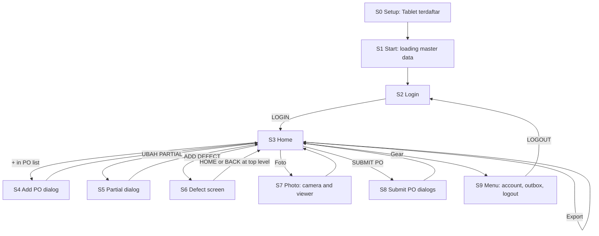

# Mobile 100% Inspection — UI/UX Flow and Screen Spec

| | |
|---|---|
| Document | 05 — UI/UX Flow and Screen Spec |
| Version | v0.1 Draft, 16 Oct 2026 |
| Inputs | PRD v0.5 (FR-01…FR-13, AC, BR, NFR), the clickable prototype (`reference/prototype/app.html`, layout and behavior only), Design System v45 (namespace `M100`), doc 03 §4 (tablet design), doc 04 §5–6 (outbox, error codes) |
| Used by | The coding agent in Phase 1 (offline PWA). Doc 06 gives the parts; this document says where each part goes and what it does. |

If this document and the prototype disagree, **this document wins**. The prototype predates Submit PO, the outbox, PO PARTIAL, device setup and the new design system; its black/grey styling is not to be copied.

## 1. How to read this document

- Screens are named `S0 … S9`. Each has: purpose, what is on it, states, interactions, copy, and the requirements it satisfies.
- Component names in `code` are from the Design System (`M100.*`). A component that is not listed in doc 06 is a layout container written in the app, using tokens only.
- Screen text is Bahasa Indonesia; fixed shop-floor labels stay English and uppercase (doc 00). Quoted copy in this document is the exact text to use.
- Decision IDs `U1…U12` (section 18) record the choices made here that the PRD left open. Two are proposed defaults that need the owner's confirmation: U1 (OQ-07) and U2 (OQ-08); U10 also needs a look.

## 2. Screen map and navigation



- There are three full screens: **Login (S2), Home (S3), Defect (S6)**. S0 and S1 are shown only at the very start. Everything else is a dialog over a full screen, one at a time (never stacked; a dialog is replaced by the next one).
- The app remembers the screen. After closing and reopening, a logged-in PSI lands on Home, or on the Defect screen if they were on it (AC-06.2). Not logged in: Login.
- The Android back gesture on Home or Login does nothing (the app is a PWA with its own navigation). On the Defect screen it behaves as BACK. On a dialog it closes the dialog.
- Dialogs close on the close button, the scrim tap and Escape, except the blocking ones in S8 and S9 that must be answered (marked "must answer").

## 3. Global rules

| ID | Rule |
|---|---|
| G1 | **Tap only.** No device keyboard anywhere except the PO search box in S4. NIK/name, factory, cell are pickers (`SelectField` opens a `Dialog`); the partial quantity uses `NumberPad`. |
| G2 | **Touch sizes.** Every tappable thing ≥ 44 × 44 px; rows ≥ `row-min`; bars `bar-h`. No exceptions in Compact or Stacked layouts. |
| G3 | **Taps never wait for the network.** Every tap on S3 and S6 changes state on the tablet first (NFR-03, NFR-05). Feedback within 100 ms. |
| G4 | **Toast.** One `Toast` (floating) at a time, top centre, 1.4 s; errors 3.2 s with `tone="error"`. A new toast replaces the old. Toasts confirm; they never carry a decision. |
| G5 | **Numbers** use id-ID (`2.400`, `18,8%`); rates have one decimal; a rate that can't be computed shows "—". Times are WIB `HH:mm`. |
| G6 | **Messages say what happened, then what to do.** No apology, no exclamation mark, no emoji. |
| G7 | **State is words plus colour.** Classification, inspection type and send status always carry a word (NFR-11). |
| G8 | **Disabled looks grey** (`disabled` fill), and the reason is visible on the same screen (a hint line, a `Notice`, or the dialog's checks). |
| G9 | **Haptics.** `navigator.vibrate(18)` on every recorded defect and on UNDO, where supported. |
| G10 | **Screen on.** While an inspection is active the app requests a screen wake lock so the tablet does not sleep mid-inspection; released when the inspection ends or the app is hidden. Failure is silent. |
| G11 | **Online indicator.** A small status word in the Home header: nothing when online and the outbox is empty; "Offline" (`Chip` neutral) when `navigator.onLine` is false; the outbox count when something is waiting (S3 header, S9). |
| G13 | **Logo.** The company mark `assets/parkland.png` is the app's logo (the product has no mark of its own). It appears on S0, S1, S2 (above the form), the S3 header, the S9 menu, the PDF export header, and as the PWA icon. Rules in section 4a. |
| G12 | **No hidden gestures** except one: long press on a PO in the PO list to remove it (AC-03.4, Should). Everything else has a visible button. |

## 4. Layouts

The same screens run in three layouts, chosen by the viewport (doc 06 "Responsive layout"). Target: Redmi Pad 2, 11", about 1280 × 800 CSS px landscape.

| Layout | When | S3 Home | S6 Defect |
|---|---|---|---|
| **Regular** | landscape, height > 480 px | Header on top; below it a left PO column (≈ 22%) and a main area with Top 5 Defect and, on the right, the results box; the bottom row holds ADD DEFECT (wide), EXPORT PDF, EXPORT EXCEL, SUBMIT PO | Left: shoe map pane (≈ 56%). Right: command row, breadcrumb, drill-down list, history, bottom bar BACK / HOME / UNDO |
| **Compact** | landscape, height ≤ 480 px | Same arrangement, smaller type and padding | Same arrangement |
| **Stacked** | portrait or width ≤ 640 px | Info strip, PO list as a horizontal strip, results box, Top 5, then a bottom bar | Shoe map on top, then command row, list, history; bottom bar fixed to the screen edge with the safe-area inset |

The page never scrolls sideways. Long defect names wrap inside their row. Only the list areas scroll (PO list, Top 5 when over five rows is not possible, drill-down list, history); the header, command row and bottom bars stay in place.

## 4a. Logo placement

The mark is the PT Parkland World Indonesia monogram (blue, transparent background). It is used as an image from `assets/parkland.png`, never redrawn, recoloured, stretched or placed on `accent` (doc 06 Logo). The file is stored once in `apps/web/src/assets/` and precached by the service worker so it shows offline.

| Where | Size and position |
|---|---|
| S0 Setup, S1 Start | Centred above the title, 72 px high, `space-4` below it |
| S2 Login | **Centred at the top of the form column, above the title "Login PSI", 64 px high (Regular/Compact) and 48 px (Stacked)**, `space-4` below. The brand block on the left keeps the wordmark text "MOBILE 100% INSPECTION" without a second logo, so the mark never appears twice on one screen |
| S3 Home header | Left end of the header, 36 px high, on `surface`; it is not a button (the gear is the only header action). Hidden in Compact height ≤ 480 px to save space; the PO info strip keeps its width |
| S9 Menu | Top of the dialog, 32 px high, beside the account name |
| PDF export | Top-left of every page header, 32 px high (AC-12.1) |
| PWA | `manifest.webmanifest` icons 192 px and 512 px, the mark centred on a white square with 20% padding; `purpose: "any"` and a separate `"maskable"` with 40% padding; background colour `#FFFFFF`; theme colour `#1D4ED8`. The same file gives the favicon and the Android splash screen (name "Mobile 100% Inspection") |

Minimum size 32 px high with `space-3` clear space around it (doc 06). The login screen's `alt` text is "PT Parkland World Indonesia"; elsewhere the logo is decorative (`alt=""`).

## 5. S0 — Setup: "Tablet terdaftar"

**Purpose.** Store the device key on a new tablet. Used once per tablet by the administrator (doc 03 §4.9), never by a PSI. No field, no keyboard.

**Entry.** The administrator opens `https://m100.qdms.web.id/setup#k=<key>` in Chrome. The page reads the fragment, saves the key, removes the fragment from the address, and calls `GET /system/status`.

| State | Screen | Copy |
|---|---|---|
| Checking | Centred spinner-free text | "Memeriksa tablet…" |
| `200` | Check icon, tablet label if the API returns one | Title "Tablet terdaftar". Body "Pasang aplikasi ini dari menu Chrome (Install app), lalu buka dari layar utama." Button `Lanjut` → S1 |
| `401 DEVICE_KEY_INVALID` | `Notice` danger | "Kunci tablet tidak valid. Minta tautan setup yang baru dari admin." No button |
| No connection | `Notice` warning + `Coba lagi` button | "Tidak bisa terhubung ke server. Periksa Wi-Fi, lalu coba lagi." |
| Opened without a key and none stored | `Notice` warning | "Tablet ini belum terdaftar. Buka tautan setup dari admin." |

**Not a PSI path.** If the installed app starts with no stored key, it shows the last row's message on a plain screen (no Login). If the real-device check (risk R9) shows the key saved in Chrome is invisible to the installed app, S0 gains a one-time paste field inside the installed app; that is the only keyboard use besides S4, and is administrator-only.

**Satisfies.** doc 03 §4.9, NFR-08.

## 6. S1 — Start

**Purpose.** Open the app, load master data (users, cells, area map), then show Login or Home.

| State | Behaviour |
|---|---|
| Warm start (cache exists) | Go straight to S2 or S3 within 3 s (NFR-03). Master data refreshes in the background (AC-13.2). No spinner. |
| First launch, online | Full-screen "Menyiapkan data…" with the logo; on success go to S2. |
| First launch, offline or error, nothing cached | `Notice` danger "Data awal belum bisa diunduh. Periksa Wi-Fi, lalu tekan RETRY." and a `Button` RETRY (AC-01.4). Never an empty name list. |
| New app version waiting | Handled silently; applies only when no inspection is active (doc 03 §4.8). No dialog. |

## 7. S2 — Login

**Purpose.** Identify the PSI. Nothing is typed (FR-01).

**Layout.** Two columns in Regular/Compact: a left brand block ("MOBILE 100% INSPECTION" in `brand` type, a one-line subtitle "Input defect tanpa keyboard", and the footer "QIP Digital Team"); a right form that starts with the logo (section 4a). Stacked: the logo, then the brand block, then the form.

**Form (top to bottom).**

| Element | Component | Behaviour |
|---|---|---|
| NAMA | `SelectField` (label "Nama", placeholder "Pilih nama") | Opens the name picker (below). After choosing: shows the name, and a `Chip tone="role"` "PSI lv.1" or "PSI lv.2" beside it |
| FACTORY | `SelectField` | Opens a grid picker of `F 1 … F 5` |
| CELL | `SelectField`, disabled until a factory is chosen | Opens a grid picker of the factory's cells (e.g. `F3-10`). If the factory has one cell it is selected automatically (FR-01.3) |
| LOGIN | `Button primary size="lg" block` | Disabled until all three are chosen. The hint line under the form says what is missing: "Pilih nama, factory, dan cell." |

**Pickers.** Each is a `Dialog` over a scrim.
- **Name picker.** A scrolling `List` of rows: name on the left, level `Chip` on the right, check icon on the selected one, A–Z. 14 names today, so no search box (G1). Row height ≥ 52 px.
- **Factory and Cell pickers.** A grid of large buttons (≥ 64 × 52 px), the selected one in `accent`.
- Choosing an item closes the picker. Changing the factory clears the cell.

**Returning user.** After a logout the form starts empty. After LOGIN the choice is remembered only as the session (AC-01.3); it is not pre-filled for the next login, because tablets are shared (BR-09).

**Errors.** `422 USER_NOT_FOUND` / `CELL_NOT_FOUND` from `POST /auth/login`: `Notice` danger above LOGIN with the API's `detail`. No connection and no cached master data: S1 handles it. No connection with cached master data: LOGIN needs the API (it issues the token), so the form shows `Notice` warning "Login butuh koneksi. Hubungkan Wi-Fi, lalu coba lagi." and LOGIN is disabled while offline. A PSI who is already logged in is unaffected (the 30-day token, doc 04 §2).

**Satisfies.** FR-01, AC-01.1…01.4, BR-09.

## 8. S3 — Home

**Purpose.** Pick a PO, see this session's results and Top 5, start defect input, take photos, export and submit.

### 8.1 Structure

```
┌ Header ───────────────────────────────────────────────────────────────┐
│ [PO INFO STRIP: PO Number · Artikel · Model · Destination · Factory/Cell · Partial]   [Nama + level] [outbox] [⚙] │
├ PO List ─────┬ TOP 5 DEFECT ─────────────────────────┬ Results box ─────┤
│ PO rows      │ rows: no, name, chip, areas, qty, Foto │ Qty PO Order     │
│ …            │ (Foto warning Notice)                  │ Qty Inspection … │
│ [ + ]        │                                        │ Pass Rate (RFT)  │
├──────────────┴────────────────────────────────────────┴──────────────────┤
│ [ ADD DEFECT ]            [EXPORT PDF] [EXPORT EXCEL] [ SUBMIT PO ]       │
└───────────────────────────────────────────────────────────────────────────┘
```

| Region | Components | Content |
|---|---|---|
| Info strip | layout container; `Chip`; `Button size="sm"` | Labelled values (label in `caption`, value in `body`/`mono`): PO NUMBER (`mono`), ARTIKEL, MODEL, DESTINATION, FACTORY/CELL (`F3-10`). When PO PARTIAL is set, an extra value "PARTIAL" shows `P1 · 1.200 dari 10.002` followed by `UBAH PARTIAL` (`Button secondary size="sm"`). When it is not set, `UBAH PARTIAL` is replaced by a `Button secondary size="sm"` "PO PARTIAL" that opens S5 empty (U9). With no PO selected every value is "-". |
| Account area | text, `CountBadge`, `Icon gear` | PSI name and level `Chip`; the Offline chip (G11); a `CountBadge` with the number of waiting submissions beside the gear; the gear button (≥ 44 px, accessible label "Pengaturan") opens S9 |
| PO List | `Pane`, `POListItem`, `Button` | Title "PO LIST". One `POListItem` per PO (number, "model · destinasi", defect count badge, accent line "Inspeksi berjalan · REWORK" when active). The selected row is `accent`. A round + `Button` (accessible label "Tambah PO") is fixed at the bottom of the column and opens S4. The list scrolls above it. |
| Top 5 | `Pane`, `Top5Row`, `Notice` | Title "TOP 5 DEFECT". See 8.3 |
| Results box | `Pane`, `StatRow` ×7 | Qty PO Order, Qty Inspection, Qty Defect, Qty A-Grade, Qty B-Grade, Defect Rate, Pass Rate (RFT). Labels exactly as in doc 00. Defect Rate uses `tone="bad"` above 5,0% (U3); Pass Rate has no tone. Rates show "—" when Qty Inspection is 0. |
| Bottom row | `Button` | ADD DEFECT (`secondary size="lg"`, the widest), EXPORT PDF and EXPORT EXCEL (`secondary`, `download` icon), SUBMIT PO (`primary size="lg"`). SUBMIT PO is the single `primary` on the screen. |

Stacked: the info strip wraps to two rows; the PO list becomes a horizontal strip of `POListItem`s (each ≥ 44 px high) with the + at the end; the results box becomes a 2-column grid; the bottom row becomes a fixed `BottomBar` with ADD DEFECT and SUBMIT PO, and the two export buttons move into a row above the results.

### 8.2 States

| State | What shows |
|---|---|
| **No PO yet** | PO list empty. Top 5 pane: title "Belum ada PO", hint "Tekan tombol + di PO List untuk menambahkan PO." Results box: values "—"/0 greyed. ADD DEFECT, EXPORT PDF, EXPORT EXCEL, SUBMIT PO disabled (G8: the hint above explains). |
| **PO selected, empty session** | Top 5: "Belum ada defect" and "Tekan ADD DEFECT untuk mulai input." (AC-05.2). Results all 0 with rates "—". Exports and SUBMIT PO are enabled (their checks explain, see 8.5 and 8.6). |
| **Session with data** | Values and Top 5 as in 8.3. |
| **Inspection active on this PO** | The PO row shows "Inspeksi berjalan · REWORK" or "… · B-GRADE". A `Notice warning` above the bottom row: "Inspeksi berjalan. Lanjutkan di ADD DEFECT atau selesaikan dengan END INSPECTION." ADD DEFECT label is unchanged. SUBMIT PO stays enabled but its check blocks it (8.6). |
| **Another PSI's data** | Never shown (BR-09, AC-02.3). Another user's POs and sessions are invisible. |
| **Offline** | Offline chip in the header. Nothing on Home is disabled; S4's PO search needs a connection (8.4). |

### 8.3 Top 5 Defect

`Top5Row` per row: number, defect name (exact), classification `Chip`, the areas it was found in (comma-separated, "VAMP, TOE BOX"), quantity, and for PSI lv.2 a photo control. Order and ties: AC-05.1 (quantity; ties by CRITICAL › MAJOR › MINOR, then first recorded).

| Photo control (`PhotoButton`) | When | Tap |
|---|---|---|
| none (column hidden, `photo` prop omitted) | PSI lv.1 | — (AC-10.6) |
| `state="required"` (dashed, danger, "Foto") with the word "Foto wajib" beside or under the name | PSI lv.2, no photo yet (AC-10.3) | Opens the camera (S7a) |
| `state="attached"` (thumbnail with check) | PSI lv.2, photo attached | Opens the photo viewer (S7b) |

A `Notice warning` under the table for PSI lv.2 when Top 5 photos are missing: "N foto belum ada. PSI lv.2 wajib melampirkan foto pada setiap Top 5 Defect sebelum SUBMIT PO." Pluralisation: always "N foto".

A photo belongs to a defect, not a rank. If a defect with a photo leaves the Top 5, the photo is kept and submitted with it (AC-10.4); it does not show on Home while the defect is outside the Top 5.

### 8.4 PO list interactions

- **Select** a PO: tap its row. The info strip, Top 5, results and Defect screen all follow the selection (AC-03.3). The selection is remembered across restarts.
- **Add**: + opens S4.
- **Remove** (Should, AC-03.4): long press (600 ms) on a PO with no open session → `Dialog` "Hapus PO dari list?" with the PO number, buttons BATAL and HAPUS (`danger`). A PO with an open session (any recorded defect, any started inspection, a photo, or a partial set after data exists) does not respond to a long press; no dialog.
- After SUBMIT PO the PO stays in the list with an empty session (AC-04.2), so the PSI can keep inspecting it.

### 8.5 Export

EXPORT PDF / EXPORT EXCEL create the file on the tablet from the current session (FR-12). Both work offline and never change the session (AC-12.4).

| Case | Behaviour |
|---|---|
| Normal | The file is saved/shared through the Android share sheet or the download folder (`showSaveFilePicker` if available, otherwise a download). Toast "File dibuat: M100_0903359388_20261016.pdf". |
| PSI lv.2 with missing Top 5 photos | A blocking `Dialog` (must answer) "Foto belum lengkap" listing the defect names missing a photo; button `Lengkapi foto` closes it. No file is made (prototype behavior, BR-04). |
| Empty session | Allowed. The file shows zeros and "Belum ada defect." |
| Export fails (storage full, user cancelled share) | Toast error "File gagal dibuat. Coba lagi." Cancelled share sheet: no toast. |

The PDF header carries the company mark (doc 06 Logo), PO info, inspector, Factory/Cell, export time, the results, Top 5 with photos (lv.2), and the full defect list. File names: `M100_<PO>_<YYYYMMDD>.pdf` / `.xlsx` (AC-12.3).

### 8.6 SUBMIT PO

Described in S8 (section 13). Home only starts it.

**Satisfies.** FR-03 (list), FR-04, FR-05, FR-10, FR-11 (entry), FR-12, FR-02 (gear), AC-01.2, AC-03.2, AC-03.3, AC-04.1, AC-04.2, AC-05.1, AC-05.2.

## 9. S4 — Add PO dialog (with PO PARTIAL)

**Purpose.** Add a PO to the list, optionally as a partial shipment (FR-03, ADR-013).

`Dialog title="Tambah PO"`, regular width on a tablet; the dialog body scrolls inside the viewport.

### 9.1 Parts, top to bottom

1. **PO NUMBER picker.** `SelectField mono` (placeholder "PO NUMBER"). Tapping opens the picker panel inside the dialog:
   - A search box (the only keyboard in the app, G1): `inputmode="numeric"` is **not** forced, because the search also matches article and model; use `type="search"`, placeholder "Cari PO, artikel, atau model". Autofocus when the panel opens.
   - Results appear after 3 characters, at most 20, from `GET /pos` (FR-03.2). Each result is a row: PO number in `mono`, and "model · destinasi" below. A PO already in the list is disabled with the suffix " · sudah di list" (AC-03.1).
   - States: fewer than 3 characters "Ketik minimal 3 karakter"; searching "Mencari…"; no result "PO tidak ditemukan"; offline `Notice warning` "Cari PO butuh koneksi. Hubungkan Wi-Fi, lalu coba lagi." (AC-13.3); error `Notice danger` with the API `detail`.
   - Choosing a result closes the panel and fills the PO NUMBER field.
2. **Details grid** (read-only, two columns): PO Number, Artikel, Model, Destination, Qty Order (id-ID), PODD, CRD (dates as `dd MMM yyyy`). Before a PO is chosen each value shows ":" in `ink-3`.
3. **PO PARTIAL** — `CheckboxRow label="PO PARTIAL" sub="Kirim sebagian dari Qty Order"`, off by default. Disabled until a PO is chosen.
4. **When ticked** the following appear directly below, in this order:
   - `Stepper label="Partial ke" format={v => 'P'+v} min=1 max=99`, starting at P1.
   - `NumberPad label="Qty partial" unit="PASANG" max={Qty Order}`, empty, hint "Masukkan jumlah pasang, 1 sampai {Qty Order}".
5. **ADD TO PO LIST** — `Button primary size="lg" block`. Disabled until a PO is chosen; with PO PARTIAL ticked, also disabled until the quantity is 1…Qty Order. The reason is visible: the NumberPad message ("Minimal 1 pasang", "Maksimum 10.002 pasang") or the hint (G8). Label is "ADD TO PO LIST".

In Regular layout the Stepper and NumberPad sit side by side (two columns) so the dialog does not need to scroll; in Stacked they stack.

### 9.2 Behaviour

- The quantity is a digit string; the NumberPad enforces: no leading zeros, at most 9 digits, readout formatted `1.200`. A value of 0 or above Qty Order turns the readout border to `danger` and shows the message; ADD TO PO LIST stays disabled (AC-03.6).
- Unticking PO PARTIAL hides the Stepper and NumberPad and discards their values.
- ADD TO PO LIST adds the PO at the top of the list, selects it, closes the dialog, and shows the toast "PO ditambahkan". With a partial, the Home info strip shows `P1 · 1.200 dari 10.002` (AC-03.7 happens later, at SUBMIT PO).
- A PO's details (Qty Order, article, model, destination, PODD, CRD) are stored on the tablet at this moment (AC-13.3).
- Closing the dialog before adding discards everything.

**Satisfies.** FR-03.1…03.5, AC-03.1, AC-03.5 (the PO number is shown and stored as text with its leading zero or prefix), AC-03.6, NFR-02, ADR-013.

## 10. S5 — Partial dialog (UBAH PARTIAL)

**Purpose.** Change or remove the partial of the selected PO before the next SUBMIT PO (FR-03.6).

`Dialog title="PO Partial"`. Same three parts as S4 steps 3–4: `CheckboxRow`, then `Stepper` and `NumberPad`, pre-filled with the current partial. Buttons: BATAL (`secondary`) and SIMPAN (`primary`).

- Unticking and SIMPAN removes the partial; the info strip returns to the "PO PARTIAL" button (U9).
- SIMPAN is disabled when the box is ticked and the quantity is invalid (same messages as S4).
- The partial can be changed at any time, also with data in the session; it is read at SUBMIT PO (AC-03.7).
- After a submit the partial **stays** for the PO's next session, because a partial shipment is usually inspected in several rounds (U10). The PSI changes it with UBAH PARTIAL when the next partial starts.

**Satisfies.** FR-03.6, AC-03.6, AC-03.7.

## 11. S6 — Defect screen

**Purpose.** Record defects tap by tap: start an inspection, choose area → sub-area → family → defect, undo, finish (FR-06…FR-09).

Entered from Home with ADD DEFECT. Needs a selected PO.

### 11.1 Structure

Regular/Compact:

```
┌ Shoe pane (≈56%) ──────────────────┬ Side (≈44%) ───────────────────────┐
│ [REWORK] [B-GRADE] [NO DEFECT]     │ Context line: [REWORK]  PO … · Artikel · Model │
│  ┌ ShoeMap (12 AreaPills + photo) ┐│ Breadcrumb                           │
│  │                                ││ Drill-down list (OptionRow)          │
│  └────────────────────────────────┘│ History (HistoryRow, own header)     │
│ [ END INSPECTION ]                 │ [ BACK ] [ HOME ] [ UNDO ]           │
└────────────────────────────────────┴──────────────────────────────────────┘
```

| Region | Components | Notes |
|---|---|---|
| Command row (above the shoe) | `CommandButton` mode `rework`, `bgrade`, `nodefect` | Always all three visible (doc 06). |
| Shoe map | `ShoeMap` in a `Pane` | 12 area pills on the photo. Pill shows the count of defects recorded there in the active inspection (`CountBadge`, FR-07.6). The selected area is `accent`. |
| END INSPECTION | `CommandButton mode="end"` | Full width under the shoe map. |
| Context line | `Chip tone="rework"/"bgrade"`, text | Shows the active type chip, then "PO 0903359388 · Artikel · Model". |
| Breadcrumb | `Breadcrumb` | Path of the current level; the last crumb is current; earlier crumbs are tappable (FR-07.5). |
| Drill-down list | `List` of `OptionRow` | Level-dependent (11.3). |
| History | header row `HistoryRow head`, rows `HistoryRow` | One row per area + sub-area + defect + inspection type (AC-09.2); the row just changed is highlighted and scrolled into view (AC-09.1). The history belongs to the **session**, not the active inspection: it keeps all rows since the last submit. |
| Bottom bar | `BottomBar` items BACK, HOME, UNDO | In Stacked the bar is fixed to the screen edge with the safe-area inset. |

Stacked: shoe map on top (own aspect ratio), then command row, END INSPECTION, context, breadcrumb, list, history, bottom bar.

### 11.2 Command states

| Situation | REWORK | B-GRADE | NO DEFECT | END INSPECTION | Shoe map and list |
|---|---|---|---|---|---|
| **No active inspection** | idle | idle | idle | disabled | Pills and rows disabled; photo dimmed to half; right panel says "Mulai inspeksi" / "Pilih REWORK, B-GRADE, atau NO DEFECT untuk mengaktifkan area dan defect." |
| **REWORK active** | active | disabled | disabled | enabled | Enabled |
| **B-GRADE active** | disabled | active | disabled | enabled | Enabled |
| **NO DEFECT tapped** | — | — | — | — | Records one pair at once (U1); the screen returns to the "no active inspection" state; toast "No Defect tercatat. A-Grade +1" |

BR-05: only one inspection at a time per PO. Starting one: toast "Inspeksi REWORK dimulai" / "Inspeksi B-GRADE dimulai". END INSPECTION: toast "Inspeksi selesai. N defect tercatat" or "Inspeksi selesai tanpa defect" (AC-06.3). Counting follows BR-01 and the shared engine in `packages/shared`; the UI never counts by itself.

### 11.3 Drill-down

Level 0 (no area chosen): the right panel shows the hint "Pilih area sepatu" and "Sentuh salah satu area pada gambar sepatu. Defect yang tercatat ditandai angka biru."

| Level | Shows | `OptionRow` |
|---|---|---|
| 1 Sub-areas of the area | name, sub-line "N defect", count of defects recorded in this sub-area in the active inspection | `kind="nav"` |
| 2 Families of the sub-area | family name, count recorded, number of defects in the family | `kind="nav"` |
| 3 Defects of the family | defect name (exact), classification `Chip`, tap count in the active inspection (accent box) | `kind="defect"` |

- A level with exactly one option is skipped automatically, and BACK skips it too (BR-08).
- Tapping an area, from the pill or the shoe, opens its level (selecting a different area replaces the path).
- Tapping a defect row records one finding, flashes the row (`flash`), updates the shoe-pill count, the history and the Home values, vibrates (G9) and shows the toast "+1 Defect" (REWORK) or "+1 Defect dan B-Grade" (B-GRADE). The list stays open at the same scroll position (AC-07.3, FR-07.3).
- The classification is shown, never chosen (BR-03).
- Rows are disabled (grey) when no inspection is active.

### 11.4 BACK, HOME, UNDO

| Button | Behaviour | Message |
|---|---|---|
| BACK | One level up (defects → families → sub-areas → no area). At level 0, returns to Home (FR-08). | — |
| HOME | Returns to Home. An active inspection stays active (AC-06.2). | — |
| UNDO | Per FR-08: removes the last defect of the active inspection; with none, cancels the just-started inspection; right after NO DEFECT, cancels it; otherwise disabled. | "Defect terakhir dibatalkan" / "Inspeksi dibatalkan" / "No Defect dibatalkan" (AC-08.1) |

UNDO is disabled (grey) when it has nothing to undo; the history list makes the reason visible. UNDO never reaches an ended inspection.

### 11.5 Persistence

Every tap is written to the tablet's event list before the screen confirms (NFR-05, doc 03 §4.2). Reloading or closing the app returns to the Defect screen with the same inspection, area path and list position at the area level (AC-06.2).

**Satisfies.** FR-06, FR-07, FR-08, FR-09, AC-06.1…06.3, AC-07.1…07.3, AC-08.1, AC-09.1, AC-09.2, BR-01, BR-03, BR-05, BR-08.

## 12. S7 — Photos (PSI lv.2)

### 12.1 S7a — Take a photo

Tap `PhotoButton` (required/add) on a Top 5 row → the tablet camera opens through `<input type="file" accept="image/*" capture="environment">`. No custom camera UI (risk R-camera: verify on Redmi Pad 2; fallback is a gallery pick).

After the photo returns:
1. The app resizes it to ≤ 960 px on the long edge and re-encodes as JPEG ≤ 1 MB (AC-10.1) and stores it with the session (AC-10.2). The `PhotoButton` becomes `attached`.
2. Toast "Foto tersimpan".
3. If the camera is cancelled, nothing changes.
4. If processing fails or storage is full, toast error "Foto gagal disimpan. Coba lagi." and the button stays as it was.

### 12.2 S7b — View a photo

`Dialog wide title="Foto defect"` showing the classification `Chip` and defect name, the photo, and two buttons: GANTI FOTO (`secondary`, camera icon; replaces the photo, AC-10.5) and HAPUS (`danger`). HAPUS asks nothing more: it removes the photo and returns the row to "Foto wajib", toast "Foto dihapus".

**Satisfies.** FR-10, AC-10.1…10.6, BR-04.

## 13. S8 — SUBMIT PO

**Purpose.** Seal the selected PO's session and send it (FR-11).

### 13.1 Step 1 — checks

Run on tap of SUBMIT PO, in this order; the first failure stops with a blocking `Dialog role="alertdialog"` (must answer, one button `Mengerti` or the action below):

| Check | Dialog title | Body | Button |
|---|---|---|---|
| No PO selected | (button disabled on Home) | — | — |
| An inspection is active | "Inspeksi masih berjalan" | "Selesaikan inspeksi dulu (END INSPECTION)." | `Ke ADD DEFECT` (goes to S6) |
| Qty Inspection is 0 | "Belum ada inspeksi" | "Belum ada inspeksi untuk PO ini. Mulai dari ADD DEFECT." | `Mengerti` |
| PSI lv.2 and Top 5 photos missing | "Foto belum lengkap" | "PSI lv.2 wajib menambahkan foto pada Top 5 Defect. Belum ada foto untuk:" + the list of defect names | `Lengkapi foto` |

### 13.2 Step 2 — confirmation

`Dialog title="Submit PO"` with a summary (`StatRow` list): PO, Partial (if set, `P1 · 1.200 dari 10.002`), Qty Inspection, Qty Defect, Qty A-Grade, Qty B-Grade, Defect Rate, Pass Rate (RFT), and "Foto" with the number of photos (lv.2 only). Buttons: BATAL (`secondary`) and KIRIM (`primary`). The dialog is closable; BATAL closes it, nothing changes.

### 13.3 Step 3 — after KIRIM

The session is sealed in one transaction on the tablet (doc 03 §4.6) and the PO starts a new empty session at once; Home shows zeros (AC-04.2). The partial, if any, is kept (U10). Then the outbox sends in the background.

| Result | What the PSI sees |
|---|---|
| Sent immediately (`201`/`200`) | Toast "PO terkirim 14:32" |
| Offline, `429`, `5xx`, timeout | Toast "Tersimpan. Menunggu koneksi." The header shows the waiting count (G11). The tablet resends by itself (doc 04 §5). |
| `202` (writing) | Toast "Sedang dikirim." The item shows "Mengirim" in S9 until it is written. |
| Rejected (`409`, `413`, `422`) | The item stays in the outbox as "Gagal" with the reason in S9, and a toast error "Pengiriman PO {no} gagal. Lihat Pengaturan." (AC-11.4). No automatic resend. |

Home never blocks on the result. The PSI can start the next round on the same PO immediately.

**Satisfies.** FR-11, AC-11.1…11.4, BR-04, BR-06.

## 14. S9 — Menu (gear)

`Dialog title="Pengaturan"` (anchored to the gear on Regular; centred otherwise). From top to bottom:

1. **Akun** — name, level `Chip`, "Factory/Cell F3-10".
2. **Pengiriman** — the outbox list: one `OutboxItem` per submission (PO, time `HH:mm`, status Menunggu / Mengirim / Terkirim / Gagal, and the reason for Gagal; for Menunggu the last attempt). Newest first. "Terkirim" items stay for 7 days (doc 04 §5), then leave the list. Empty: "Tidak ada pengiriman." (AC-11.3). `Gagal` items also show the hint "Hubungi admin dengan nomor PO ini."
3. **Data** — "Data master diperbarui {dd MMM HH:mm}" (AC-13.4).
4. **LOGOUT** — `Button danger block` at the bottom (FR-02).

LOGOUT: if the user has POs with an open session, a blocking `Dialog` (must answer) "Keluar?" says "{N} PO belum disubmit. Data tetap tersimpan di tablet ini untuk {name}." with BATAL and LOGOUT (`danger`) (AC-02.2). With none, LOGOUT acts at once. After logout: S2. Waiting submissions keep being sent with the author's token (doc 04 §2).

**Satisfies.** FR-02, AC-02.1…02.3, AC-11.3, AC-13.4.

## 15. Copy catalogue

Exact texts beyond those quoted above, so that the coding agent does not invent them.

| Where | Text |
|---|---|
| Brand subtitle | Input defect tanpa keyboard |
| Login hint | Pilih nama, factory, dan cell. |
| Offline chip | Offline |
| Master data failure | Data awal belum bisa diunduh. Periksa Wi-Fi, lalu tekan RETRY. |
| Add PO — short query | Ketik minimal 3 karakter |
| Add PO — no result | PO tidak ditemukan |
| Partial number readout | P1, P2 … |
| Partial summary (Home, Submit) | P1 · 1.200 dari 10.002 |
| Number pad errors | Minimal 1 pasang / Maksimum {n} pasang |
| Empty Top 5 | Belum ada defect / Tekan ADD DEFECT untuk mulai input. |
| Empty history | Belum ada defect tercatat untuk PO ini. |
| Photo required | Foto wajib |
| Defect toasts | +1 Defect / +1 Defect dan B-Grade |
| Inspection toasts | Inspeksi REWORK dimulai / Inspeksi B-GRADE dimulai / Inspeksi selesai. N defect tercatat / Inspeksi selesai tanpa defect |
| NO DEFECT toast | No Defect tercatat. A-Grade +1 |
| UNDO toasts | Defect terakhir dibatalkan / Inspeksi dibatalkan / No Defect dibatalkan |
| Submit toasts | PO terkirim {HH:mm} / Tersimpan. Menunggu koneksi. / Sedang dikirim. |
| Device not registered (401 DEVICE_KEY_INVALID) | Tablet belum terdaftar, hubungi admin |
| Server error | Terjadi kesalahan server. Data tetap tersimpan di tablet. |

Error `detail` texts come from the API as is (doc 04 §6).

## 16. Requirement traceability

| Requirement | Screen / section |
|---|---|
| FR-01, AC-01.1…01.4 | S2, S1 |
| FR-02, AC-02.1…02.3 | S9 (§14), S3 header |
| FR-03, AC-03.1…03.7 | S3 §8.1/§8.4, S4 §9, S5 §10 |
| FR-04, AC-04.1, 04.2 | S3 §8.1, §13.3 |
| FR-05, AC-05.1, 05.2 | S3 §8.3 |
| FR-06, AC-06.1…06.3 | S6 §11.2 |
| FR-07, AC-07.1…07.3 | S6 §11.3 |
| FR-08, AC-08.1 | S6 §11.4 |
| FR-09, AC-09.1, 09.2 | S6 §11.1 |
| FR-10, AC-10.1…10.6 | S7 §12, S3 §8.3 |
| FR-11, AC-11.1…11.4 | S8 §13, S9 §14 |
| FR-12, AC-12.1…12.4 | S3 §8.5 |
| FR-13, AC-13.1…13.4 | S1 §6, S4 §9, S9 §14 |
| NFR-02 (tap only, 44 px) | G1, G2, S4 NumberPad |
| NFR-03, NFR-05 | G3, §11.5 |
| NFR-09 (language, numbers) | G5, §15 |
| NFR-11 (words with colour) | G7 |

## 17. Component use

| Component (doc 06) | Used in |
|---|---|
| `Button` | S0, S1, S2 (LOGIN), S3 (ADD DEFECT, exports, SUBMIT PO, + , UBAH PARTIAL), S4/S5 buttons, S8, S9 |
| `CommandButton` | S6 |
| `BottomBar` | S6 (BACK, HOME, UNDO), S3 Stacked |
| `SelectField` | S2, S4 |
| `Dialog` | pickers, S4, S5, S7b, S8, S9, blocking messages |
| `CheckboxRow` (new) | S4, S5 |
| `Stepper` (new) | S4, S5 |
| `NumberPad` (new) | S4, S5 |
| `Chip` | level, classification, inspection type |
| `CountBadge` | PO rows, shoe pills, outbox count |
| `Toast`, `Notice` | G4, warnings and errors |
| `OutboxItem` | S9 |
| `POListItem`, `StatRow`, `Top5Row`, `PhotoButton` | S3 |
| `ShoeMap`, `AreaPill`, `Breadcrumb`, `OptionRow`, `HistoryRow` | S6 |
| `Pane`, `List`, `Icon` | everywhere |

Layout containers written in the app (not in the design system): the Home grid, the Defect two-column split, the info strip, the Login two-column. They use tokens only.

## 18. Decisions taken in this document

| ID | Decision | Why |
|---|---|---|
| U1 | **Proposed (OQ-07).** NO DEFECT records the pair at once and needs no END INSPECTION; UNDO right after it cancels it. | It is the prototype's behavior and one pair needs one tap. Needs owner confirmation. |
| U2 | **Proposed (OQ-08).** Home shows only the current session, not what was already submitted today. | The API has no read endpoint (doc 04 §8); Leader Quality reads the sheet. A later release can add it. Needs owner confirmation. |
| U3 | The Defect Rate figure turns `bad` (danger colour plus its number) above 5,0%. | The prototype did this; the threshold is a display aid only and is not a business rule. Change in one place if QIP wants another value. |
| U4 | Login is disabled while offline; an already logged-in PSI is unaffected. | `POST /auth/login` issues the token (doc 04 §3.1). |
| U5 | Login choices are not remembered between logins. | Shared tablets (BR-09). |
| U6 | The history on the Defect screen lists the whole session, not only the active inspection. | FR-09 and AC-09.2 describe the session. |
| U7 | A screen wake lock is requested while an inspection is active. | A tablet that sleeps mid-inspection breaks flow; failure is silent. |
| U8 | The camera is the system camera through a file input, no custom camera UI. | Fewer moving parts; verify on a real Redmi Pad 2. |
| U9 | PO PARTIAL can be added after a PO is added, through the "PO PARTIAL" button in the info strip (same dialog as UBAH PARTIAL). | A PSI who forgot the box should not have to remove and re-add the PO. |
| U10 | A partial stays on the PO after SUBMIT PO. | A partial shipment is inspected in several rounds; ADR-013 does not say to clear it. Confirm with the owner when ADR-013 is reviewed. |
| U11 | HAPUS on a photo needs no confirmation. | The photo can be retaken at once; an extra dialog costs more than the mistake. |
| U12 | The gear menu holds account, outbox, master data time and LOGOUT; "Reset data demo" from the prototype does not exist. | Demo only. |

## 19. Checks for the coding agent

Before calling a screen done (Phase 1 acceptance, doc 08), open it at 1280 × 800, 915 × 412 and 800 × 1280 and check:

- Every tappable element measures ≥ 44 × 44 px (a Playwright test measures all `button` and `[role]` elements).
- No horizontal page scroll; no text overflows its row.
- The state table of that screen is reproducible: each row has a fixture and a test.
- Tab/focus order is the reading order; every icon-only button has an accessible label.
- Light and dark themes both pass the contrast rules of doc 06.
- With `prefers-reduced-motion`, no animation runs.
- With Wi-Fi off the whole of S3, S6, S7 and S8 still works; S2 shows its offline notice; S4's search shows its offline notice.
